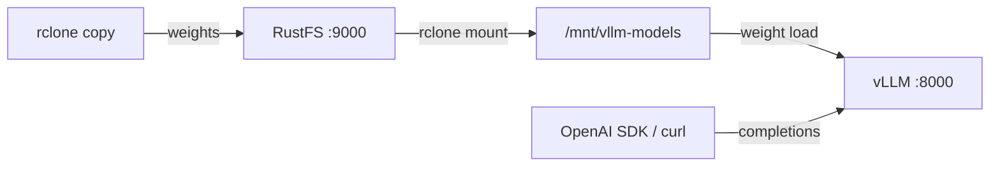

このガイドでは、高スループットの LLM 推論エンジンである [vLLM](https://github.com/vllm-project/vllm) を、モデルウェイトのストアとして **RustFS** に接続します。モデルを RustFS のバケットへアップロードし、rclone マウントで vLLM ホストからバケットを参照し、OpenAI 互換 API でモデルを提供します。この流れは、CPU のみのホストで、`vllm/vllm-openai-cpu`（vLLM 0.30.0）が `rustfs/rustfs-x86-musl:v2.3.1` の RustFS バケットから `facebook/opt-125m` を提供する構成で検証済みです。

vLLM を実行するホストには、Docker と rclone バイナリが必要です。このデプロイはローカルでの統合テストを目的としており、本番向けではありません。

## アーキテクチャ



バケットがモデルの唯一のコピーです。モデルを提供するホストはバケットを読み取り専用でマウントするため、各ノードは RustFS からウェイトを取得し、内容がずれるローカルのモデルストアは残りません。

:::note[rclone マウントを使う理由]

vLLM 0.30 は `s3://` のモデルパスを RunAI model streamer 経由で読み込みます。その範囲読み取りは、現時点では RustFS のようなカスタム S3 エンドポイントに対して失敗し、0 でないオフセットではローダーが `File access error` を返します。ウェイトを RustFS に置いたまま vLLM がローカルファイルとして読む、検証済みの方法は、バケットをファイルシステムとしてマウントすることです。

:::

## 1. モデルを RustFS にアップロードする

接続用のプレースホルダーをすべて置き換え、バケットを作成してモデルウェイトをコピーします。

```ini title="rclone.conf"
[rustfs]
type = s3
provider = Other
access_key_id = <your-access-key>
secret_access_key = <your-secret-key>
endpoint = http://<your-rustfs-endpoint>:9000
region = us-east-1
```

```bash
rc mb rustfs/vllm-models
rclone copy ./opt-125m rustfs:vllm-models/opt-125m --transfers 4
```

Hugging Face のレイアウトであれば使えます。対象は `config.json`、トークナイザーのファイル、ウェイトファイル（`model.safetensors` または `pytorch_model.bin`）です。複数のモデルでバケットを共有できるよう、プレフィックスごとにモデルを 1 つにします。

## 2. vLLM ホストでバケットをマウントする

vLLM を実行するマシンで、クライアント向けに `--allow-other` を付け、バケットを読み取り専用でマウントします。

```bash
mkdir -p /mnt/vllm-models
rclone mount rustfs:vllm-models /mnt/vllm-models \
  --allow-other --daemon
ls /mnt/vllm-models/opt-125m/
```

```text
config.json  merges.txt  model.safetensors  tokenizer.json  vocab.json
```

## 3. vLLM を実行する

マウントしたウェイトを対象に、CPU イメージを起動します。

```bash
docker run -d --name vllm -p 8000:8000 --shm-size=2g \
  -v /mnt/vllm-models:/models:ro \
  vllm/vllm-openai-cpu:latest \
  --model /models/opt-125m --served-model-name opt-125m \
  --dtype float32 --max-model-len 256 --gpu-memory-utilization 0.15
```

vLLM はマウント経由でウェイトを読みます。コンテナはステートレスのままで、モデルは RustFS にあります。サーバーの起動を待ちます。

```bash
curl -s http://localhost:8000/v1/models | head -c 200
```

```text
{"object":"list","data":[{"id":"opt-125m","object":"model","created":...,"root":"/models/opt-125m",...}]}
```

`--gpu-memory-utilization` は、CPU バックエンドで KV キャッシュ用に予約する RAM の割合を制御します。小規模なホストでは値を下げます。`--dtype float32` は、このモデルで CPU アテンションカーネルが対応する形式に合わせます。

## 4. 推論を実行する

OpenAI 互換の補完リクエストを送信します。

```bash
curl -s http://localhost:8000/v1/completions \
  -H "Content-Type: application/json" \
  -d '{"model": "opt-125m", "prompt": "RustFS is", "max_tokens": 12, "temperature": 0}'
```

```json
{"id":"cmpl-...","object":"text_completion","model":"opt-125m",
 "choices":[{"index":0,"text":" a great tool for building your own server. It's a",
 "finish_reason":"length",...}]}
```

リクエストは標準の OpenAI スキーマなので、Python クライアントはそのまま動作します。

```python
from openai import OpenAI

client = OpenAI(base_url="http://localhost:8000/v1", api_key="EMPTY")
print(client.completions.create(
    model="opt-125m", prompt="RustFS is", max_tokens=12, temperature=0,
).choices[0].text)
```


## 5. 停止またはリセット

バケット内のオブジェクトを残したままデモを解体するには、次を実行します。

```bash
docker rm -f vllm
fusermount -u /mnt/vllm-models
```

保存したモデルを削除するには、次を実行します。

```bash
rclone purge rustfs:vllm-models
```

## トラブルシューティング

### `Cannot find any model weights with /models/...`

マウントのディレクトリキャッシュが古いか、ウェイトファイルがバケットに届いていません。`rclone copy` を再実行し、vLLM を起動する前にマウント経由の `ls` でファイルを確認します。反復作業中は、短い `--dir-cache-time`（例: `10s`）が有効です。

### `Unsupported CPU attention configuration: head_dim=...`

vLLM の CPU カーネルが対応するヘッド次元は、固定の集合です。`hf-internal-testing/tiny-random-*` のような極小のテストモデルは特殊な形状を使うため、リクエスト時に失敗します。`facebook/opt-125m` のような実際の小型モデルを使います。

### `Insufficient space in /dev/shm`

vLLM の CPU エンジンは、共有メモリ経由でテンソルを交換します。コンテナは `--shm-size=2g`（または `--ipc=host`）で実行します。

### `Available memory on node 0 ... is less than desired CPU memory utilization` でサーバーが終了する

KV キャッシュの既定の予約は、システム RAM の 90% です。`--gpu-memory-utilization 0.15` で下げます。このフラグは名前にかかわらず、CPU バックエンドではメモリ割合として適用されます。

## 次のステップ

- 追加のサービング構成を採用する前に、[S3 互換性に関する注意](/ja/administration/protocols/s3)を確認します。
- [アクセスキー管理](/ja/security-compliance/iam/access-token)で、本番用の専用認証情報を作成します。
- [vLLM ドキュメント](https://docs.vllm.ai/en/latest/serving/openai_compatible_server.html)に従い、同じバケットをバックエンドにしたモデルストアの上で、チャットテンプレート、テンソル並列、量子化ウェイトを確認します。
