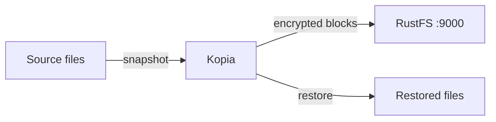

このガイドでは、オープンソースのバックアップおよび復元ツールである [Kopia](https://github.com/kopia/kopia) を、S3 リポジトリとして **RustFS** に接続します。RustFS のバケットにリポジトリを作成し、ディレクトリのスナップショットを取得し、空のディレクトリへ復元してチェックサムを比較します。この流れは `kopia/kopia:0.18.1` と `rustfs/rustfs-x86-musl:v2.3.1` で検証済みです。

Docker が必要です。このデプロイはローカルでの統合テストを目的としており、本番向けではありません。

## アーキテクチャ



Kopia は、リポジトリ形式のファイルと、重複排除され暗号化されたコンテンツブロックをバケットに保存します。復元ではブロックを読み戻して元のファイルを再構成するため、復元した各ファイルのチェックサムはソースと一致する必要があります。

## 1. リポジトリを作成する

先にバケットを作成し、その中で Kopia リポジトリを初期化します。エンドポイントはスキームのない `host:port` です。`--disable-tls` はクライアントを平文 HTTP に切り替えます。

```bash
rc alias set rustfs http://<your-rustfs-endpoint>:9000 <your-access-key> <your-secret-key>
rc mb rustfs/kopia-backups

docker run --rm --network oo-rustfs_default kopia/kopia:0.18.1 repository create s3 \
  --bucket kopia-backups \
  --access-key <your-access-key> \
  --secret-access-key <your-secret-key> \
  --endpoint <your-rustfs-endpoint>:9000 \
  --region us-east-1 \
  --disable-tls \
  --password <your-kopia-password> \
  --override-username demo --override-hostname workstation
```

Kopia は成功を報告する前に、S3 API 経由の読み書きでプロバイダーを検証します。

## 2. 接続、スナップショット、復元

前の手順で作成した `repository.config` があるディレクトリで、次のコマンドを実行します。Kopia はそのファイルから接続設定を読み取るため、S3 フラグが必要なのは一度だけです。

```bash
export KOPIA_PASSWORD=<your-kopia-password>
export KOPIA_CONFIG_PATH=/config/repository.config

alias kopia='docker run --rm --network oo-rustfs_default \
  -e KOPIA_PASSWORD -e KOPIA_CONFIG_PATH \
  -v "$PWD/config:/config" \
  -v "$PWD/source:/source:ro" \
  -v "$PWD/restore:/restore" kopia/kopia:0.18.1'

kopia repository connect s3 \
  --bucket kopia-backups \
  --access-key <your-access-key> \
  --secret-access-key <your-secret-key> \
  --endpoint <your-rustfs-endpoint>:9000 \
  --region us-east-1 --disable-tls \
  --override-username demo --override-hostname workstation

kopia snapshot create /source
kopia snapshot list
```

スナップショットを空のディレクトリへ復元し、ソースとチェックサムを比較します。スナップショット ID は、`snapshot list` が表示する `ka...` 形式の識別子です。

```bash
kopia restore <snapshot-id> /restore

sha256sum source/blob.bin restore/blob.bin
```

```text
bec4530e2798465b...  source/blob.bin
bec4530e2798465b...  restore/blob.bin
```

## 3. RustFS でオブジェクトを確認する

バケットを一覧表示します。

```bash
rc ls rustfs/kopia-backups/ -r
```

出力には、リポジトリ形式のファイルと、スナップショットが書き込んだパック済みコンテンツブロックが表示されます。

```text
kopia.blobcfg
kopia.repository
p0000.../...
```


## 4. 停止またはリセット

Kopia はクライアント側のツールであり、実行中の状態は持ちません。リポジトリとすべてのスナップショットを削除するには、バケットを削除します。

```bash
rc rb rustfs/kopia-backups --force
```

## トラブルシューティング

### `Endpoint url cannot have fully qualified paths`

エンドポイントは、スキームもパスもない `host:port` である必要があります。オブジェクト URL は Kopia が組み立てます。

### `server gave HTTP response to HTTPS client`

`--disable-tls` がないと、Kopia は HTTPS で通信します。TLS のない RustFS では、`repository create s3` と `repository connect s3` の両方に `--disable-tls` フラグが必要です。

### DNS エラーを伴う `can't connect to storage`

S3 クライアントが仮想ホスト形式を使っています。エンドポイントはスキームのない `host:port` のままにします。その形式で指定したエンドポイントに対して、Kopia はパススタイルアクセスのリクエストを使います。

## 次のステップ

- 追加の Kopia 操作を採用する前に、[S3 互換性に関する注意](/ja/administration/protocols/s3)を確認します。
- [アクセスキー管理](/ja/security-compliance/iam/access-token)で、本番用の専用認証情報を作成します。
- [Kopia リポジトリのドキュメント](https://kopia.io/docs/repositories/)に従い、ポリシー、保持設定、スケジュールされたスナップショットを追加します。
