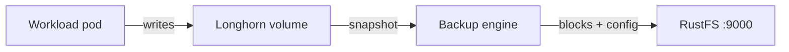

このガイドでは、Kubernetes 向けの分散ブロックストレージである [Longhorn](https://github.com/longhorn/longhorn) を、S3 バックアップターゲットとして **RustFS** に接続します。バックアップターゲットを構成し、データを含むボリュームをバックアップし、ボリュームを削除して RustFS から復元し、データを確認します。この流れは、k3s（Kubernetes 1.30）上の Longhorn 1.9.0 と `rustfs/rustfs-x86-musl:v2.3.1` で検証済みです。

Longhorn がインストールされた Kubernetes クラスターと、そのクラスターへの `kubectl` アクセスが必要です。このガイドは統合テストを目的としており、本番向けではありません。

## アーキテクチャ



Longhorn は、ターゲットバケットの `backupstore/volumes/` プレフィックスに、コンテンツアドレス指定のブロックと小さなボリューム設定ファイルとしてバックアップを保存します。復元では、RustFS に到達できる任意のノード上の新しいボリュームへ、それらのオブジェクトを読み戻します。

## 1. バックアップバケットを作成する

独自のエンドポイントと認証情報を使い、[`rc` クライアント](https://github.com/rustfs/cli) で専用バケットを作成します。

```bash
rc alias set rustfs http://<your-rustfs-endpoint>:9000 <your-access-key> <your-secret-key>
rc mb rustfs/longhorn-backups
```

Longhorn はバケットを作成しないため、最初のバックアップの前にこの手順を完了する必要があります。

## 2. バックアップターゲットを構成する

`longhorn-system` 名前空間の Secret に RustFS の認証情報を保存します。`AWS_ENDPOINTS` は、すべてのノードから到達できるエンドポイントである必要があります。ノードの IP または内部ロードバランサーのアドレスを使います。作業用マシンからのポートフォワードは使えません。

```bash
kubectl -n longhorn-system create secret generic rustfs-s3-secret \
  --from-literal=AWS_ACCESS_KEY_ID=<your-access-key> \
  --from-literal=AWS_SECRET_ACCESS_KEY=<your-secret-key> \
  --from-literal=AWS_ENDPOINTS=http://<your-rustfs-endpoint>:9000
```

Longhorn 1.9 は `BackupTarget` リソースでバックアップターゲットを管理します。`default` ターゲットを RustFS のバケットでパッチします。

```bash
kubectl -n longhorn-system patch backupTarget default --type merge -p '
spec:
  backupTargetURL: s3://longhorn-backups@us-east-1/
  credentialSecret: rustfs-s3-secret
  pollInterval: 5m'
```

`@us-east-1` の部分は、S3 URL 形式のリージョン注釈です。実際のデプロイのリージョンと一致している必要はありません。

ターゲットが利用可能になるまで待ちます。これにより、Longhorn が Secret 経由でバケットに到達できたことを確認できます。

```bash
kubectl -n longhorn-system get backupTarget default
```

```text
NAME      URL                                CREDENTIAL         AVAILABLE   LASTSYNCEDAT
default   s3://longhorn-backups@us-east-1/   rustfs-s3-secret   true        2026-09-21T08:36:55Z
```

## 3. データを書き込んでバックアップを作成する

データを含むテスト用ボリュームを作成します。次のマニフェストは、1 GiB の PVC と、マーカーファイルを書き込む Pod を作成します。

```yaml title="demo.yaml"
apiVersion: v1
kind: PersistentVolumeClaim
metadata:
  name: demo-vol
spec:
  accessModes: [ReadWriteOnce]
  storageClassName: longhorn
  resources:
    requests:
      storage: 1Gi
---
apiVersion: v1
kind: Pod
metadata:
  name: demo-app
spec:
  volumes:
  - name: data
    persistentVolumeClaim:
      claimName: demo-vol
  containers:
  - name: app
    image: busybox:1.36
    command: ["sh", "-c", "echo 'longhorn rustfs demo' > /data/hello.txt && sleep 3600"]
    volumeMounts:
    - name: data
      mountPath: /data
```

適用し、Pod が実行状態になるまで待ちます。

```bash
kubectl apply -f demo.yaml
kubectl get pod demo-app
```

スナップショットを作成してバックアップします。Longhorn UI の **Volume**（ボリューム）→ **Snapshot**（スナップショット）→ **Backup**（バックアップ）で実行するか、宣言的に作成できます。

```bash
VOLUME=$(kubectl get pvc demo-vol -o jsonpath='{.spec.volumeName}')
kubectl -n longhorn-system apply -f - <<EOF
apiVersion: longhorn.io/v1beta2
kind: Snapshot
metadata:
  name: demo-snap
  namespace: longhorn-system
spec:
  volume: $VOLUME
EOF
```

そのスナップショットに対する `Backup` リソースを作成します。

```bash
kubectl -n longhorn-system apply -f - <<EOF
apiVersion: longhorn.io/v1beta2
kind: Backup
metadata:
  name: demo-backup
  namespace: longhorn-system
spec:
  snapshotName: demo-snap
EOF
```

バックアップの完了を待ちます。

```bash
kubectl -n longhorn-system wait --for=jsonpath='{.status.state}'=Completed backup/demo-backup --timeout=300s
kubectl -n longhorn-system get backup demo-backup -o jsonpath='{.status.backupURL}'
```

## 4. RustFS でバックアップを確認する

バケットを一覧表示します。

```bash
rc ls rustfs/longhorn-backups/ -r
```

出力には、ボリューム設定とコンテンツアドレス指定のブロックが含まれます。

```text
backupstore/volumes/08/62/pvc-b73aeb3a-1482-4146-a8c9-749954c5dd7d/backups/backup_backup-f52accbdf3984e3d.cfg
backupstore/volumes/08/62/pvc-b73aeb3a-1482-4146-a8c9-749954c5dd7d/blocks/15/22/15220b19...blk
```


## 5. データを復元して確認する

手順 3 の `backupURL` を使い、バックアップから復元する新しいボリュームを作成します。

```bash
kubectl -n longhorn-system apply -f - <<EOF
apiVersion: longhorn.io/v1beta2
kind: Volume
metadata:
  name: demo-restored
  namespace: longhorn-system
spec:
  size: "1073741824"
  numberOfReplicas: 1
  fromBackup: "<backupURL-from-step-3>"
EOF
```

復元は、ボリュームが最初にアタッチされたときに実行されます。静的な PV を通じて復元ボリュームにバインドした PVC を作成し、マウントします。

```bash
kubectl apply -f - <<EOF
apiVersion: v1
kind: PersistentVolume
metadata:
  name: demo-restored-pv
spec:
  capacity:
    storage: 1Gi
  accessModes: [ReadWriteOnce]
  claimRef:
    name: demo-restored
    namespace: default
  csi:
    driver: driver.longhorn.io
    volumeHandle: demo-restored
    fsType: ext4
  storageClassName: longhorn-static
---
apiVersion: v1
kind: PersistentVolumeClaim
metadata:
  name: demo-restored
spec:
  accessModes: [ReadWriteOnce]
  storageClassName: longhorn-static
  volumeName: demo-restored-pv
  resources:
    requests:
      storage: 1Gi
EOF
```

確認用の Pod で、復元したボリュームをマウントします。

```bash
kubectl apply -f - <<EOF
apiVersion: v1
kind: Pod
metadata:
  name: restore-verify
spec:
  volumes:
  - name: data
    persistentVolumeClaim:
      claimName: demo-restored
  containers:
  - name: verify
    image: busybox:1.36
    command: ["sh", "-c", "cat /data/hello.txt && sleep 300"]
    volumeMounts:
    - name: data
      mountPath: /data
EOF
sleep 40
kubectl logs restore-verify
```

出力には手順 3 のマーカーファイルが表示され、データが RustFS を経由して往復検証できたことを示します。

```text
longhorn rustfs demo
```

## 6. クリーンアップ

テスト用ワークロードと復元したボリュームを削除します。

```bash
kubectl delete pod restore-verify demo-app
kubectl delete pvc demo-restored demo-vol
kubectl -n longhorn-system delete volume/demo-restored
```

RustFS 内のバックアップは、Longhorn UI またはバケットから削除するまで残ります。

## トラブルシューティング

### `No available disk candidates to create a new replica`

ノード上にスケジュール可能なディスクがありません。ノードがデフォルトディスクを登録していることを確認します。

```bash
kubectl -n longhorn-system get nodes.longhorn.io -o jsonpath='{.items[0].status.diskStatus}'
```

マップが空の場合は、ノード上に `/var/lib/longhorn` を作成してディスクを登録します。

```bash
kubectl -n longhorn-system patch nodes.longhorn.io <node-name> --type merge -p '
spec:
  disks:
    default:
      path: /var/lib/longhorn
      allowScheduling: true'
```

### `failed to create backup ... missing input parameter`

デフォルトのバックアップターゲットを構成する前に、バックアップが実行されました。手順 2 を完了し、`AVAILABLE` が `true` であることを確認してから、バックアップを再作成します。

### バックアップターゲットが利用可能にならない

ターゲットが同期する前に Secret が存在する必要があり、`AWS_ENDPOINTS` はノード自身から到達できる必要があります。S3 エラーがないか、`longhorn-manager` のログを確認します。

```bash
kubectl -n longhorn-system logs -l app=longhorn-manager | grep -i s3 | tail
```

## 次のステップ

- 追加のバックアップターゲットを採用する前に、[S3 互換性に関する注意](/ja/administration/protocols/s3)を確認します。
- [アクセスキー管理](/ja/security-compliance/iam/access-token)で、本番用の専用認証情報を作成します。
- [Longhorn のバックアップドキュメント](https://longhorn.io/docs/1.9.0/backups-and-restore/)に従い、定期バックアップジョブとスケジュールされたスナップショットを構成します。
