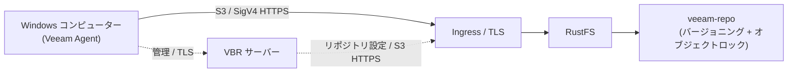
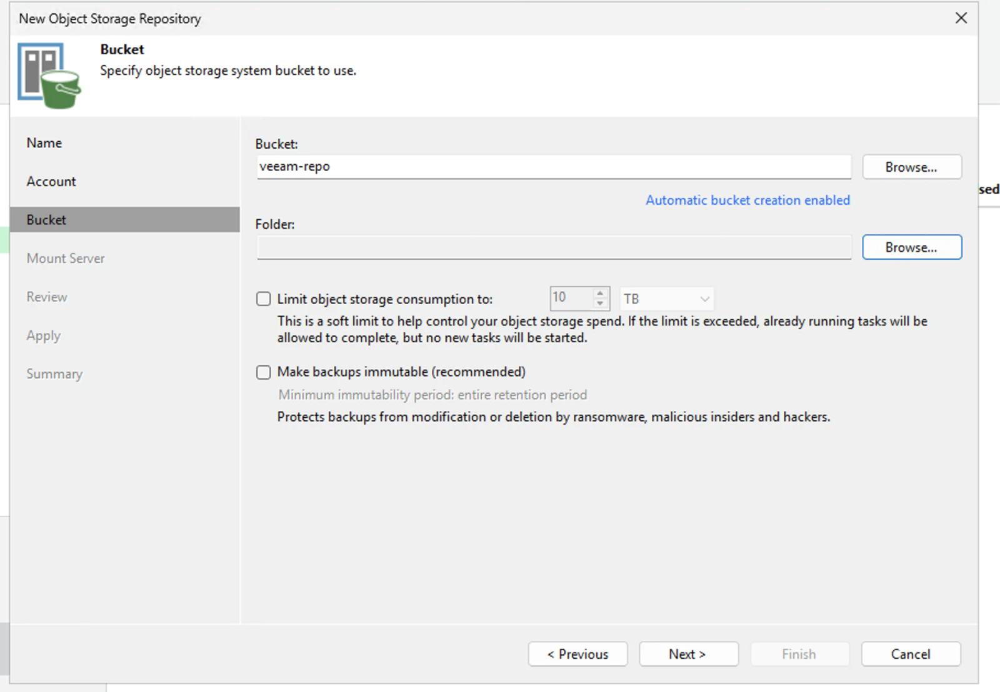
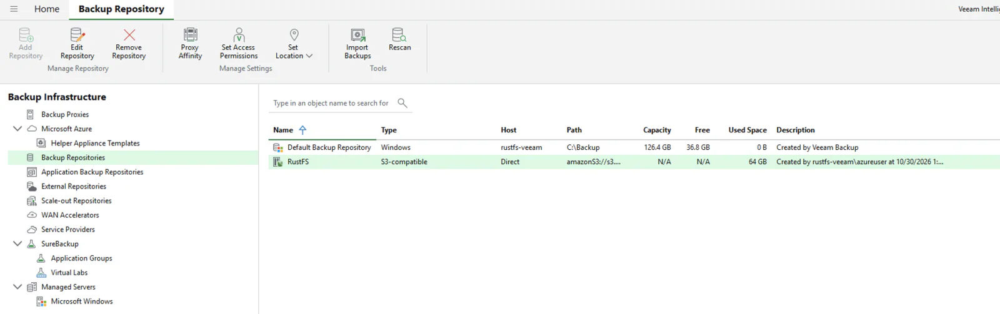

Veeam Backup & Replication（VBR）は、バックアップデータを S3 互換オブジェクトストレージに保存するエンタープライズ向けバックアッププラットフォームです。このページでは、RustFS を VBR のオブジェクトストレージリポジトリとして登録し、Veeam Agent で Windows コンピューター全体をバックアップし、保存されたバックアップからファイルを復元する方法を説明します。

HTTPS でアクセスできる RustFS インスタンス、バックアップ専用バケット、VBR 13 をインストールした Windows マシン、オブジェクトストレージバックアップを含む Veeam ライセンスが必要です。[Veeam 公式ダウンロードページ](https://www.veeam.com/products/downloads.html)から VBR を取得してください。バックアップサーバーは小規模な検証用 VM の構成ではなく、[Veeam のシステム要件](https://helpcenter.veeam.com/docs/vbr/userguide/system_requirements_backup_server.html?ver=13)に従って設計してください。

:::note[ライセンス要件]

S3 互換オブジェクトストレージへのバックアップは Veeam のエンタープライズ向け機能です。本番利用には Veeam Enterprise ライセンス、またはこの機能を含む別の有償ライセンスを購入してください。概念実証（POC）では、[Veeam Data Platform の無料 30 日間試用ライセンスを申請](https://www.veeam.com/products/data-platform-trial.html)し、ジョブの実行前にインストールできます。VBR のダウンロードやインストールだけではこの機能は有効になりません。検証構成では Community Edition でリポジトリを追加できましたが、必要なライセンスがなければオブジェクトストレージへのバックアップジョブは実行できませんでした。

:::

## 検証済みの構成

報告されたテストでは、VBR **13.1.2.57**、RustFS **1.0.1**、Windows Agent のバックアップ、および **Direct** 接続モードのリポジトリを使用し、バックアップジョブと 1 件のファイル復元が成功しました。これは連携テストであり、Veeam の認定や、ベアメタル復元、保持期間の強制適用、すべての Veeam ワークロードの検証ではありません。観測された約 1 MiB のオブジェクトは、固定ブロックサイズを保証するものではありません。

## アーキテクチャ



Direct モードでは Agent がバックアップデータを RustFS に送信し、VBR はジョブとリポジトリを管理します。ゲートウェイ構成では、選択したゲートウェイまたはマウントサーバーを経由します。実際にデータを転送する Agent またはゲートウェイが RustFS の HTTPS エンドポイントに到達でき、証明書を信頼できる必要があります。[Veeam Agent の接続モード](https://helpcenter.veeam.com/docs/vbr/userguide/agents_object_storage.html?ver=13)を参照してください。オブジェクトキーのプレフィックスは `veeam`、バケットは `veeam-repo` です。

## 1. バケットと認証情報を準備する

バージョニングとオブジェクトロック（Object Lock）を有効にした専用バケットを作成します。バージョニングは、Veeam の変更不可バックアップで使用するオブジェクトロックの前提条件です。

```bash
rc bucket create <your-alias>/veeam-repo --with-lock
rc bucket version info <your-alias>/veeam-repo
```

次のバケット限定の初期ポリシーを使用し、選択した Veeam モードで検証してください。バケット操作とオブジェクト操作ではリソースの範囲が異なります。バケットが既に存在するため `s3:CreateBucket` は省略しています。これは最小権限と確認されたポリシーではありません。検証用ポリシーにはリーガルホールドの管理とガバナンスモードの保持を回避する権限が含まれます。本番利用前に必要性を確認し、不要な権限を削除してください。特に `s3:BypassGovernanceRetention` はガバナンスモードの保護を回避できるため、この認証情報では保護されたバージョンを削除できないとは限りません。

```json
{
  "Version": "2012-10-17",
  "Statement": [
    {
      "Effect": "Allow",
      "Action": ["s3:GetObject","s3:PutObject","s3:DeleteObject",
                 "s3:GetObjectVersion","s3:DeleteObjectVersion",
                 "s3:AbortMultipartUpload","s3:ListMultipartUploadParts",
                 "s3:PutObjectRetention","s3:GetObjectRetention",
                 "s3:PutObjectLegalHold","s3:GetObjectLegalHold",
                 "s3:BypassGovernanceRetention"],
      "Resource": ["arn:aws:s3:::veeam-repo/*"]
    },
    {
      "Effect": "Allow",
      "Action": ["s3:ListBucket","s3:ListBucketVersions","s3:GetBucketLocation",
                 "s3:GetBucketVersioning","s3:GetBucketObjectLockConfiguration",
                 "s3:ListBucketMultipartUploads"],
      "Resource": ["arn:aws:s3:::veeam-repo"]
    }
  ]
}
```

```bash
rc admin policy create <your-alias> veeam-repo-rw <path-to-policy-file>
rc admin user add <your-alias> veeam <your-secret-key>
rc admin policy attach <your-alias> veeam-repo-rw --user veeam
```

Veeam は S3 互換オブジェクトストレージに HTTPS を要求します。Traefik や Nginx で RustFS の前段の TLS を終端できます。SAN はエンドポイントのホスト名を含み、VBR サーバーおよび転送を行う Agent またはゲートウェイが証明書チェーンを信頼する必要があります。プライベート CA の場合は、そのルート CA 証明書を適切な信頼済みルートストアにインストールしてください。任意のエンドポイント証明書を信頼済み CA として扱ったり、検証を無効にしたりしないでください。

この専用バックアップバケットにはライフサイクルの有効期限や移行ルールを設定せず、Veeam に保持期間を管理させてください。[Veeam Agent のオブジェクトストレージ制限](https://helpcenter.veeam.com/docs/agentforwindows/userguide/backup_to_object_storage.html)を参照してください。

## 2. VBR に RustFS リポジトリを追加する

VBR コンソールで **Backup Infrastructure → Backup Repositories → Add Repository → Object storage → S3 Compatible** に進みます:

1. Service point: RustFS の HTTPS エンドポイント、Region: `us-east-1`。
2. Credentials: `veeam` のアクセスキーとシークレットキー。図のデータ経路には **Direct** を選択します。直接アクセスが適さない場合はゲートウェイを選択してください。
3. Bucket: `veeam-repo`、Folder: `veeam`。
4. 新しいバケットにプレフィックスがない場合、S3 クライアントで `veeam/` 配下にオブジェクトを作成してから **Browse** で Folder を選択します。
5. 変更不可バックアップをテストする場合は **Make backups immutable** を有効にし、オブジェクトの保持を別途検証します。バケットのオブジェクトロックを有効にするだけでは、すべてのバックアップが変更不可になるわけではありません。



自動バケットプロビジョニングが Access Denied で失敗したというメッセージが表示された場合は、**Yes** を選んで無効化して先へ進みます。バケットは既に存在し、IAM ユーザーは意図的にバケットを作成できません。

Agent バックアップでは、[Veeam の S3 互換リポジトリのアクセス手順](https://helpcenter.veeam.com/docs/vbr/userguide/access_permissions.html?ver=13)に従い **Set Access Permissions → Security** を明示的に設定してください。**Provided by the backup server** はリポジトリが Direct と表示されてもゲートウェイまたはマウントサーバーを使用します。実際の Direct アクセスには互換性のある IAM/STS 構成、または **Agents share credentials to object storage repository** が必要です。後者は保護対象マシンにリポジトリ認証情報を渡すため安全性が低く、必要な場合にのみ隔離した POC で使用してください。一般的な IAM/STS 対応だけでは Veeam の認証情報処理との互換性は証明できません。本番利用前に選択したモードを検証してください。

検証報告には Security の選択が記録されていないため、データがゲートウェイを経由しなかったことを独立に確認するものではありません。

成功するとリポジトリは **S3-compatible** として表示されます。Used Space は Veeam が報告する使用量であり、RustFS 容量の独立した測定ではありません。



## 3. 保護対象コンピューターを登録する

バックアップジョブだけでは Veeam Agent はインストールされません。プロテクショングループを使用します:

1. **Inventory → Physical and Cloud Infrastructure → Add protection group…**
2. タイプは **Individual computers** を選び、実際のホスト名と `HOSTNAME\user` 形式のローカル管理者認証情報でマシンを追加します。
3. **Install Veeam Backup & Replication Agent** を有効のままにして Apply をクリックします。

:::warning[Windows UAC のリモート制限]

まずホスト名、認証情報、接続性、ファイアウォールを確認してください。ローカルアカウントの UAC リモートフィルタリングが原因と確認された場合にのみ、管理者が `HKLM\SOFTWARE\Microsoft\Windows\CurrentVersion\Policies\System` の `LocalAccountTokenFilterPolicy` を `1` にすることを検討してください。この設定はローカル管理者に昇格したリモートトークンを許可するもので、アクセス拒否全般の対処ではありません。アクセスを信頼できる管理ネットワークに制限し、元の値を記録して、不要になったら戻し、Agent 管理が正常に動作することを確認してください。[Microsoft の UAC リモート制限](https://learn.microsoft.com/en-us/troubleshoot/windows-server/windows-security/user-account-control-and-remote-restriction)を参照してください。インストール後、Backup agent 列に **Reboot required** と表示されたら再起動します。

:::

## 4. バックアップジョブを実行する

1. **Home → Backup Job → Windows computer…**
2. Computers: **From protection group**、Backup Mode: **Entire computer**。
3. Storage: Backup repository = **RustFS**、保持期間は必要に応じて設定。
4. Finish の後、ジョブを右クリックして **Start** を選択します。

ジョブ完了後、ジョブ一覧には **Last Result: Success** が表示され、復元ポイントは **Home → Backups → Object Storage → RustFS Veeam Backup** の下に現れます。


RustFS 内のオブジェクトを確認します:

```bash
rc object find <your-alias>/veeam-repo/ | tail -1
```

テストでは `Veeam/Backup/veeam/Clients/{agent-id}/…` 配下にデータオブジェクトが観測されました。オブジェクトの一覧表示だけでは、バックアップの完全性、復元ポイント、変更不可の保持設定は検証できません。

## 5. ファイルを復元する

1. **Home → Backups → Object Storage → RustFS Veeam Backup → <computer>**。
2. 復元ポイントを右クリック → **Restore guest files…** → Browse。
3. Backup Browser でファイルを選択し、復元先フォルダーに復元して内容を確認します。


復元が成功し内容が一致すれば、そのファイルのバックアップからファイル復元までの処理を検証できますが、すべての復元ポイントが復元可能とは限りません。変更不可バックアップの POC では、保持モードと期限も確認し、管理されたテストデータで保持期間中に保護されたバージョンを削除できないことを検証してください。本番バックアップに対して破壊的なテストを実施しないでください。

## トラブルシューティング

| 症状 | 対処 |
|---|---|
| "Backup to object storage requires a valid Enterprise edition license" | オブジェクトストレージバックアップを含むライセンス（試用または有料）をインストールしてください。Community Edition では実行できません |
| ジョブ中に "backup agent is missing" | プロテクショングループでマシンを登録してください（ステップ 3）。ジョブウィザードはエージェントをプッシュインストールしません |
| エージェントのプッシュがアクセス拒否で失敗する | まず認証情報、ホスト名、ファイアウォールを確認し、リモートフィルタリングが確認された場合のみ上記の UAC 警告を参照してください |
| Backup agent 列に "Reboot required" と表示される | エージェントのインストールを完了するためにマシンを再起動します |
| 起動直後にコンソールが HTTP 502 を表示 | Veeam サービスがまだ起動中です。`VeeamBackupSvc` と PostgreSQL サービスが Running になってから再試行します |
| ウィザードの Folder 一覧が空 | フォルダーの選択肢には既存のプレフィックスのみ表示されます。先にプレフィックス配下にプレースホルダーオブジェクトを作成してから Browse してください |
| リポジトリの容量が N/A と表示される | SOSAPI レポートはバックアップに必須ではありません。対応状況は [rustfs/rustfs#1511](https://github.com/rustfs/rustfs/issues/1511) で追跡されています |

## 次のステップ

- [Veeam 公式ダウンロード](https://www.veeam.com/products/downloads.html)と [POC 用試用ライセンス](https://www.veeam.com/products/data-platform-trial.html)。
- [Veeam Agent のオブジェクトストレージ要件](https://helpcenter.veeam.com/docs/agentforwindows/userguide/backup_to_object_storage.html)。
- [RustFS オブジェクトロック](../../../administration/data/object/object-lock.md)と[バケットのバージョニング](../../../administration/data/object/versioning.md)。
