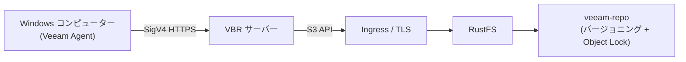
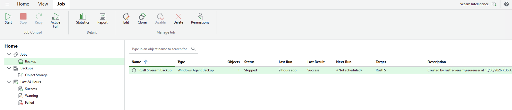

Veeam Backup & Replication（VBR）は、バックアップデータを S3 互換オブジェクトストレージに保存するエンタープライズ向けバックアッププラットフォームです。このページでは、RustFS を VBR のオブジェクトストレージリポジトリとして登録し、Veeam Agent で Windows コンピューター全体をバックアップし、保存されたバックアップからファイルを復元する方法を説明します。

HTTPS でアクセスできる稼働中の RustFS インスタンス、バックアップ専用のバケット、VBR 13 がインストールされた Windows マシン（実用上は 4 vCPU・8 GB RAM 以上）、オブジェクトストレージバックアップを含む Veeam ライセンスが必要です。

:::note[ライセンス要件]

オブジェクトストレージへのバックアップは Veeam の Enterprise 階層の機能です。VBR Community Edition は S3 リポジトリの追加と検証はできますが、そこへバックアップジョブを実行するには Enterprise ライセンスまたは 30 日間の無料評価キー（Veeam Data Platform Trial Key）が必要です。

:::

## アーキテクチャ



バックアップ中、Veeam は S3 API を通じて約 1 MiB のバックアップブロックをバケットに書き込みます。復元時には、要求されたデータを含むブロックだけを読み戻します。このページのプレフィックスは `veeam`、バケットは `veeam-repo` です。

## 1. バケットと認証情報を準備する

バージョニングと Object Lock を有効にした専用バケットを作成します。バージョニングは、Veeam のイミュータビリティが依存する Object Lock の前提条件です。

```bash
rc bucket create <your-alias>/veeam-repo --with-lock
rc bucket version info <your-alias>/veeam-repo
```

バケットにスコープされた最小権限のポリシーを作成します。このポリシーは意図的に `s3:CreateBucket` を省略しています。バケットが既に存在する場合、Veeam の自動プロビジョニングを拒否するのが推奨されます。

```json
{
  "Version": "2012-10-17",
  "Statement": [
    {
      "Effect": "Allow",
      "Action": ["s3:GetObject","s3:PutObject","s3:DeleteObject",
                 "s3:GetObjectVersion","s3:DeleteObjectVersion",
                 "s3:AbortMultipartUpload","s3:ListMultipartUploadParts",
                 "s3:ListBucketMultipartUploads",
                 "s3:PutObjectRetention","s3:GetObjectRetention",
                 "s3:PutObjectLegalHold","s3:GetObjectLegalHold",
                 "s3:BypassGovernanceRetention"],
      "Resource": ["arn:aws:s3:::veeam-repo/*"]
    },
    {
      "Effect": "Allow",
      "Action": ["s3:ListBucket","s3:ListBucketVersions","s3:GetBucketLocation",
                 "s3:GetBucketVersioning"],
      "Resource": ["arn:aws:s3:::veeam-repo"]
    }
  ]
}
```

```bash
rc admin policy create <your-alias> veeam-repo-rw <path-to-policy-file>
rc admin user add <your-alias> veeam <your-secret-key>
rc admin policy attach <your-alias> veeam-repo-rw --user veeam
```

Veeam はオブジェクトストレージに HTTPS を要求します。RustFS の前で TLS を終端し（Traefik や Nginx など）、エンドポイントのホスト名を SAN に含む証明書を使用してください。その証明書を Veeam サーバーの **Trusted Root Certification Authorities** ストアにインポートします。

## 2. VBR に RustFS リポジトリを追加する

VBR コンソールで **Backup Infrastructure → Backup Repositories → Add Repository → Object storage → S3 Compatible** に進みます:

1. Service point: RustFS の HTTPS エンドポイント、Region: `us-east-1`。
2. Credentials: `veeam` のアクセスキーとシークレットキー。
3. Bucket: `veeam-repo`、Folder: `veeam`。
4. 必要に応じて **Make backups immutable** を有効化（バケットの Object Lock は既に有効）。


自動バケットプロビジョニングが Access Denied で失敗したというメッセージが表示された場合は、**Yes** を選んで無効化して先へ進みます。バケットは既に存在し、IAM ユーザーは意図的にバケットを作成できません。

成功すると、リポジトリは **S3-compatible** として一覧表示され、使用容量はバケットの内容と一致します。


## 3. 保護対象コンピューターを登録する

バックアップジョブだけでは Veeam Agent はインストールされません。プロテクショングループを使用します:

1. **Inventory → Physical and Cloud Infrastructure → Add protection group…**
2. タイプは **Individual computers** を選び、実際のホスト名と `HOSTNAME\user` 形式のローカル管理者資格情報でマシンを追加します。
3. **Install Veeam Backup & Replication Agent** を有効のままにして Apply をクリックします。

:::note[Windows UAC]

エージェントのプッシュがアクセスエラーで失敗する場合は、対象マシンの `HKLM\SOFTWARE\Microsoft\Windows\CurrentVersion\Policies\System` にある `LocalAccountTokenFilterPolicy` を `1` に設定して再スキャンしてください。エージェントのインストール後、Backup agent 列に **Reboot required** と表示されたらマシンを再起動します。

:::

## 4. バックアップジョブを実行する

1. **Home → Backup Job → Windows computer…**
2. Computers: **From protection group**、Backup Mode: **Entire computer**。
3. Storage: Backup repository = **RustFS**、保持期間は必要に応じて設定。
4. Finish の後、ジョブを右クリックして **Start** を選択します。

ジョブ完了後、ジョブ一覧には **Last Result: Success** が表示され、復元ポイントは **Home → Backups → Object Storage → RustFS Veeam Backup** の下に現れます。



RustFS 内のオブジェクトを確認します:

```bash
rc object find <your-alias>/veeam-repo/ | tail -1
```

Veeam は約 1 MiB のデータブロックを `Veeam/Backup/veeam/Clients/{agent-id}/…` の下に保存し、各オブジェクトには ETag とバージョンが付きます。

## 5. ファイルを復元する

1. **Home → Backups → Object Storage → RustFS Veeam Backup → <computer>**。
2. 復元ポイントを右クリック → **Restore guest files…** → Browse。
3. Backup Browser でファイルを選択し、目標フォルダーに復元して内容を確認します。


復元では選択したファイルを含むブロックだけが読み戻されます。これにより、RustFS への読み取りパス全体が検証されます。

## トラブルシューティング

| 症状 | 対処 |
|---|---|
| "Backup to object storage requires a valid Enterprise edition license" | オブジェクトストレージバックアップを含むライセンス（試用または有料）をインストールしてください。Community Edition では実行できません |
| ジョブ中に "backup agent is missing" | プロテクショングループでマシンを登録してください（ステップ 3）。ジョブウィザードはエージェントをプッシュインストールしません |
| エージェントのプッシュがアクセス拒否で失敗する | 対象で `LocalAccountTokenFilterPolicy=1` を設定し、`localhost` ではなく実際のホスト名を使用してください |
| Backup agent 列に "Reboot required" と表示される | エージェントのインストールを完了するためにマシンを再起動します |
| 起動直後にコンソールが HTTP 502 を表示 | Veeam サービスがまだ起動中です。`VeeamBackupSvc` と PostgreSQL サービスが Running になってから再試行します |
| ウィザードの Folder 一覧が空 | フォルダーの選択肢には既存のプレフィックスのみ表示されます。先にプレフィックス配下にプレースホルダーオブジェクトを作成してから Browse してください |
| リポジトリの容量が N/A と表示される | SOSAPI レポートはバックアップに必須ではありません。対応状況は [rustfs#1511](https://github.com/rustfs/rustfs/issues/1511) で追跡されています |
