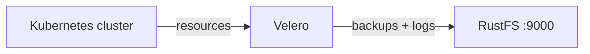
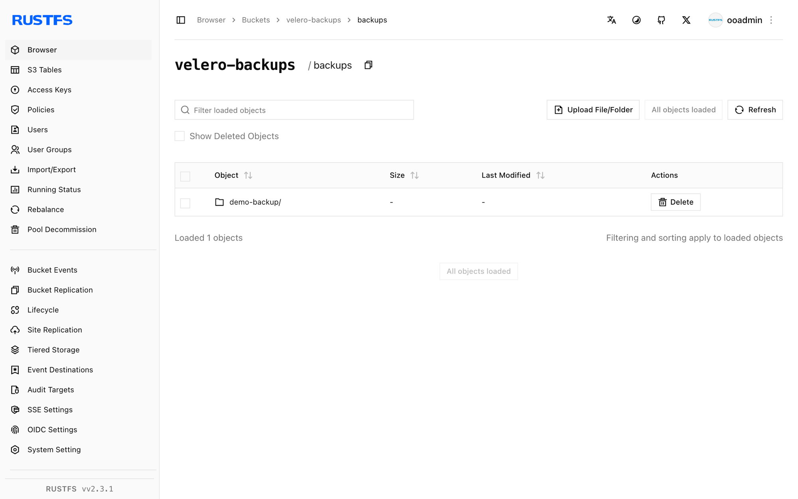

このガイドでは、Kubernetes のバックアップおよび復元ツールである [Velero](https://github.com/vmware-tanzu/velero) を、オブジェクトストレージのバックエンドとして **RustFS** に接続します。Kubernetes クラスターに Velero をインストールして RustFS のバックアップロケーションを設定し、クラスターリソースをバックアップして削除し、バケットから復元して、復元されたオブジェクトを確認します。この流れは、k3s（Kubernetes 1.30）上の Velero CLI 1.16.2 と `velero-plugin-for-aws:v1.12.2`、および `rustfs/rustfs-x86-musl:v2.3.1` で検証済みです。

`kubectl` でアクセスできる Kubernetes クラスターと、Velero CLI が必要です。このガイドは統合テストを目的としており、本番向けではありません。

## アーキテクチャ



Velero は、Kubernetes リソースと（任意で）Pod のボリュームデータを、バケット内の `backups/<name>/` 配下にある gzip アーカイブへシリアライズします。復元ではそれらのアーカイブをダウンロードし、クラスター内にリソースを再作成します。

## 1. バックアップバケットを作成する

専用バケットを作成します。Velero はバケットを作成しません。

```bash
rc alias set rustfs http://<your-rustfs-endpoint>:9000 <your-access-key> <your-secret-key>
rc mb rustfs/velero-backups
```

## 2. Velero をインストールする

認証情報をファイルに書き込み、Velero サーバーをインストールします。`s3Url` は、クラスターの Pod 自身から到達できるエンドポイントである必要があります。ノードの IP または内部アドレスを使います。作業用マシンからのポートフォワードは使えません。

```bash
cat > velero-creds <<EOF
[default]
aws_access_key_id=<your-access-key>
aws_secret_access_key=<your-secret-key>
EOF

kubectl create namespace velero
kubectl create secret generic cloud-credentials \
  --namespace velero --from-file=cloud=velero-creds

velero install \
  --provider aws \
  --plugins velero/velero-plugin-for-aws:v1.12.2 \
  --bucket velero-backups \
  --backup-location-config region=us-east-1,s3ForcePathStyle="true",s3Url=http://<your-rustfs-endpoint>:9000 \
  --secret-file velero-creds \
  --use-volume-snapshots=false
```

デプロイが準備完了になり、バックアップロケーションが `Available` になるまで待ちます。

```bash
kubectl -n velero get pods
velero backup-location get
```

```text
NAME      PROVIDER   BUCKET/PREFIX    PHASE      LAST VALIDATED   ACCESS MODE   DEFAULT
default   aws        velero-backups   Available  2026-09-22 ...   ReadWrite     true
```

## 3. クラスターリソースをバックアップする

デモ用リソースを 2 つ作成し、default 名前空間全体をバックアップします。

```bash
kubectl create configmap demo-cm --from-literal=key=rustfs-velero-demo
kubectl create deployment nginx --image=nginx:1.27

velero backup create demo-backup --wait
velero backup get
```

バックアップは、リソースのアーカイブとログを RustFS にアップロードします。

## 4. RustFS でバックアップを確認する

バケットを一覧表示します。

```bash
rc ls rustfs/velero-backups/ -r
```

バックアップアーカイブ一式は、`backups/` プレフィックス配下に保存されます。

```text
backups/demo-backup/demo-backup-resources.json.gz
backups/demo-backup/demo-backup-logs.gz
backups/demo-backup/demo-backup-itemoperations.json.gz
```



## 5. 復元して確認する

デモ用リソースを削除し、バックアップから復元します。復元は RustFS からアーカイブを読み取り、リソースを再作成します。

```bash
kubectl delete configmap demo-cm
kubectl delete deployment nginx

velero restore create --from-backup demo-backup --wait
```

リソースが元の内容で戻っていることを確認します。

```bash
kubectl get configmap demo-cm -o jsonpath="{.data.key}"
kubectl get deployment nginx
```

```text
rustfs-velero-demo
NAME    READY   UP-TO-DATE   AVAILABLE   AGE
nginx   1/1     1            1           10s
```

## 6. 停止またはリセット

バックアップは `velero-backups` バケットに残り、同じバケットを対象に Velero を実行する任意のクラスターへ復元できます。RustFS からデモ用バックアップを削除するには、次を実行します。

```bash
velero backup delete demo-backup --confirm
rc rm rustfs/velero-backups/backups/ --recursive --force
```

## トラブルシューティング

### バックアップロケーションが `Unavailable` のままになる

Velero の Pod が `s3Url` に到達できません。Docker のカスタムブリッジネットワーク上のエンドポイントは、Kubernetes の Pod からルーティングできません。Docker ホストのブリッジ IP（シングルホストのクラスターでは例として `http://172.17.0.1:9000` ）、またはノードのアドレスを使います。ロケーションをパッチし、Velero に再検証させます。

```bash
kubectl -n velero patch backupstoragelocation default --type merge -p \
  '{"spec":{"config":{"s3Url":"http://172.17.0.1:9000"}}}'
```

### daemonset エラーでバックアップが `PartiallyFailed` になる

エラー `daemonset pod not found in running state` は、Pod ボリュームのバックアップに使う node-agent Pod が実行中でなかったことを意味します。クラスターリソースのアーカイブには影響しません。エージェントの起動を待つか、エージェントが実行中の場合にのみ `--default-volumes-to-fs-backup` を維持します。

### インストール直後の `FailedValidation`

最初のバックアップ試行は、まだ検証されていないロケーションに対して実行されます。バックアップを作成する前に、`velero backup-location get` が `Available` を報告するまで待ちます。

## 次のステップ

- 追加の Velero 操作を採用する前に、[S3 互換性に関する注意](/ja/administration/protocols/s3)を確認します。
- [アクセスキー管理](/ja/security-compliance/iam/access-token)で、本番用の専用認証情報を作成します。
- [Velero ドキュメント](https://velero.io/docs/main/)に従い、スケジュール、ボリュームスナップショット、クラスター移行の手順を追加します。
