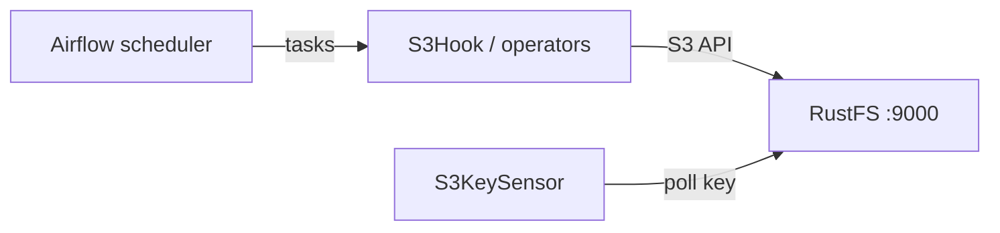

このガイドでは、ワークフローオーケストレーションのプラットフォームである [Apache Airflow](https://github.com/apache/airflow) を、Amazon S3 プロバイダーのフック、オペレーター、センサーを通じて **RustFS** に接続します。カスタムエンドポイントの接続を登録し、オブジェクトを RustFS のバケットへ書き込み、`S3KeySensor` でキーを待ち、`S3Hook` でオブジェクトを読み戻す DAG を実行します。この流れは、`apache/airflow:3.3.2`（スタンドアロン、SequentialExecutor）と `apache-airflow-providers-amazon` プロバイダーを `rustfs/rustfs-x86-musl:v2.3.1` に対して検証済みです。

Docker、または既存の Airflow 環境が必要です。このデプロイはローカルでの統合テストを目的としており、本番向けではありません。

## アーキテクチャ



DAG 内のすべての S3 操作は、接続の `endpoint_url` で RustFS を向いたプロバイダーの S3 クライアントを経由します。オペレーター、センサー、フックは同じ接続オブジェクトを共有します。

## 1. Airflow を実行する

サンプルを無効にしたスタンドアロンインスタンスを起動し、デモ用バケットを作成します。

```bash
docker run -d --name airflow --network oo-rustfs_default -p 8080:8080 \
  -e AIRFLOW__CORE__LOAD_EXAMPLES=False \
  -v "$PWD/dags":/opt/airflow/dags \
  apache/airflow:3.3.2 standalone

rc mb rustfs/airflow-demo
```

イメージには、`apache-airflow-providers-amazon` を含むすべてのプロバイダーが事前にインストールされています。

## 2. RustFS 接続を登録する

S3 プロバイダーは、接続の extra フィールドからエンドポイントを読み取ります。接続用のプレースホルダーをすべて置き換えます。

```bash
docker exec airflow airflow connections add rustfs \
  --conn-type aws \
  --conn-extra '{"endpoint_url": "http://<your-rustfs-endpoint>:9000", "region_name": "us-east-1", "aws_access_key_id": "<your-access-key>", "aws_secret_access_key": "<your-secret-key>"}'
```

`--conn-extra` 内の `aws_access_key_id` と `aws_secret_access_key` が認証情報を渡します。`endpoint_url` は boto3 クライアントの向き先を AWS から RustFS に変えます。

## 3. DAG を書く

DAG はオペレーターでオブジェクトを書き込み、センサーでキーを待ち、フックで読み戻します。

```python title="rustfs_demo.py"
import datetime

from airflow.providers.amazon.aws.hooks.s3 import S3Hook
from airflow.providers.amazon.aws.operators.s3 import S3CreateObjectOperator
from airflow.providers.amazon.aws.sensors.s3 import S3KeySensor
from airflow.sdk import dag, task

@dag(
    schedule=None,
    start_date=datetime.datetime(2026, 1, 1),
    catchup=False,
    tags=["rustfs"],
)
def rustfs_demo():
    create = S3CreateObjectOperator(
        task_id="write_object",
        s3_bucket="airflow-demo",
        s3_key="dags/airflow-put.txt",
        data="written by airflow to rustfs",
        aws_conn_id="rustfs",
        replace=True,
    )

    wait = S3KeySensor(
        task_id="wait_for_object",
        bucket_key="dags/airflow-put.txt",
        bucket_name="airflow-demo",
        aws_conn_id="rustfs",
        timeout=120,
        poke_interval=10,
        mode="reschedule",
    )

    @task
    def read_object():
        hook = S3Hook(aws_conn_id="rustfs")
        body = hook.read_key(key="dags/airflow-put.txt", bucket_name="airflow-demo")
        print("read back:", body)
        assert body == "written by airflow to rustfs"

    create >> [wait, read_object()]

rustfs_demo()
```

インポートパスに注意します。`S3CreateObjectOperator` は `operators` モジュールにあり、`S3KeySensor` は `sensors` モジュールにあります。両方を同じ場所からインポートすると失敗します。

## 4. 一時停止を解除してトリガーする

新しい DAG は一時停止状態で始まり、一時停止中に発火したトリガーは永久にキューへ残ります。先に一時停止を解除してからトリガーします。

```bash
docker exec airflow airflow dags unpause rustfs_demo
docker exec airflow airflow dags trigger rustfs_demo
```

実行の完了を確認します。

```bash
docker exec airflow airflow dags list-runs rustfs_demo | head -3
```

```text
dag_id       run_id                                    state
rustfs_demo  manual__2026-09-29T13:15:57.332688+00:00  success
```

`write_object`、`wait_for_object`、`read_object` の 3 つのタスクがすべて成功します。

## 5. RustFS でオブジェクトを確認する

バケットのプレフィックスを一覧表示します。

```bash
rc ls rustfs/airflow-demo/ -r
rc cat rustfs/airflow-demo/dags/airflow-put.txt
```

```text
[2026-09-29 13:16:01]       28 B dags/airflow-put.txt
written by airflow to rustfs
```


## 6. 停止またはリセット

バケット内のオブジェクトを残したままデモを解体するには、次を実行します。

```bash
docker rm -f airflow
```

保存したデータを削除するには、次を実行します。

```bash
rc rm rustfs/airflow-demo/ --recursive --force
```

## トラブルシューティング

### トリガー後も DAG の実行が `queued` のままになる

DAG が一時停止しています。Airflow 3 では新しい DAG が既定で一時停止し、その状態でトリガーしても実行は始まりません。`airflow dags unpause rustfs_demo` を実行すると、キューに入った実行は自動的に開始します。

### `cannot import name 'S3KeySensor' from 'airflow.providers.amazon.aws.operators.s3'`

センサーは別モジュールにあります。`from airflow.providers.amazon.aws.sensors.s3 import S3KeySensor` を使います。

### 接続エラーでタスクが失敗する

`endpoint_url` は Airflow コンテナから到達できる必要があります。RustFS には Docker ネットワークのホスト名を使います。`localhost` では到達できません。コンポーネントの状態を確認する場合、Airflow 3 のヘルスチェック用エンドポイントは `/api/v2/monitor/health` です。

## 次のステップ

- 追加のプロバイダーフックを採用する前に、[S3 互換性に関する注意](/ja/administration/protocols/s3)を確認します。
- [アクセスキー管理](/ja/security-compliance/iam/access-token)で、本番用の専用認証情報を作成します。
- [Amazon プロバイダーのドキュメント](https://airflow.apache.org/docs/apache-airflow-providers-amazon/stable/index.html)に従い、`S3ToLocalFilesystemOperator` や `LocalFilesystemToS3Operator` などの転送オペレーターを確認します。
