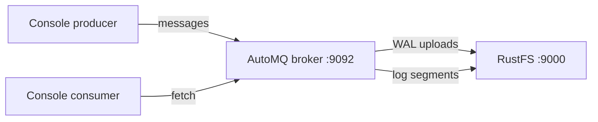

このガイドでは、ログストレージをオブジェクトストレージに置くクラウドネイティブな Kafka ディストリビューションである [AutoMQ](https://github.com/AutoMQ/automq) を **RustFS** に接続します。KRaft モードのシングルノード AutoMQ ブローカーを、S3 ログバケットを RustFS に向けて起動し、メッセージを送信して消費します。この流れは、AutoMQ 1.3.0（Kafka 3.9.0 API）を `rustfs/rustfs-x86-musl:v2.3.1` に対して検証済みです。

Docker が必要です。このデプロイはローカルでの統合テストを目的としており、本番向けではありません。

## アーキテクチャ



AutoMQ はストレージをブローカーから分離します。先行書き込みログ（WAL）はローカルにバッファしたあと、不変のストリームオブジェクトとしてバケットへアップロードします。ブローカーがローカルに保持するデータディレクトリは WAL だけです。

## 1. ブローカーを実行する

S3 バケットを RustFS に向けて AutoMQ を起動します。次の 4 点は必須です。スクリプト引数は空白区切りにします（`--key=value` 形式だと起動スクリプトが永久にループします）。`JAVA_TOOL_OPTIONS` に `-XX:-UseContainerSupport` を含めます（同梱の JDK 17 は、これがないと cgroup v2 の検出でクラッシュします）。複合ロールは `server` にします。認証情報は `KAFKA_S3_ACCESS_KEY` と `KAFKA_S3_SECRET_KEY` の環境変数で渡します（`--s3.access.key` のスクリプト引数は無視されます）。

```bash
docker run -d --name automq --hostname automq --network oo-rustfs_default -p 9092:9092 \
  -e JAVA_TOOL_OPTIONS="-XX:-UseContainerSupport" \
  -e KAFKA_HEAP_OPTS="-Xms512m -Xmx512m -XX:MetaspaceSize=96m -XX:MaxDirectMemorySize=512M" \
  -e KAFKA_S3_ACCESS_KEY=<your-access-key> \
  -e KAFKA_S3_SECRET_KEY=<your-secret-key> \
  -v /opt/automq-data:/data/kafka \
  automqinc/automq:1.3.0 /opt/automq/scripts/start.sh up \
  --process.roles server \
  --node.id 0 \
  --controller.quorum.voters 0@automq:9093 \
  --s3.region us-east-1 \
  --s3.bucket automq-demo \
  --s3.endpoint http://rustfs:9000
```

ブローカーはリスナーをコンテナの IP にバインドします。コンソールツールからはその IP で接続します。コンテナ内からはホスト名 `automq` も使えます。

## 2. トピックを作成して送信する

```bash
AIP=<automq-container-ip>
docker exec automq sh -c "cd /opt/automq/kafka && \
  ./bin/kafka-topics.sh --bootstrap-server $AIP:9092 --create --topic rustfs-automq --partitions 1 --replication-factor 1"

docker exec automq sh -c "cd /opt/automq/kafka && \
  printf 'mq-msg-one\nmq-msg-two\nmq-msg-three\n' | \
  ./bin/kafka-console-producer.sh --bootstrap-server $AIP:9092 --topic rustfs-automq"
```

## 3. メッセージを消費する

```bash
docker exec automq sh -c "cd /opt/automq/kafka && \
  ./bin/kafka-console-consumer.sh --bootstrap-server $AIP:9092 \
  --topic rustfs-automq --from-beginning --max-messages 3 --timeout-ms 30000"
```

```text
mq-msg-one
mq-msg-two
mq-msg-three
Processed a total of 3 messages
```

## 4. RustFS でオブジェクトを確認する

バケットを一覧表示します。AutoMQ はログストリームとメトリクスをオブジェクトとして書き込みます。

```bash
rc ls rustfs/automq-demo/ -r
```

```text
automq/logs/rZdE0DjZSrqy96PXrMUZVw/0/2026100700/fcd3fc76-... 
automq/logs/rZdE0DjZSrqy96PXrMUZVw/0/2026100701/52877dc7-...
automq/metrics/rZdE0DjZSrqy96PXrMUZVw/0/2026100701/4733e680-...
```

ログストリームのオブジェクトがトピックデータを保持します。ブローカーがローカルに保持するのは WAL だけなので、ブローカーを増減してもデータは移動しません。


## 5. 停止またはリセット

```bash
docker rm -f automq
rc rm rustfs/automq-demo/ --recursive --force
```

## トラブルシューティング

### 起動スクリプトが CPU 使用率 100% のまま `setup_value:` の行を出し続ける

引数パーサーが受け付けるのは空白区切りの形式（`--s3.bucket x`）だけです。`--s3.bucket=x` のような `=` 形式では、パーサーが永久にループします。

### `java.lang.NullPointerException ... CgroupInfo.getMountPoint()`

このイメージに同梱された JDK 17 は、cgroup v2 の検出に失敗します。`JAVA_TOOL_OPTIONS="-XX:-UseContainerSupport"` を設定します。

### `unknown process role broker,controller`

AutoMQ 1.3.0 のスクリプトは、複合ロールの表記を `server` と想定しています。

### ブローカーは起動するがクライアントが `Connection to node -1 could not be established` になる

リスナーはコンテナの IP（`hostname -I`）にバインドします。同じ Docker ネットワーク内からは、その IP またはホスト名 `automq` でブローカーに接続します。`localhost` が使えるのは、ブローカーコンテナ自身の中で動くツールだけです。

### `List objects failed, cost: 120000+ ms`

AutoMQ は既定で仮想ホスト形式を使い、IP エンドポイントに対して再試行ループに入ります。`KAFKA_CFG_S3_DATA_BUCKETS` と `KAFKA_CFG_S3_OPS_BUCKETS` でバケット URL を上書きし、値を `0@s3://<bucket>?region=us-east-1&endpoint=http://rustfs:9000&pathStyle=true&authType=static` にしてパススタイルアクセスを強制します。認証情報は `KAFKA_S3_ACCESS_KEY` と `KAFKA_S3_SECRET_KEY` で渡します。

## 次のステップ

- 標準の Kafka で Connect ベースの S3 連携を選ぶ場合は、[Kafka](/ja/developer/integration/big-data/kafka) のガイドと比較します。
- [アクセスキー管理](/ja/security-compliance/iam/access-token)で、本番用の専用認証情報を作成します。
- [AutoMQ ドキュメント](https://docs.automq.com/)に従い、同じバケット上でのマルチノードクラスターと WAL パラメーターの調整を確認します。
