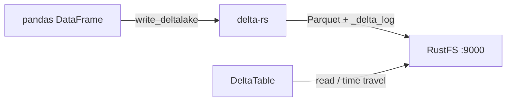
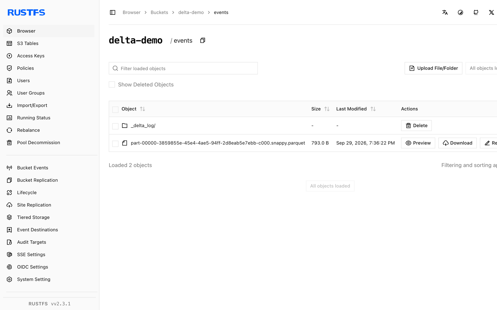

このガイドでは、オープンソースのレイクハウステーブル形式である [Delta Lake](https://github.com/delta-io/delta) を、Rust ネイティブの Delta 実装である delta-rs を通じて **RustFS** に接続します。Python から RustFS のバケットへ Delta テーブルを書き込み、ACID のトランザクション履歴付きで読み戻し、バケット内の `_delta_log` と Parquet ファイルを確認します。この流れは、`deltalake` Python パッケージ（delta-rs）と pandas を `rustfs/rustfs-x86-musl:v2.3.1` に対して検証済みです。

Python 3.9 以降が必要です。このデプロイはローカルでの統合テストを目的としており、本番向けではありません。

## アーキテクチャ



delta-rs は、各テーブルを Parquet ファイルとトランザクションログ（`_delta_log/`）として保存します。すべての I/O は `object_store` クレートを経由し、他の S3 クライアントと同じ AWS 環境変数で構成します。

## 1. クライアントをインストールする

```bash
pip install deltalake pandas pyarrow
```

pandas のフレームを Delta 互換のレコードバッチへ変換するには、`pyarrow` が必要です。

## 2. Delta テーブルを書き込む

接続用のプレースホルダーをすべて置き換え、バケットを作成してテーブルを書き込みます。`AWS_S3_ALLOW_UNSAFE_RENAME` が必要なのは、RustFS が copy-if-not-exists（存在しないときだけコピーする操作）を提供せず、delta-rs がコミット競合の処理にそれを使うためです。

```python title="delta_s3.py"
import pandas as pd
from deltalake import DeltaTable, write_deltalake

storage_options = {
    "AWS_ENDPOINT_URL": "http://<your-rustfs-endpoint>:9000",
    "AWS_ACCESS_KEY_ID": "<your-access-key>",
    "AWS_SECRET_ACCESS_KEY": "<your-secret-key>",
    "AWS_REGION": "us-east-1",
    "AWS_ALLOW_HTTP": "true",
    "AWS_S3_ALLOW_UNSAFE_RENAME": "true",
}

table = "s3://<your-bucket>/events"
df = pd.DataFrame({"id": [1, 2, 3], "name": ["alpha", "beta", "gamma"]})
write_deltalake(table, df, storage_options=storage_options)
print("written:", df.shape[0], "rows")
```

```text
written: 3 rows
```

`table` の URI は標準の `s3://bucket/prefix` 形式です。エンドポイントと認証情報は `storage_options` から渡します。

## 3. テーブルを読み戻す

```python title="delta_read.py"
from deltalake import DeltaTable

back = DeltaTable("s3://<your-bucket>/events", storage_options=storage_options).to_pandas()
print("read back:", back.shape[0], "rows")
print(back.sort_values("id").to_string(index=False))
print("version:", DeltaTable("s3://<your-bucket>/events", storage_options=storage_options).version())
```

```text
read back: 3 rows
 id   name
  1  alpha
  2   beta
  3  gamma
version: 0
```

バージョンはトランザクションログで追跡されるため、同じテーブルで `DeltaTable(..., version=N)` によるタイムトラベルと、バージョンを進める追記が使えます。

## 4. RustFS でオブジェクトを確認する

テーブルのプレフィックスを一覧表示します。

```bash
rc ls rustfs/<your-bucket>/ -r
```

最初のコミットで、トランザクションログと Parquet ファイルが 1 つ作成されます。

```text
events/_delta_log/00000000000000000000.json
events/part-00000-3859855e-45e4-4ae5-94ff-2d8eab5e7ebb-c000.snappy.parquet
```

新しい書き込みのたびに、`NNNNNNNNNNNNNNNNNNNN.json` のログエントリと Parquet のパートが追加されます。読み取り側はログを再生して、一貫したスナップショットを得ます。



## 5. 停止またはリセット

delta-rs 自身は状態を持ちません。テーブルを削除するには、次を実行します。

```bash
rc rm rustfs/<your-bucket>/events/ --recursive --force
```

## トラブルシューティング

### pandas の DataFrame 書き込み時の `Import pyarrow failed`

`write_deltalake` はフレームを Arrow 経由で変換します。`deltalake` と `pandas` に加えて `pyarrow` をインストールします。

### コミット時の `Generic DeltaTable error: commit conflict` またはリネームエラー

delta-rs は一時オブジェクトのコピーとリネームでコミットするため、バックエンドにアトミックなリネームが必要です。copy-if-not-exists を持たない S3 互換ストアでは、`storage_options` に `AWS_S3_ALLOW_UNSAFE_RENAME: "true"` を設定します。単一ライターでは許容できます。同時ライターには向きません。

### `Unknown lengthy error: AWS connectivity or endpoint errors`

平文 HTTP のエンドポイントでは、`AWS_ENDPOINT_URL` にスキームが含まれることと、`AWS_ALLOW_HTTP` が `"true"` であることを確認します。設定しないと、S3 クライアントは HTTPS のみで通信します。

## 次のステップ

- 追加の Delta クライアントを採用する前に、[S3 互換性に関する注意](/ja/administration/protocols/s3)を確認します。
- [アクセスキー管理](/ja/security-compliance/iam/access-token)で、本番用の専用認証情報を作成します。
- [delta-rs の利用ドキュメント](https://delta-io.github.io/delta-rs/usage/writing/writing-to-s3/)に従い、DynamoDB をバックエンドにしたコミット調整による同時ライター構成を確認します。
