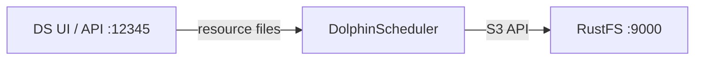

このガイドでは、ワークフロースケジューラーである [Apache DolphinScheduler](https://github.com/apache/dolphinscheduler) を、リソースセンターのストレージとして **RustFS** に接続します。スタンドアロンサーバーを実行し、リソースストレージを S3 に切り替え、API でリソースファイルをアップロードし、バケット内のオブジェクトを確認します。この流れは、DolphinScheduler 3.2.1（スタンドアロンサーバー）を `rustfs/rustfs-x86-musl:v2.3.1` に対して検証済みです。

Docker が必要です。

## アーキテクチャ



リソースセンターは、ワークフローのスクリプト、依存 JAR、その他のファイルを保存します。S3 ストレージでは、アップロードした各ファイルがバケット内の `dolphinscheduler/<tenant>/resources/` 配下のオブジェクトになります。

## 1. スタンドアロンサーバーを実行する

```bash
docker run -d --name dolphinscheduler --hostname dolphinscheduler \
  --network oo-rustfs_default -p 12345:12345 \
  apache/dolphinscheduler-standalone-server:3.2.1
```

単一のコンテナに master、worker、API、alert、組み込み ZooKeeper が含まれます。UI は `http://localhost:12345/dolphinscheduler/ui` です（既定のログインは `admin` / `dolphinscheduler123`）。

## 2. リソースセンターを RustFS に切り替える

ストレージのバックエンドは `/opt/dolphinscheduler/conf/common.properties` にあります。既存ファイルへ S3 のプロパティを追記します。ファイルには他の設定も多数あるため、置き換えないでください。

```bash
docker exec dolphinscheduler bash -c "cat >> /opt/dolphinscheduler/conf/common.properties << 'EOF'

resource.storage.type=S3
resource.storage.base.dir=/ds-resources
resource.aws.s3.bucket.name=ds-demo
resource.aws.s3.endpoint=http://<your-rustfs-endpoint>:9000
resource.aws.access.key.id=<your-access-key>
resource.aws.secret.access.key=<your-secret-key>
resource.aws.region=us-east-1
EOF"
docker restart dolphinscheduler
```

API が復帰するまで待ち（およそ 1 分）、その後バケットを作成します。

```bash
rc mb rustfs/ds-demo
```

## 3. リソースファイルをアップロードする

API でログインしてセッション ID を取得し、ファイルをアップロードします。エンドポイントには `name` と `fullName` の両方のパラメーターが必要です。

```bash
printf "ds resource file stored in rustfs" > /tmp/ds-file.txt
TOKEN=$(curl -s -m 10 -X POST http://localhost:12345/dolphinscheduler/login \
  -d "userName=admin&userPassword=dolphinscheduler123" \
  | python3 -c "import json,sys; print(json.load(sys.stdin)['data']['sessionId'])")

curl -s -m 30 -X POST "http://localhost:12345/dolphinscheduler/resources" \
  -H "session-id: $TOKEN" -H "Cookie: sessionId=$TOKEN" \
  -F "file=@/tmp/ds-file.txt" -F "type=FILE" -F "currentDir=/" \
  -F "name=ds-file.txt" -F "fullName=/ds-file.txt" -F "description=demo"
```

```json
{"code":0,"msg":"success","data":null,"failed":false,"success":true}
```

## 4. DolphinScheduler と RustFS で確認する

API 経由でファイルを読み戻します。

```bash
curl -s -m 30 "http://localhost:12345/dolphinscheduler/resources/view-ui?fullName=/ds-file.txt&skipLineNum=100&limit=100" \
  -H "session-id: $TOKEN" -H "Cookie: sessionId=$TOKEN" | grep "ds resource"
```

```text
ds resource file stored in rustfs
```

バケットを一覧表示します。ファイルはテナントの resources プレフィックス配下にあります。

```bash
rc ls rustfs/ds-demo/ -r
```

```text
dolphinscheduler/default/resources/ds-file.txt
dolphinscheduler/default/udfs/
```


## 5. 停止またはリセット

```bash
docker rm -f dolphinscheduler
rc rm rustfs/ds-demo/ --recursive --force
```

## トラブルシューティング

### Azure の `clientId/tenantId/clientSecret` エラーでサーバーが起動しない

ストレージ設定を追記せず新規ファイルとして書いたため、`resource.storage.type=S3` が失われ、既定値が Azure を向いたままです。手順 2 のとおり、必ず既存の `common.properties` へ追記します。

### `Required request parameter 'name'/'fullName' is not present`

リソース作成エンドポイントには、`file`、`type`、`currentDir` に加えて、`name` と `fullName` のフォームフィールドが両方必要です。

### トークン呼び出しで API が 405 を返す

ログインおよびトークンのエンドポイントは POST を受け付けます。バージョンによって `/api/v2/token` 形式のエンドポイントは異なります。手順 3 のログインフォームを使い、すべての呼び出しで `session-id` ヘッダーと `Cookie: sessionId=...` を渡します。

## 次のステップ

- 組み込みのリソースセンターを使わないオーケストレーションについては、[Airflow](/ja/developer/integration/big-data/airflow) のガイドと比較します。
- [アクセスキー管理](/ja/security-compliance/iam/access-token)で、本番用の専用認証情報を作成します。
- [DolphinScheduler ドキュメント](https://dolphinscheduler.apache.org/en-us/docs/latest/user_doc/common/resource-management.html)に従い、同じ S3 リソースセンターをワーカーのタスク実行へ接続します。
