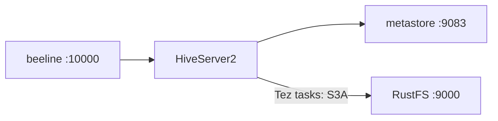
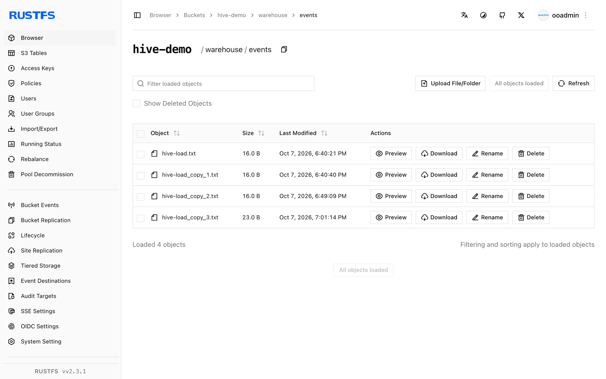

このガイドでは、従来型のデータウェアハウスである [Apache Hive](https://github.com/apache/hive) を、S3A ファイルシステムを通じて **RustFS** に接続します。メタストアと HiveServer2 を含む Hive 4.0.1 の Docker イメージを実行し、3 つの設定レイヤーで S3A を構成し、RustFS のロケーション上に外部テーブルを作成して、データのロードとクエリを行います。この流れは、Hive 4.0.1 を `rustfs/rustfs-x86-musl:v2.3.1` に対して検証済みです。

Docker が必要です（コンテナは 2 つ、metastore と hiveserver2 です）。

## アーキテクチャ



Hive は、テーブルのメタデータをメタストア（この検証では Derby）に、テーブルデータをテーブルの S3A ロケーションに保存します。クエリの実行は hiveserver2 コンテナ内の Tez で行われます。

## 1. メタストアと HiveServer2 を実行する

```bash
docker run -d --name hive-metastore --hostname hive-meta --network oo-rustfs_default \
  -e SERVICE_NAME=metastore -e DB_DRIVER=derby apache/hive:4.0.1

docker run -d --name hive-server --hostname hive-server --network oo-rustfs_default \
  -e SERVICE_NAME=hiveserver2 -e DB_DRIVER=derby apache/hive:4.0.1
```

メタストアが Derby スキーマを初期化するまで 1〜2 分かかります。HiveServer2 は 10000、メタストアは 9083 で待ち受けます。

## 2. S3A を 3 箇所に設定する

Tez のタスクは Hadoop の設定ディレクトリを読み、HiveServer2 は Hive の設定を読みます。メタストアにもエンドポイントが必要です。プロパティファイルを 1 つ作成し、3 つのパスすべてへコピーします。

```xml title="s3a-core-site.xml"
<?xml version="1.0"?>
<configuration>
  <property><name>fs.s3a.endpoint</name><value>http://<your-rustfs-endpoint>:9000</value></property>
  <property><name>fs.s3a.access.key</name><value><your-access-key></value></property>
  <property><name>fs.s3a.secret.key</name><value><your-secret-key></value></property>
  <property><name>fs.s3a.path.style.access</name><value>true</value></property>
  <property><name>fs.s3a.connection.ssl.enabled</name><value>false</value></property>
  <property><name>fs.s3a.aws.credentials.provider</name><value>org.apache.hadoop.fs.s3a.SimpleAWSCredentialsProvider</value></property>
  <property><name>fs.s3a.impl</name><value>org.apache.hadoop.fs.s3a.S3AFileSystem</value></property>
</configuration>
```

```bash
rc mb rustfs/hive-demo
docker cp s3a-core-site.xml hive-server:/opt/hive/conf/hive-site.xml
docker cp s3a-core-site.xml hive-server:/opt/hive/conf/core-site.xml
docker cp s3a-core-site.xml hive-server:/opt/hadoop/etc/hadoop/core-site.xml
docker exec -u root hive-server bash -c \
  "chown hive:hive /opt/hive/conf/hive-site.xml /opt/hive/conf/core-site.xml /opt/hadoop/etc/hadoop/core-site.xml; \
   mkdir -p /home/hive/.beeline; chmod 777 /home/hive/.beeline"
docker exec hive-server bash -c \
  "echo 'export HADOOP_CONF_DIR=/opt/hadoop/etc/hadoop' >> /opt/hive/conf/hive-env.sh; \
   echo 'export HADOOP_CLASSPATH=/opt/hadoop/share/hadoop/tools/lib/*:/opt/tez/*:/opt/tez/lib/*' >> /opt/hive/conf/hive-env.sh"
docker restart hive-server
```

`hadoop-aws` の JAR は `/opt/hadoop/share/hadoop/tools/lib` に同梱されています。`HADOOP_CLASSPATH` の export により、クエリのクラスパスに載ります。`mkdir /home/hive/.beeline` は、無害な beeline のホームディレクトリエラーを抑止します。

## 3. 外部テーブルを作成する

```bash
docker exec hive-server bash -c "cd /opt/hive && beeline -u 'jdbc:hive2://localhost:10000' \
  -n hive -e \"CREATE EXTERNAL TABLE default.events (id INT, label STRING) \
  ROW FORMAT DELIMITED FIELDS TERMINATED BY ',' STORED AS TEXTFILE \
  LOCATION 's3a://hive-demo/warehouse/events';\""
```

S3A の `LOCATION` を持つ `EXTERNAL` テーブルは、すべてのデータを RustFS に保持します。（既定以外のデータベースパスに対する管理テーブルの `CREATE TABLE ... LOCATION` は、Hive 4 の管理テーブル規則により拒否されます。S3A のロケーションには外部テーブルを使います。）

## 4. データをロードしてクエリする

`LOAD DATA INPATH` はローカルファイルをテーブルの S3A ロケーションへ移動します（リネームは、認証情報を持つ HiveServer2 が実行します）。

```bash
docker exec hive-server bash -c "printf '1,alpha\n2,beta\n3,gamma\n' > /tmp/hive-load.txt"
docker exec hive-server bash -c "cd /opt/hive && beeline -u 'jdbc:hive2://localhost:10000' \
  -n hive -e \"LOAD DATA INPATH 'file:///tmp/hive-load.txt' INTO TABLE default.events;\""
```

```text
INFO  : Loading data to table default.events from file:/tmp/hive-load.txt
```

## 5. クエリし、RustFS で確認する

```bash
docker exec hive-server bash -c "cd /opt/hive && beeline -u 'jdbc:hive2://localhost:10000' \
  -n hive --outputformat=tsv2 -e 'SELECT * FROM default.events ORDER BY id;'"
```

```text
1	alpha
2	beta
3	gamma
```

テーブルディレクトリを一覧表示します。ロードしたファイルは通常のオブジェクトです。

```bash
rc ls rustfs/hive-demo/warehouse/events/
```

```text
warehouse/events/hive-load.txt
warehouse/events/hive-load_copy_1.txt
warehouse/events/hive-load_copy_2.txt
```



## 6. 停止またはリセット

```bash
docker rm -f hive-server hive-metastore
rc rm rustfs/hive-demo/ --recursive --force
```

## トラブルシューティング

### INSERT 時の `NoClassDefFoundError: org.apache.tez.mapreduce.hadoop.InputSplitInfo`

クエリのクラスパスに Tez の JAR がありません。手順 2 の `HADOOP_CLASSPATH` の export（tools lib、tez、tez lib）を `/opt/hive/conf/hive-env.sh` に追加します。

### `NoAwsCredentialsException: SimpleAWSCredentialsProvider: No AWS credentials in the Hadoop configuration`

Tez のタスクプロセスが読むのは Hive の設定ディレクトリだけではありません。`/opt/hadoop/etc/hadoop/core-site.xml` も読みます。手順 2 の 3 つのパスすべてに S3A プロパティをコピーします。

### beeline コマンドのたびに `Permission denied` が表示される

beeline は `/home/hive/.beeline` の作成を試みます。コンテナ内で root として、`mkdir -p /home/hive/.beeline && chmod 777` を一度実行します。

### `Unable to create database managed path file:/user/hive/warehouse/...`

Hive 4 は管理データベースを、管理ウェアハウスのルート内に保持します。S3A のロケーションには `CREATE EXTERNAL TABLE ... LOCATION 's3a://...'` を使います。

## 次のステップ

- メタストアなしで同じオブジェクトに対する対話的な SQL が必要な場合は、[Trino](/ja/developer/integration/database/trino) のガイドと比較します。
- [アクセスキー管理](/ja/security-compliance/iam/access-token)で、本番用の専用認証情報を作成します。
- [Hive ドキュメント](https://hive.apache.org/)に従い、MySQL をバックエンドにしたメタストアを接続し、同じバケット上のウェアハウスを Hive と Spark で共有します。
