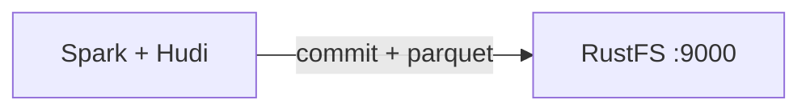

このガイドでは、トランザクション型データレイク基盤である [Apache Hudi](https://github.com/apache/hudi) を、コピーオンライトのテーブルストアとして **RustFS** に接続します。Hudi バンドル付きの Spark を実行し、RustFS バケット内の `s3a://` ロケーションへテーブルを書き込み、読み戻してテーブルファイルを確認します。この流れは `apache/spark:3.5.6`、`hudi-spark3.5-bundle_2.12:0.15.0`、`hadoop-aws:3.3.4`、`rustfs/rustfs-x86-musl:v2.3.1` で検証済みです。

Docker が必要です。このデプロイはローカルでの統合テストを目的としており、本番環境向けではありません。

## アーキテクチャ



Hudi は、バケット内のテーブルパス配下に `.hoodie/` タイムライン、コミットファイル、Parquet データブロックを保存します。読み取りはタイムラインから最新のテーブルスナップショットを解決するため、すべての書き込みとクエリは S3 API を経由します。

## 1. Spark の書き込みを実行する

Hudi では Kryo シリアライザーと s3a の認証情報を Hadoop プロパティとして指定する必要があります。次の `spark-shell` セッションは `my-bucket` に非パーティションテーブルを作成します。接続用のプレースホルダーはすべて置き換えます。

```scala
import org.apache.spark.sql.SaveMode

val df = Seq((1, "a"), (2, "b"), (3, "c")).toDF("id", "name")
df.write.format("hudi")
  .option("hoodie.table.name", "events")
  .option("hoodie.datasource.write.recordkey.field", "id")
  .option("hoodie.datasource.write.precombine.field", "name")
  .option("hoodie.datasource.write.partitionpath.field", "")
  .mode(SaveMode.Overwrite)
  .save("s3a://my-bucket/hudi-demo/events")

val back = spark.read.format("hudi").load("s3a://my-bucket/hudi-demo/events")
back.select("id", "name").show()
```

```bash
docker run --rm --network oo-rustfs_default \
  -v "$PWD/hudi_test.scala":/tmp/hudi_test.scala \
  apache/spark:3.5.6 /opt/spark/bin/spark-shell \
  --packages org.apache.hudi:hudi-spark3.5-bundle_2.12:0.15.0,org.apache.hadoop:hadoop-aws:3.3.4 \
  --conf spark.serializer=org.apache.spark.serializer.KryoSerializer \
  --conf spark.hadoop.fs.s3a.endpoint=http://rustfs:9000 \
  --conf spark.hadoop.fs.s3a.path.style.access=true \
  --conf spark.hadoop.fs.s3a.access.key=<your-access-key> \
  --conf spark.hadoop.fs.s3a.secret.key=<your-secret-key> \
  --conf spark.hadoop.fs.s3a.region=us-east-1 \
  --conf spark.jars.ivy=/tmp/.ivy2 \
  --conf spark.sql.shuffle.partitions=2 \
  -i /tmp/hudi_test.scala
```

`--packages` フラグは、初回実行時に Hudi バンドルと s3a コネクタをダウンロードします。`spark.jars.ivy` は、コンテナ内の Ivy キャッシュ権限エラーを避けます。読み戻しの `show()` は次の 3 行を出力します。

```text
+---+----+
|  2|   b|
|  3|   c|
|  1|   a|
+---+----+
```

## 2. RustFS 内のオブジェクトを確認する

テーブルのプレフィックスを一覧します。

```bash
rc ls rustfs/my-bucket/hudi-demo/ -r
```

Hudi のテーブルレイアウトはテーブルパス配下に現れます。コミットファイルを含む `.hoodie/` タイムラインと、Parquet データブロックです。

```text
hudi-demo/events/.hoodie/20260922015803291.commit
hudi-demo/events/.hoodie/20260922015803291.commit.requested
hudi-demo/events/<partition>/<filegroup>/<parquet-block>
```


## 3. 停止またはリセットする

Spark はワンショットのクライアントとして動作し、状態を保持しません。デモテーブルを削除します。

```bash
rc rm rustfs/my-bucket/hudi-demo/ --recursive --force
```

## トラブルシューティング

### `hoodie only support org.apache.spark.serializer.KryoSerializer as spark.serializer`

Hudi は Spark のデフォルトシリアライザーを拒否します。上記のとおり `--conf spark.serializer=org.apache.spark.serializer.KryoSerializer` を渡します。

### `Partition-path field has to be non-empty` または keygenerator クラスのエラー

非パーティションテーブルでは、デフォルトのキージェネレーターを維持します（`hoodie.datasource.write.keygenerator.class` は設定しません）。`hoodie.datasource.write.partitionpath.field` は空文字列にします。

### Hudi の書き込みで `NoSuchMethodError` または `ClassNotFoundException` が出る

Spark と Hudi バンドルのバージョンは一致している必要があります。`hudi-spark3.5-bundle_2.12` は Spark 3.5.x と組み合わせ、同梱の Hadoop クライアントは `hadoop-aws:3.3.4` と互換である必要があります。

## 次のステップ

- 追加の Hudi 操作を採用する前に、[S3 互換性ノート](/ja/administration/protocols/s3)を確認します。
- [アクセスキー管理](/ja/security-compliance/iam/access-token)で、本番用の専用認証情報を作成します。
- [Hudi Spark ガイド](https://hudi.apache.org/docs/quick-start-guide/)に従い、同じテーブルへ upsert、コンパクション、クエリ連携を追加します。
