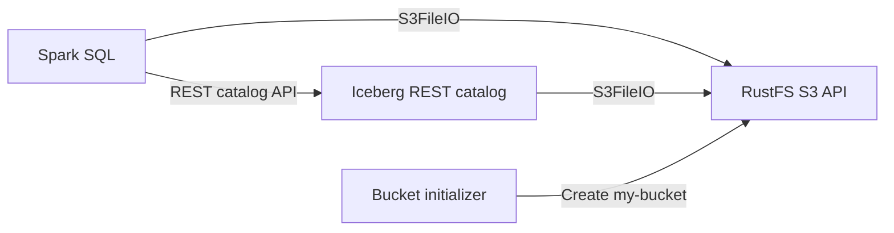

このガイドでは、Spark、Iceberg REST カタログ、S3 互換ウェアハウスとしての **RustFS** を用いて **Apache Iceberg** を実行します。Iceberg テーブルを作成し、行を書き込み、問い合わせ、テーブルファイルが RustFS に保存されていることを確認します。

RustFS の組み込み REST カタログを使う場合は、[S3 Tables の設定](/ja/administration/data/s3-tables)と [PyIceberg ガイド](/ja/developer/integration/big-data/pyiceberg)を参照してください。以下の構成では、別のカタログサービスを起動します。

Docker と Compose プラグイン、および 4 つのコンテナを動かすだけのローカルリソースが必要です。この構成はローカルの連携テスト向けであり、本番向けではありません。

:::note[アップストリームの状態]

Apache Iceberg の [PR #14928](https://github.com/apache/iceberg/pull/14928) では、同じ Spark、REST カタログ、`S3FileIO`、RustFS の流れ（テーブルの作成と書き込みを含む）が示されています。このプルリクエストはマージされずにクローズされ、現行の [Spark クイックスタート](https://iceberg.apache.org/spark-quickstart/#docker-compose) は別の S3 互換ストアを使っています。そのため、以下の設定は Apache Iceberg のデフォルトではなく、RustFS との連携として記載しています。

:::

## アーキテクチャ



Spark はカタログ操作に REST サービスを使います。Spark と REST カタログの両方に、RustFS のエンドポイント、リージョン、認証情報、パススタイルアクセスの設定を渡すことで、`s3://my-bucket/warehouse` 内のメタデータとデータファイルへアクセスできます。

## 1. プロジェクトファイルを作成する

作業ディレクトリを作成します。

```bash
mkdir rustfs-iceberg
cd rustfs-iceberg
```

環境ファイルを作成し、両方の認証情報プレースホルダーを置き換えます。

```ini title=".env"
RUSTFS_ACCESS_KEY=<your-access-key>
RUSTFS_SECRET_KEY=<your-secret-key>
```

ウェアハウスバケットには専用の認証情報を使います。`.env` をソース管理にコミットしないでください。

Spark のカタログ設定を作成します。

```ini title="spark-defaults.conf"
spark.sql.extensions org.apache.iceberg.spark.extensions.IcebergSparkSessionExtensions
spark.sql.catalog.demo org.apache.iceberg.spark.SparkCatalog
spark.sql.catalog.demo.type rest
spark.sql.catalog.demo.uri http://rest:8181
spark.sql.catalog.demo.io-impl org.apache.iceberg.aws.s3.S3FileIO
spark.sql.catalog.demo.warehouse s3://my-bucket/warehouse
spark.sql.catalog.demo.s3.endpoint http://rustfs:9000
spark.sql.catalog.demo.s3.path-style-access true
spark.sql.defaultCatalog demo
spark.sql.catalogImplementation in-memory
```

このコンテナネットワークのエンドポイントでは、パススタイルアクセスが必要です。ホスト名 `rustfs` は Compose ネットワーク内でのみ解決されます。ホスト上で動くクライアントは、代わりに `http://localhost:9000` を使います。

Compose ファイルを作成します。

```yaml title="compose.yaml"
services:
  rustfs:
    image: rustfs/rustfs:1.0.0-alpha.83
    environment:
      RUSTFS_ACCESS_KEY: ${RUSTFS_ACCESS_KEY}
      RUSTFS_SECRET_KEY: ${RUSTFS_SECRET_KEY}
      RUSTFS_VOLUMES: /data
      RUSTFS_ADDRESS: ":9000"
      RUSTFS_CONSOLE_ADDRESS: ":9001"
      RUSTFS_CONSOLE_ENABLE: "true"
      RUSTFS_OBS_LOGGER_LEVEL: error
      RUSTFS_OBS_LOG_DIRECTORY: /var/log/rustfs/
    volumes:
      - rustfs-data:/data
    ports:
      - "9000:9000"
      - "9001:9001"
    networks:
      - iceberg

  create-bucket:
    image: rustfs/rc:latest
    depends_on:
      - rustfs
    environment:
      RUSTFS_ACCESS_KEY: ${RUSTFS_ACCESS_KEY}
      RUSTFS_SECRET_KEY: ${RUSTFS_SECRET_KEY}
    entrypoint:
      - /bin/sh
      - -c
      - |
        until /usr/bin/rc alias set rustfs http://rustfs:9000 "$${RUSTFS_ACCESS_KEY}" "$${RUSTFS_SECRET_KEY}"; do
          echo "Waiting for RustFS..."
          sleep 2
        done
        /usr/bin/rc ls rustfs/my-bucket >/dev/null 2>&1 || /usr/bin/rc mb rustfs/my-bucket
    networks:
      - iceberg

  rest:
    image: apache/iceberg-rest-fixture
    depends_on:
      create-bucket:
        condition: service_completed_successfully
    environment:
      AWS_ACCESS_KEY_ID: ${RUSTFS_ACCESS_KEY}
      AWS_SECRET_ACCESS_KEY: ${RUSTFS_SECRET_KEY}
      AWS_REGION: us-east-1
      CATALOG_WAREHOUSE: s3://my-bucket/warehouse
      CATALOG_IO__IMPL: org.apache.iceberg.aws.s3.S3FileIO
      CATALOG_S3_ENDPOINT: http://rustfs:9000
      CATALOG_S3_PATH__STYLE__ACCESS: "true"
    ports:
      - "8181:8181"
    networks:
      - iceberg

  spark-iceberg:
    image: tabulario/spark-iceberg
    depends_on:
      create-bucket:
        condition: service_completed_successfully
      rest:
        condition: service_started
    environment:
      AWS_ACCESS_KEY_ID: ${RUSTFS_ACCESS_KEY}
      AWS_SECRET_ACCESS_KEY: ${RUSTFS_SECRET_KEY}
      AWS_REGION: us-east-1
    volumes:
      - ./spark-defaults.conf:/opt/spark/conf/spark-defaults.conf:ro
    ports:
      - "8888:8888"
      - "8080:8080"
    networks:
      - iceberg

networks:
  iceberg:

volumes:
  rustfs-data:
```

[`rc` イメージ](https://github.com/rustfs/cli)は、公式の RustFS コマンドラインクライアントを提供します。初期化処理は `my-bucket` の有無を確認してから作成するため、再起動しても既存のウェアハウスデータは削除されません。RustFS のボリュームは、コンテナを再作成してもウェアハウスのオブジェクトを保持します。

:::warning[イメージのバージョン]

Apache Iceberg のクイックスタートイメージは、アップストリームの例では安定したバージョンタグなしで公開されています。ローカルテストを超えてこの構成を使う前に、すべてのイメージを検証済みのタグまたはダイジェストに固定し、Spark、Iceberg ランタイム、REST カタログのバージョンをまとめて検証してください。

:::

## 2. デプロイを検証して起動する

コンテナを起動する前に、Compose ファイルを解決します。

```bash
docker compose config
```

サービスを起動し、バケット初期化の完了を待ちます。

```bash
docker compose up -d
docker compose ps -a
```

`create-bucket` サービスは終了コード `0` になるはずです。完了しない場合はログを確認します。

```bash
docker compose logs create-bucket
```

RustFS Console は `http://localhost:9001` で開きます。REST カタログは `http://localhost:8181` で、Spark のノートブックサーバーは `http://localhost:8888` で利用できます。

## 3. Iceberg テーブルを作成して問い合わせる

Spark SQL を起動します。

```bash
docker compose exec spark-iceberg spark-sql
```

名前空間とパーティションテーブルを作成します。

```sql
CREATE NAMESPACE IF NOT EXISTS demo.nyc;

CREATE TABLE demo.nyc.taxis
(
	vendor_id bigint,
	trip_id bigint,
	trip_distance float,
	fare_amount double,
	store_and_fwd_flag string
)
PARTITIONED BY (vendor_id);
```

サンプル行を挿入して問い合わせます。

```sql
INSERT INTO demo.nyc.taxis
VALUES
	(1, 1000371, 1.8, 15.32, 'N'),
	(2, 1000372, 2.5, 22.15, 'N'),
	(2, 1000373, 0.9, 9.01, 'N'),
	(1, 1000374, 8.4, 42.13, 'Y');

SELECT * FROM demo.nyc.taxis ORDER BY trip_id;
```

問い合わせは 4 行を返すはずです。

```text
1  1000371  1.8  15.32  N
2  1000372  2.5  22.15  N
2  1000373  0.9  9.01   N
1  1000374  8.4  42.13  Y
```

## 4. RustFS 内のオブジェクトを確認する

バケット初期化用のイメージからウェアハウスを一覧表示します。

```bash
docker compose run --rm --entrypoint /bin/sh create-bucket -c \
  '/usr/bin/rc alias set rustfs http://rustfs:9000 "$RUSTFS_ACCESS_KEY" "$RUSTFS_SECRET_KEY" >/dev/null && /usr/bin/rc find rustfs/my-bucket/warehouse'
```

出力には、`warehouse/nyc/taxis` プレフィックス配下の Iceberg メタデータとデータオブジェクトが含まれるはずです。RustFS Console で `my-bucket` を確認することもできます。

## 5. スタックを停止またはリセットする

RustFS のデータボリュームを残したままコンテナを停止します。

```bash
docker compose down
```

ローカルのウェアハウスを削除し、空の RustFS ボリュームからやり直す場合は、明示的に `--volumes` を付けます。

```bash
docker compose down --volumes
```

## トラブルシューティング

### Spark から RustFS に到達できない

Compose 内では `http://rustfs:9000` を使います。`spark-defaults.conf` で `http://localhost:9000` を指定すると、Spark コンテナ自身を指します。

`spark.sql.catalog.demo.s3.path-style-access` が `true` であることを確認します。仮想ホスト形式のリクエストには、RustFS のドメインと DNS の追加設定が必要です。

### カタログが S3 エラーを返す

`.env` の認証情報が RustFS の認証情報と一致し、`create-bucket` サービスが正常に完了したことを確認します。

```bash
docker compose logs create-bucket rest
```

REST カタログのプロパティでは、`CATALOG_IO__IMPL` と `CATALOG_S3_PATH__STYLE__ACCESS` のアンダースコアを重ねます。フィクスチャは、これらをドットとハイフンを含む Iceberg のプロパティ名に変換します。

## 次のステップ

- ほかの Iceberg 操作を採用する前に、[S3 互換性に関する注意](/ja/administration/protocols/s3)を確認します。
- [アクセスキーの管理](/ja/security-compliance/iam/access-token)で、本番用の専用認証情報を作成します。
- 既存の Spark 環境を設定するには、[Apache Iceberg の Spark ドキュメント](https://iceberg.apache.org/docs/latest/spark-getting-started/)に従ってください。
