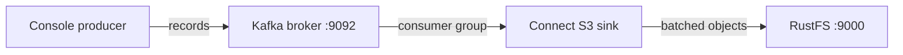

このガイドでは、分散イベントストリーミング基盤である [Apache Kafka](https://github.com/apache/kafka) を、Kafka Connect の S3 シンクコネクタを通じて **RustFS** に接続します。KRaft ブローカーと Connect ワーカーを実行し、トピック向けに S3 シンクをデプロイして、レコードを生成し RustFS バケット内のオブジェクトとして書き込みます。この流れは `apache/kafka:4.0.0`、`confluentinc/kafka-connect-s3` v10.5.25、`rustfs/rustfs-x86-musl:v2.3.1` で検証済みです。

Kafka の KIP-405 ティアードストレージには `RemoteLogStorageManager` プラグインが必要で、エコシステムにある S3 実装はベンダー独自です。Connect の S3 シンクは、トピックデータを S3 互換ストレージへ移すオープンでセルフホストの方法であり、このガイドで説明する方式です。

Docker が必要です。このデプロイはローカルでの統合テストを目的としており、本番環境向けではありません。

## アーキテクチャ



シンクタスクは専用のコンシューマーグループでトピックを消費し、パーティションごとに `flush.size` 件のレコードを 1 オブジェクトとしてバケットへ書き込みます。

## 1. ブローカーを実行する

他のコンテナから到達できるよう、アドバタイズするリスナーを設定した KRaft ブローカーを起動します。

```bash
docker run -d --name kafka --hostname kafka --network oo-rustfs_default \
  -e CLUSTER_ID=5L6g3nShT-eMCtK--X86sw \
  -e KAFKA_NODE_ID=1 \
  -e KAFKA_PROCESS_ROLES=broker,controller \
  -e KAFKA_LISTENERS=PLAINTEXT://:9092,CONTROLLER://:9093 \
  -e KAFKA_ADVERTISED_LISTENERS=PLAINTEXT://kafka:9092 \
  -e KAFKA_CONTROLLER_LISTENER_NAMES=CONTROLLER \
  -e KAFKA_LISTENER_SECURITY_PROTOCOL_MAP=CONTROLLER:PLAINTEXT,PLAINTEXT:PLAINTEXT \
  -e KAFKA_CONTROLLER_QUORUM_VOTERS=1@kafka:9093 \
  -e KAFKA_OFFSETS_TOPIC_REPLICATION_FACTOR=1 \
  -e KAFKA_TRANSACTION_STATE_LOG_REPLICATION_FACTOR=1 \
  -e KAFKA_TRANSACTION_STATE_LOG_MIN_ISR=1 \
  apache/kafka:4.0.0

docker exec kafka /opt/kafka/bin/kafka-topics.sh \
  --bootstrap-server localhost:9092 \
  --create --topic rustfs-topic --partitions 1 --replication-factor 1

rc mb rustfs/kafka-demo
```

イメージはデフォルトで `localhost:9092` をアドバタイズしますが、これはブローカーコンテナの内部からしか使えません。`KAFKA_ADVERTISED_LISTENERS` の上書きにより、Connect（およびリモートクライアント）がブローカーへ到達できます。

## 2. コネクタをインストールする

コネクタと依存関係をまとめた Confluent Hub のアーカイブをダウンロードし、ワーカーから見える場所へ展開します。

```bash
curl -Lo kafka-connect-s3.zip "https://hub-downloads.confluent.io/api/plugins/confluentinc/kafka-connect-s3/versions/10.5.25/confluentinc-kafka-connect-s3-10.5.25.zip"
unzip kafka-connect-s3.zip -d /opt/kafka-conn/plugins
```

## 3. ワーカーとシンクを設定する

ワーカーのプロパティを作成します。レコードをそのまま書き込むため、値コンバーターは `ByteArrayConverter` である必要があります。

```ini title="worker.properties"
bootstrap.servers=kafka:9092
key.converter=org.apache.kafka.connect.storage.StringConverter
value.converter=org.apache.kafka.connect.converters.ByteArrayConverter
offset.storage.file.filename=/tmp/connect.offsets
offset.flush.interval.ms=5000
plugin.path=/opt/kafka-conn-plugins
```

接続用のプレースホルダーをすべて置き換え、シンクコネクタの設定を作成します。

```ini title="rustfs-sink.properties"
name=rustfs-sink
connector.class=io.confluent.connect.s3.S3SinkConnector
tasks.max=1
topics=rustfs-topic
s3.bucket.name=kafka-demo
s3.region=us-east-1
store.url=http://<your-rustfs-endpoint>:9000
s3.path.style.access.enabled=true
flush.size=3
storage.class=io.confluent.connect.s3.storage.S3Storage
format.class=io.confluent.connect.s3.format.bytearray.ByteArrayFormat
consumer.override.auto.offset.reset=earliest
```

Kafka 4.0 ではクラスが `org.apache.kafka.connect.converters.ByteArrayConverter` に移りました。以前の `storage` パッケージパスは解決できなくなっています。

## 4. ワーカーを実行する

ログが `docker logs` に出るよう、`connect-standalone` をフォアグラウンドで実行します。バケットの認証情報は環境変数で渡します。

```bash
docker run -d --name kafka-connect --hostname kafka-connect \
  --network oo-rustfs_default \
  -v /opt/kafka-conn/plugins:/opt/kafka-conn-plugins:ro \
  -v "$PWD/worker.properties":/etc/kafka/worker.properties:ro \
  -v "$PWD/rustfs-sink.properties":/etc/kafka/sink.properties:ro \
  -e AWS_ACCESS_KEY_ID=<your-access-key> \
  -e AWS_SECRET_ACCESS_KEY=<your-secret-key> \
  apache/kafka:4.0.0 \
  /opt/kafka/bin/connect-standalone.sh /etc/kafka/worker.properties /etc/kafka/sink.properties
```

シンクタスクがパーティションを取得すると、ワーカーの準備は完了です。

```text
INFO [rustfs-sink|task-0] Assigned topic partitions: [rustfs-topic-0]
```

## 5. レコードを生成する

コネクタがバッチを完了できるよう、少なくとも `flush.size` 件のレコードを送ります。

```bash
docker exec kafka sh -c "printf 'msg-one\nmsg-two\nmsg-three\n' | \
  /opt/kafka/bin/kafka-console-producer.sh --bootstrap-server localhost:9092 --topic rustfs-topic"
```

数秒後、バッチはバケット内のオブジェクトになります。

```bash
rc ls rustfs/kafka-demo/ -r
rc cat rustfs/kafka-demo/topics/rustfs-topic/partition=0/rustfs-topic+0+0000000000.bin
```

```text
topics/rustfs-topic/partition=0/rustfs-topic+0+0000000000.bin
topics/rustfs-topic/partition=0/rustfs-topic+0+0000000003.bin
msg-one
msg-two
msg-three
```

オブジェクト名にはトピック、パーティション、開始オフセットが入ります。続く 3 件ずつのバッチは次のオブジェクト（`+0000000003.bin` 以降）に書き込まれます。


## 6. 停止またはリセットする

バケット内のオブジェクトを残したままデモを撤去します。

```bash
docker rm -f kafka-connect kafka
```

保存したデータを削除します。

```bash
rc rm rustfs/kafka-demo/ --recursive --force
```

## トラブルシューティング

### `AdminClient ... Rebootstrapping with Cluster (id: null)` が無限に繰り返される

ブローカーが `localhost:9092` をアドバタイズしているため、リモートクライアントは自分自身を指すメタデータを受け取ります。手順 1 のとおり `KAFKA_ADVERTISED_LISTENERS=PLAINTEXT://kafka:9092`（と対応するリスナー変数）を設定します。

### `Invalid schema type for ByteArrayConverter: STRING`

`ByteArrayFormat` ライターは生のバイトだけを受け付けます。ワーカーの `value.converter` を ByteArray コンバーターに切り替えるか、使用するコンバーターに合うフォーマットクラスを選びます。

### `Class org.apache.kafka.connect.storage.ByteArrayConverter could not be found`

Kafka 4.0 ではクラスが `org.apache.kafka.connect.converters.ByteArrayConverter` に移りました。`worker.properties` では新しいパッケージパスを使います。

### コネクタはダウンロードされるがプラグインが見つからない

Maven のコネクタ JAR 単体には依存関係が含まれません。手順 2 の Confluent Hub アーカイブを使い、完全な `lib/` ディレクトリをまとめて配置します。`plugin.path` はコネクタフォルダーを含むディレクトリを指す必要があります。

## 次のステップ

- 追加のコネクタを採用する前に、[S3 互換性ノート](/ja/administration/protocols/s3)を確認します。
- [アクセスキー管理](/ja/security-compliance/iam/access-token)で、本番用の専用認証情報を作成します。
- Parquet と Avro のフォーマット、時刻によるパーティショニング、IAM ベースの認証情報チェーンについては、[Kafka Connect S3 シンクのドキュメント](https://docs.confluent.io/kafka-connect-s3/current/index.html)に従います。
