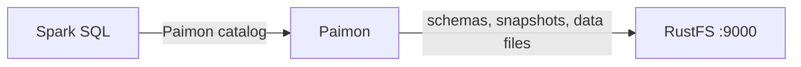

このガイドでは、ストリーミングレイクハウスのテーブルフォーマットである [Apache Paimon](https://github.com/apache/paimon) を、ウェアハウスストレージとして **RustFS** に接続します。Spark で RustFS バケット上に Paimon カタログを作成し、主キーテーブルを書き込んで読み戻します。この流れは Spark 3.5.6 上の Paimon 1.2.0 と `rustfs/rustfs-x86-musl:v2.3.1` で検証済みです。

Docker と `rc` クライアントが必要です。

## アーキテクチャ



Paimon はカタログのウェアハウス配下に、各テーブルを `schema/`、`snapshot/`、データファイルを含む `*.db` ディレクトリとして保存します。入出力はすべて Paimon 自身の S3 FileIO（`paimon-s3`）を経由し、Hadoop S3A は使いません。

## 1. Spark を実行する

```bash
docker run -d --name spark-paimon --hostname spark --network oo-rustfs_default \
  spark:3.5.6-scala2.12-java17-python3-ubuntu sleep infinity
docker cp paimon_test.sql spark-paimon:/tmp/paimon_test.sql
```

SQL ファイルを作成します（カタログオプションはファイル内ではなく、後述の CLI で渡します）。

```sql title="paimon_test.sql"
CREATE TABLE paimon.default.events (id INT, label STRING) TBLPROPERTIES ("primary-key"="id");
INSERT INTO paimon.default.events VALUES (1,'alpha'),(2,'beta'),(3,'gamma');
SELECT * FROM paimon.default.events ORDER BY id;
```

## 2. SQL スクリプトを実行する

必要なものは 3 つです。Spark 拡張、Paimon 自身の S3 FileIO（`paimon-s3`。Paimon のリーダーは Hadoop S3A の JAR を使いません）、カタログレベルの `s3.*` オプションです。

```bash
docker exec -u root spark-paimon bash -c "cd /opt/spark && \
  ./bin/spark-sql \
  --packages org.apache.paimon:paimon-spark-3.5:1.2.0,org.apache.paimon:paimon-s3:1.2.0,org.apache.hadoop:hadoop-aws:3.3.4 \
  --conf spark.sql.extensions=org.apache.paimon.spark.extensions.PaimonSparkSessionExtensions \
  --conf spark.sql.catalog.paimon=org.apache.paimon.spark.SparkCatalog \
  --conf spark.sql.catalog.paimon.warehouse=s3://paimon-demo/warehouse \
  --conf spark.sql.catalog.paimon.s3.endpoint=http://rustfs:9000 \
  --conf spark.sql.catalog.paimon.s3.access-key=<your-access-key> \
  --conf spark.sql.catalog.paimon.s3.secret-key=<your-secret-key> \
  --conf spark.sql.catalog.paimon.s3.path-style-access=true \
  -f /tmp/paimon_test.sql"
```

```text
Time taken: 9.447 seconds
1	alpha
2	beta
3	gamma
Time taken: 1.257 seconds, Fetched 3 row(s)
```

拡張の行がないと Paimon は `requiredSparkConfsCheck` エラーで即座に失敗します。`paimon-s3` がないと、カタログは `UnsupportedSchemeException: Could not find a file io implementation for scheme 's3'` で失敗します。

## 3. RustFS 内のオブジェクトを確認する

```bash
rc ls rustfs/paimon-demo/warehouse/ -r | head -6
```

```text
warehouse/default.db/events/schema/schema-0
warehouse/default.db/events/snapshot/snapshot-1
warehouse/default.db/events/bucket-0/data-...
warehouse/default.db/events/manifest/...
```

S3 バケットには、スキーマ、スナップショット、マニフェスト、Paimon バケットごとのデータファイルを含むレイクハウスのレイアウト全体が入ります。


## 4. 停止またはリセットする

```bash
docker rm -f spark-paimon
rc rm rustfs/paimon-demo/ --recursive --force
```

## トラブルシューティング

### `UnsupportedSchemeException: Could not find a file io implementation for scheme 's3'`

Paimon 自身の FileIO には、クラスパス上の S3 プラグインが必要です。Spark コネクタとあわせて `--packages` に `org.apache.paimon:paimon-s3:1.2.0` を追加します。

### `When using Paimon, it is necessary to configure spark.sql.extensions...`

`--conf spark.sql.extensions=org.apache.paimon.spark.extensions.PaimonSparkSessionExtensions` を追加します。これがないと Paimon は即座に失敗します。

### `SCHEMA_NOT_FOUND: The schema paimon cannot be found`

カタログが登録されていません。`spark.sql.catalog.paimon` として登録し、テーブル名は `paimon.` で修飾します。

### エグゼキューター側の S3 エラーで書き込みが失敗する

Paimon の FileIO が読むのはカタログレベルの `s3.*` オプション（`s3.endpoint`、`s3.access-key`、`s3.secret-key`、`s3.path-style-access`）です。Hadoop の `fs.s3a.*` 設定だけでは、エグゼキューター側のファイル操作には使われません。

## 次のステップ

- 同じバケット上のほかのレイクハウスフォーマットについては、[Iceberg](/ja/developer/integration/big-data/iceberg)、[Hudi](/ja/developer/integration/big-data/hudi)、[Delta Lake](/ja/developer/integration/big-data/delta-lake) のガイドと比較します。
- [アクセスキー管理](/ja/security-compliance/iam/access-token)で、本番用の専用認証情報を作成します。
- 同じバケット上でコンパクション、changelog プロデューサー、Flink のストリーミング書き込みを設定するには、[Paimon ドキュメント](https://paimon.apache.org/docs/master/)に従います。
