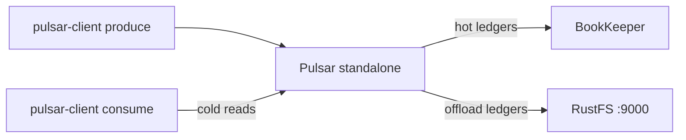

このガイドは、[Apache Pulsar](https://github.com/apache/pulsar) を階層化ストレージ（Tiered Storage）の S3 オフローダーを通じて **RustFS** に接続します。オフロード先を RustFS バケットに向けたスタンドアロンブローカーを実行し、メッセージを生成し、レジャーのオフロードをトリガーした後、オフロードされたメッセージをバケットから読み戻します。このワークフローは `apachepulsar/pulsar-all:4.0.4` で topic を RustFS にオフロードし、そこからコールドリードすることで検証しました。

Docker が必要です。このデプロイはローカルでの結合テスト用であり、本番環境向けではありません。

## アーキテクチャ



古いレジャーは `<offloader-id>-ledger-<n>` のデータブロックと小さな `-index` オブジェクトとしてバケットへアップロードされます。コンシューマーが BookKeeper に存在しないメッセージを要求すると、ブローカーは透過的にバケットから読み戻します。

## 1. オフロード設定付きでスタンドアロンブローカーを起動する

プレーンな `apachepulsar/pulsar` イメージにはオフローダーのパッケージが含まれず、`No offloader found for driver 'S3'` で失敗します。それらを含む `pulsar-all` イメージを使用してください。ブローカーのヒープは小さく制限しています：

```bash
docker run -d --name pulsar -p 6650:6650 -p 8080:8080 \
  -e ACCESS_KEY_ID=<your-access-key> \
  -e ACCESS_KEY_SECRET=<your-secret-key> \
  -e PULSAR_MEM="-Xms512m -Xmx512m" \
  --entrypoint bash apachepulsar/pulsar-all:4.0.4 -c '
    sed -i -e "s|^managedLedgerMaxEntriesPerLedger=.*|managedLedgerMaxEntriesPerLedger=100|" \
           -e "s|^managedLedgerMinLedgerRolloverTimeMinutes=.*|managedLedgerMinLedgerRolloverTimeMinutes=1|" \
           /pulsar/conf/standalone.conf
    printf "\nmanagedLedgerOffloadDriver=S3\nmanagedLedgerOffloadBucket=my-bucket\nmanagedLedgerOffloadServiceEndpoint=http://<your-rustfs-endpoint>:9000\nmanagedLedgerOffloadRegion=us-east-1\n" >> /pulsar/conf/standalone.conf
    exec bin/pulsar standalone -nss
  '
```

2 つの `managedLedger*` の編集はレジャーを小さくしてデモ内でロールが発生するようにするもので、追記したブロックがオフロードを有効化します。

:::note[ドライバー S3 が読むのは managedLedgerOffload* キー（s3ManagedLedgerOffload* ではない）]

ドライバー `S3` の場合、オフローダーは汎用キーの `managedLedgerOffloadBucket`・`managedLedgerOffloadServiceEndpoint`・`managedLedgerOffloadRegion` を解決します。`s3ManagedLedgerOffload*` という名前は `aws-s3` ドライバーのもので、ここでは無視されます。これらを使うとオフローダーは `NullPointerException: endpoint` でクラッシュします。認証情報も同様です。ドライバー `S3` は環境変数 `ACCESS_KEY_ID` と `ACCESS_KEY_SECRET` を読み、`AWS_*` のペアは読みません。

:::

ブローカーの起動を待ちます：

```bash
docker logs -f pulsar 2>&1 | grep -m1 "The ledger offloader was created"
```

## 2. メッセージを生成し、topic を存続させる

subscription のない topic は非アクティブ topic のクリーンアップによって数分で削除され、デモが途中で消えます。最初のバッチを生成した後、topic を登録し続ける永続的な subscription を作成します：

```bash
docker exec pulsar bin/pulsar-client produce -m "hello rustfs offload" -n 300 \
  persistent://public/default/rustfs-test
```

```text
300 messages successfully produced
```

```bash
timeout 30 docker exec pulsar bin/pulsar-client consume -s keepalive -n 1 -p Earliest \
  persistent://public/default/rustfs-test
```

## 3. レジャーをロールし、オフロードをトリガーする

レジャーは `managedLedgerMinLedgerRolloverTimeMinutes` の経過後に書き込みが発生してはじめてロールします。チェックは書き込み時に行われ、バックグラウンドでは行われません。1 分以上待ち、別のバッチを生成してロールを強制してから、最後の 1 KB より前のすべてをオフロードします：

```bash
sleep 65
docker exec pulsar bin/pulsar-client produce -m "rollover" -n 120 \
  persistent://public/default/rustfs-test
docker exec pulsar bin/pulsar-admin topics offload -s 1K \
  persistent://public/default/rustfs-test
```

```text
Offload triggered for persistent://public/default/rustfs-test for messages before 11:0:-1
```

オフロードには時間がかかります。完了を待ちます：

```bash
sleep 30
docker exec pulsar bin/pulsar-admin topics offload-status \
  persistent://public/default/rustfs-test
```

```text
Offload was a success
```

レジャーのオブジェクトが RustFS に着いたことを確認します。データブロックとインデックスがバケットのルートに置かれます：

```bash
aws s3 ls s3://my-bucket/ --recursive \
  --endpoint-url http://<your-rustfs-endpoint>:9000 | grep ledger
```

```text
2026-10-25 02:34:49      21057 7f9379cc-c21d-4829-a857-4c39ec02e391-ledger-9
2026-10-25 02:34:49        214 7f9379cc-c21d-4829-a857-4c39ec02e391-ledger-9-index
```

## 4. オフロード済みメッセージを読み戻す

新しい subscription で最古の位置から消費します。最初のレジャーはもう RustFS にしか存在しないため、ブローカーが返すすべてのメッセージがバケットからのコールドリードです：

```bash
timeout 90 docker exec pulsar bin/pulsar-client consume -s coldread -n 420 -p Earliest \
  persistent://public/default/rustfs-test 2>&1 | grep -c "^-----"
```

```text
420
```

420 件すべてのメッセージ（オフロード済みレジャーの 300 件とアクティブなレジャーの 120 件）がバケット経由で返ってきます。


## 5. 停止またはリセット

バケットのオブジェクトを残したままブローカーを解体するには：

```bash
docker rm -f pulsar
```

オフロード済みのレジャーを削除するには：

```bash
aws s3 rm s3://my-bucket/ --recursive --exclude "*" --include "*ledger*" \
  --endpoint-url http://<your-rustfs-endpoint>:9000
```

## トラブルシューティング

### `No offloader found for driver 'S3'. Please make sure you dropped the offloader nar packages`

イメージにオフローダーの NAR が含まれていません。手順 1 のとおり `apachepulsar/pulsar-all` を使用してください。

### オフロード時に `NullPointerException: endpoint`

オフローダーがサービスエンドポイントを読み取れていません。`managedLedgerOffload*` キーが欠けているか、`aws-s3` ドライバーの `s3ManagedLedgerOffload*` 名で書かれています。手順 1 のブロックを正確に追記して再起動してください。

### ブローカーログに `Couldn't get the access key id.`

ドライバー `S3` は `AWS_ACCESS_KEY_ID` を読みません。ブローカーコンテナで `ACCESS_KEY_ID` と `ACCESS_KEY_SECRET` をエクスポートしてください。

### デモ中に `Topic ... not found`

非アクティブ topic のクリーンアップが、subscription のない topic を削除しました。手順 2 をやり直し、`keepalive` subscription を維持してください。

### `Offload was a success` なのにオブジェクトが現れない

アップロードされるのはサイズしきい値より前の閉じたレジャーだけで、レジャーは最短ロール年齢を過ぎた後の次の書き込みでロールします。さらにバッチを生成してから、オフロードを再度トリガーしてください。

## 次のステップ

- namespace で自動オフロードしきい値を有効にする前に [S3 互換性についての注意](/administration/protocols/s3) を確認してください。
- [アクセスキー管理](/security-compliance/iam/access-token) で本番用の専用認証情報を作成してください。
- [Pulsar 階層化ストレージのドキュメント](https://pulsar.apache.org/docs/next/cookbooks-tiered-storage/) に従い、同じバケットで namespace のしきい値・保持ポリシー・マルチノードブローカーを利用してください。
