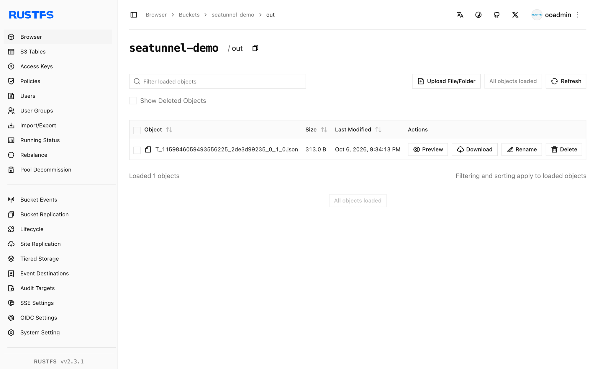

このガイドでは、データ統合エンジンである [Apache SeaTunnel](https://github.com/apache/seatunnel) を、S3File コネクタを通じて **RustFS** に接続します。FakeSource で行を生成し、JSON ファイルとして RustFS バケットへ書き込むバッチジョブを実行します。この流れは SeaTunnel 2.3.12 と `rustfs/rustfs-x86-musl:v2.3.1` で検証済みです。

Docker と `rc` クライアントが必要です。

## アーキテクチャ


S3File シンクは Hadoop S3A ファイルシステム経由で書き込むため、コネクタ独自の認証情報オプションと、標準の `fs.s3a.*` Hadoop キーの両方を受け付けます。

## 1. エンジンを実行する

コネクタと Hadoop AWS の JAR はイメージに同梱されています。

```bash
docker run --rm apache/seatunnel:2.3.12 \
  sh -c "ls /opt/seatunnel/connectors/ | grep s3; ls /opt/seatunnel/lib/ | grep hadoop-aws"
```

```text
connector-file-s3-2.3.12.jar
seatunnel-hadoop-aws.jar
```

## 2. ジョブ設定を書く

注意点は次のとおりです。シンクはコンパイル時に `access_key` と `secret_key` を検証しますが、実際の S3A クライアントが読むのは `fs.s3a.*` キーです。両方を指定し、エンドポイントはスキームなしにします。同梱の Hadoop バージョンは `http://` のエンドポイントを拒否します。

```text title="seatunnel-rustfs.conf"
env {
  parallelism = 1
  job.mode = "BATCH"
}

source {
  FakeSource {
    plugin_output = "fake"
    row.num = 5
    schema = {
      fields {
        id = "int"
        name = "string"
        value = "double"
      }
    }
  }
}

sink {
  S3File {
    bucket = "s3a://seatunnel-demo"
    access_key = "<your-access-key>"
    secret_key = "<your-secret-key>"
    fs.s3a.endpoint = "<your-rustfs-endpoint>:9000"
    fs.s3a.access.key = "<your-access-key>"
    fs.s3a.secret.key = "<your-secret-key>"
    fs.s3a.aws.credentials.provider = "org.apache.hadoop.fs.s3a.SimpleAWSCredentialsProvider"
    fs.s3a.connection.ssl.enabled = "false"
    file_format_type = "json"
    path = "/out"
  }
}
```

## 3. ジョブを実行する

```bash
docker run --rm --network oo-rustfs_default \
  -v "$PWD/seatunnel-rustfs.conf":/task.conf:ro \
  apache/seatunnel:2.3.12 \
  sh -c "cd /opt/seatunnel && ./bin/seatunnel.sh --config /task.conf -e local"
```

```text
2026-10-07 ... INFO  ... Submit job finished, job id: 1159846059493556225
```

## 4. RustFS 内のオブジェクトを確認する

```bash
rc ls rustfs/seatunnel-demo/out/
rc cat rustfs/seatunnel-demo/out/T_1159846059493556225_2de3d99235_0_1_0.json | head -1
```

```text
out/T_1159846059493556225_2de3d99235_0_1_0.json
{"id":168282592,"name":"ELyqD","value":1.594479327987022E308}
```

FakeSource の 5 行が、バケット内の 1 つの JSON ファイルになりました。



## 5. 停止またはリセットする

`-e local` モードの SeaTunnel はステートレスです。出力を削除します。

```bash
rc rm rustfs/seatunnel-demo/ --recursive --force
```

## トラブルシューティング

### `Plugin PluginIdentifier{... pluginName='S3'} not found`

シンククラスは `S3` ではなく `S3File` として登録されています。

### `There are unconfigured options, the options('access_key', 'secret_key') are required`

`fs.s3a.*` キーがあっても、S3File シンクには独自の `access_key` と `secret_key` オプションが必要です。手順 2 のとおり両方の組を指定します。

### `No AWS Credentials provided by InstanceProfileCredentialsProvider`

コーディネーター側の S3A クライアントは、`fs.s3a.aws.credentials.provider` と `fs.s3a.access.key` / `fs.s3a.secret.key` の組が無いため、インスタンスプロファイルのプロバイダーへフォールバックしました。手順 2 のとおり 3 つすべてを追加します。

### `doesBucketExist` でジョブがハングする

同梱の Hadoop バージョンは `http://` スキームのエンドポイントを拒否します。`fs.s3a.endpoint` には `host:port` 形式だけを使い、`fs.s3a.connection.ssl.enabled = "false"` を追加します。

## 次のステップ

- 追加の SeaTunnel コネクタを採用する前に、[S3 互換性ノート](/ja/administration/protocols/s3)を確認します。
- [アクセスキー管理](/ja/security-compliance/iam/access-token)で、本番用の専用認証情報を作成します。
- Parquet / ORC フォーマット、パーティション書き込み、対応する S3File ソースについては、[SeaTunnel S3File のドキュメント](https://seatunnel.apache.org/docs/connector-v2/sink/S3File)に従います。
