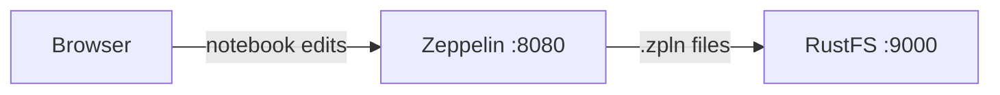

このガイドでは、データ分析向けの Web ベースのノートブックである [Apache Zeppelin](https://github.com/apache/zeppelin) を、Zeppelin の S3 ノートブックストレージを通じて **RustFS** に接続します。RustFS バケットを指すように Zeppelin を起動し、ノートを作成して、ノートブックファイルが RustFS に保存され再起動後も残ることを確認します。この流れは `apache/zeppelin:0.12.0` と `rustfs/rustfs-x86-musl:v2.3.1` で検証済みです。

Docker が必要です。このデプロイはローカルでの統合テストを目的としており、本番環境向けではありません。

## アーキテクチャ



ストレージクラスが `S3NotebookRepo` の場合、各ノートはバケットの `user/notebook/` プレフィックス配下に `.zpln` JSON ファイルとして永続化されます。Zeppelin はバケットを直接読み書きするため、ノートはコンテナの再起動後も残り、インスタンス間で共有できます。

## 1. Zeppelin を起動する

環境ファイルを作成し、両方の認証情報プレースホルダーを置き換えます。

```ini title=".env"
AWS_ACCESS_KEY_ID=<your-access-key>
AWS_SECRET_ACCESS_KEY=<your-secret-key>
```

S3 ストレージの設定を付け、RustFS と同じ Docker ネットワーク上で Zeppelin を起動します。

```bash
docker run -d --name zeppelin --network oo-rustfs_default \
  -p 8080:8080 \
  -e AWS_ACCESS_KEY_ID \
  -e AWS_SECRET_ACCESS_KEY \
  -e ZEPPELIN_NOTEBOOK_STORAGE=org.apache.zeppelin.notebook.repo.S3NotebookRepo \
  -e ZEPPELIN_NOTEBOOK_S3_BUCKET=my-bucket \
  -e ZEPPELIN_NOTEBOOK_S3_ENDPOINT=http://rustfs:9000 \
  -e ZEPPELIN_NOTEBOOK_S3_PATH_STYLE_ACCESS=true \
  apache/zeppelin:0.12.0
```

Zeppelin は `ZEPPELIN_*` 環境変数を設定プロパティとして読むため、`zeppelin-site.xml` の編集は不要です。このガイドでは既存の `my-bucket` を使います。ノートは `user/notebook/` プレフィックス配下に置かれ、このプレフィックスは S3 ストレージが必要に応じて作成します。

## 2. ノートを作成する

`http://localhost:8080` の UI を待ち、ノートブック一覧で `rustfs-demo` という名前のノートを作成してパラグラフを追加するか、REST API を使います。

```bash
NOTE=$(curl -s -X POST "http://localhost:8080/api/notebook" \
  -H "Content-Type: application/json" \
  -d '{"name": "rustfs-demo"}' | python3 -c "import json,sys; print(json.load(sys.stdin)['body'])")
echo "note id: $NOTE"
```

## 3. RustFS 内のノートブックを確認する

ノートブックのプレフィックスを一覧します。

```bash
rc ls rustfs/my-bucket/user/notebook/ -r
```

ノートは、ノート名と ID からなる JSON ファイルとして保存されます。

```text
user/notebook/rustfs-demo_2N4PY7UY5.zpln
```


Zeppelin はバケットからノートを読み込むため、再起動後もノートは残ります。

```bash
docker restart zeppelin
curl -s "http://localhost:8080/api/notebook" | head -c 200
```

再起動後のノート一覧には、再び `2N4PY7UY5` が含まれます。

## 4. デプロイを停止またはリセットする

ノートを残したまま Zeppelin を停止します。

```bash
docker rm -f zeppelin
```

ノートは `my-bucket` の `user/notebook/` プレフィックスに残ります。削除する場合はプレフィックスを取り除きます。

```bash
rc rm rustfs/my-bucket/user/notebook/ --recursive --force
```

## トラブルシューティング

### Zeppelin は起動するがノートがバケットに現れない

3 つの `ZEPPELIN_NOTEBOOK_S3_*` 変数が設定され、認証情報の環境変数がコンテナに届いていることを確認します。S3 リポジトリは起動時に初期化されるため、変更後はコンテナを再作成する必要があります。

### `UnknownHostException: my-bucket.rustfs`

パススタイルアクセスのフラグが反映されていません。`ZEPPELIN_NOTEBOOK_S3_PATH_STYLE_ACCESS=true` を表示どおり維持します。パススタイルアクセスを無効にすると、Zeppelin はバケットをホスト名として扱います。

## 次のステップ

- 追加の Zeppelin 操作を採用する前に、[S3 互換性ノート](/ja/administration/protocols/s3)を確認します。
- [アクセスキー管理](/ja/security-compliance/iam/access-token)で、本番用の専用認証情報を作成します。
- ユーザーごとのプレフィックスでノートを整理するには、[Zeppelin ストレージのドキュメント](https://zeppelin.apache.org/docs/latest/setup/storage/storage.html#notebook-storage-in-s3)に従います。
