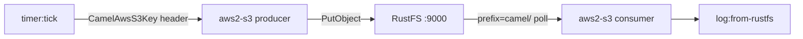

このガイドは、多用途の統合フレームワーク [Apache Camel](https://github.com/apache/camel) を S3 コンポーネント経由で **RustFS** に接続します。YAML で 2 つのルートからなる統合を記述します。タイマーでメッセージをバケットに書き込むプロデューカールートと、それらのオブジェクトを読み戻してログに出力するコンシューマールートです。このワークフローは `eclipse-temurin:21-jdk` 上の Camel JBang で、エンドポイントを上書きした `aws2-s3` コンポーネントとパススタイル addressing を使って検証しました。

Docker が必要です。このデプロイはローカルでの結合テスト用であり、本番環境向けではありません。

## アーキテクチャ



Camel JBang はルートファイルを直接実行し、S3 コンポーネントの依存関係を自動解決します。プロジェクトの雛形作成もビルドもデプロイも不要です。

## 1. 統合ルートを書く

ルートファイルを作成します。認証情報はデフォルトの AWS 認証情報チェーン（環境変数）から取得するため、URI は addressing 情報のみを持ちます：

```yaml title="route.yaml"
- from:
    uri: "timer:tick"
    parameters:
      period: "5000"
    steps:
      - setBody:
          simple: "Hello from Camel at ${date:now:yyyy-MM-dd HH:mm:ss}"
      - setHeader:
          name: "CamelAwsS3Key"
          simple: "camel/hello-${date:now:HHmmss}.txt"
      - to:
          uri: "aws2-s3://my-bucket?overrideEndpoint=true&uriEndpointOverride=http://<your-rustfs-endpoint>:9000&forcePathStyle=true&useDefaultCredentialsProvider=true"
- from:
    uri: "aws2-s3://my-bucket?prefix=camel/&deleteAfterRead=false&maxMessagesPerPoll=5&overrideEndpoint=true&uriEndpointOverride=http://<your-rustfs-endpoint>:9000&forcePathStyle=true&useDefaultCredentialsProvider=true"
    steps:
      - to:
          uri: "log:from-rustfs"
```

プロデューサーは `CamelAwsS3Key` ヘッダーでオブジェクトキーを設定します。ここではメッセージごとのタイムスタンプを使うため、ティックごとに新しいオブジェクトが書き込まれます。コンシューマーは `deleteAfterRead=false` で `camel/` プレフィックスをポーリングし、オブジェクトは消費後もバケットに残ります。

:::note[コンポーネント名とエンドポイントオプション]

このワークフローで Camel JBang が解決するコンポーネントは `aws2-s3` です。`overrideEndpoint=true` がカスタムエンドポイントを有効化し、`uriEndpointOverride` がその URL を担い、`forcePathStyle=true` が RustFS が期待するパススタイル addressing を選択します。`useDefaultCredentialsProvider=true` により、コンポーネントは標準の環境変数から認証情報を読み取ります。

:::

## 2. Camel JBang でルートを実行する

認証情報をエクスポートしたコンテナで統合を実行します。JBang は初回使用時に信頼を求めるため、起動前に信頼ルールを追加します：

```bash
docker run --rm --network bridge \
  -e AWS_ACCESS_KEY_ID=<your-access-key> \
  -e AWS_SECRET_ACCESS_KEY=<your-secret-key> \
  -e AWS_REGION=us-east-1 \
  -v "$PWD:/routes" \
  --entrypoint bash eclipse-temurin:21-jdk -c '
    export JBANG_DIR=/root/.jbang PATH=/root/.jbang/bin:$PATH
    curl -Ls https://sh.jbang.dev | bash >/dev/null 2>&1
    jbang trust add https://github.com/apache/ 2>/dev/null || true
    jbang trust add /routes 2>/dev/null || true
    cd /routes && jbang camel@apache/camel run route.yaml
  '
```

最初の実行で Camel ランタイムと依存関係がダウンロードされ、ルートが起動します。コンシューマーは読み取ったオブジェクトごとにログを出力します：

```text
2026-10-25 02:02:41.069  INFO 120 --- [-s3://my-bucket] from-rustfs : Exchange[ExchangePattern: InOnly, BodyType: byte[], Body: Hello from Camel at 2026-10-25 02:02:38]
```

## 3. オブジェクトを確認する

プロデューサーのオブジェクトが RustFS に存在することを確認します。接続プレースホルダーをすべて置き換えてください：

```bash
aws s3 ls s3://my-bucket/camel/ \
  --endpoint-url http://<your-rustfs-endpoint>:9000
```

```text
2026-10-25 02:02:13         39 hello-020213.txt
2026-10-25 02:02:18         39 hello-020218.txt
2026-10-25 02:02:23         39 hello-020223.txt
```


## 4. 停止またはリセット

コンテナを停止するとルートが終了します。デモのオブジェクトを削除するには：

```bash
aws s3 rm s3://my-bucket/camel --recursive \
  --endpoint-url http://<your-rustfs-endpoint>:9000
```

## トラブルシューティング

### `Cannot find component with name: aws-s3`

お使いの Camel バージョンは別名でコンポーネントを解決します。このワークフローは `aws2-s3` を使います。ランタイムが提案リスト（`Did you mean: ... aws2-s3 ...`）で示す名前を使ってください。

### `is not from a trusted source`

JBang は信頼できないコードの実行を拒否します。手順 2 のとおり、`jbang camel@apache/camel run` の前に `jbang trust add https://github.com/apache/` と `jbang trust add /routes` を実行してください。

### `useDefaultCredentialsProvider is set to false`

コンポーネントが URI 内に認証情報の設定を見つけられませんでした。`useDefaultCredentialsProvider=true` を追加して `AWS_ACCESS_KEY_ID` と `AWS_SECRET_ACCESS_KEY` をエクスポートするか、`accessKey`・`secretKey` エンドポイントオプションを直接設定してください。

### コンシューマーが何も読み取らない

コンシューマーは `prefix=camel/` で指定されたプレフィックスのみをポーリングします。プロデューサーが動いたこと（`timer` のログ行）と、その `CamelAwsS3Key` ヘッダーが `camel/` で始まることを確認してください。

## 次のステップ

- マルチパートやストリーミング操作を採用する前に [S3 互換性についての注意](/administration/protocols/s3) を確認してください。
- [アクセスキー管理](/security-compliance/iam/access-token) で本番用の専用認証情報を作成してください。
- [Camel S3 コンポーネントのドキュメント](https://camel.apache.org/components/latest/aws2-s3-component.html) に従い、同じルートでダウンロード範囲・バケット操作・コンシューマーのチューニングを利用してください。
