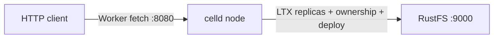

このガイドでは、Denoland のセルフホスト型で分散した Durable Objects ランタイムである [celld](https://github.com/denoland/celld) を、フリートバケットとして **RustFS** に接続します。RustFS のバケットに対して `celld diagnose` を実行し（条件付き書き込みのプローブを含む）、Counter ワーカーをデプロイし、HTTP 経由で Durable Object の状態を変更し、celld を再起動して状態が残ることを確認します。この流れは celld v0.6.2 を `rustfs/rustfs-x86-musl:v2.3.1` に対して検証済みです。

`celld` バイナリ、バンドル用の `esbuild`、デプロイしたワーカーを操作するための Node.js が必要です。

## アーキテクチャ



celld がローカルに持つのは WAL だけです。コミットされた SQLite の書き込みはすべて LTX 形式で捕捉され、フリートバケットへアップロードされます。条件付きのバケット書き込み（put-if-not-exists、存在しない場合のみ書き込み）がノードの所有権を割り当てます。バケットが正本であり、ノードがクラッシュしたり再起動したりしても Durable Object の状態は失われません。

## 1. celld をインストールする

```bash
curl -sLo /tmp/celld.gz \
  https://github.com/denoland/celld/releases/download/v0.6.2/celld-x86_64-unknown-linux-gnu.gz
gunzip /tmp/celld.gz && chmod +x /tmp/celld
mv /tmp/celld /usr/local/bin/celld
celld --version
```

```text
celld 0.6.2
```

esbuild もインストールします。`celld deploy` はこれでワーカーをバンドルします。

```bash
npm install -g esbuild
```

## 2. バケットを診断する

`celld diagnose` は、所有権フェンシングに celld が必要とする条件付き書き込みを含め、バケットをプローブします。

```bash
export S3_ENDPOINT=http://<your-rustfs-endpoint>:9000
export AWS_REGION=us-east-1
export AWS_ACCESS_KEY_ID=<your-access-key>
export AWS_SECRET_ACCESS_KEY=<your-secret-key>

rc mb rustfs/celld-demo
celld diagnose --bucket s3://celld-demo
```

```text
ok listen 127.0.0.1:18080: bind check; diagnose does not serve
ok bucket s3://celld-demo
ok bucket conditional write: create, reject-create, update, reject-stale
ok fleet: 0 node lease(s) enumerated
```

重要なのは `ok bucket conditional write` の行です。RustFS は put-if-not-exists をネイティブにサポートするため、フォールバック用のストレージは不要です。

## 3. ノードを起動する

ループバック以外の `--listen` には、明示的な `--internal-listen` が必要です。

```bash
nohup celld --bucket s3://celld-demo \
  --listen 0.0.0.0:18080 \
  --internal-listen 0.0.0.0:9099 \
  --advertise 127.0.0.1:9099 > /opt/celld/celld.out 2>&1 &
```

```text
INFO celld: host runtime initialized event="host_runtime" worker_count=4
INFO celld::fleet: no deployment yet; run `celld deploy` ...
```

## 4. Counter ワーカーをデプロイする

celld リポジトリの counter サンプルを使います。リクエストのたびに SQLite ストレージ内の `n` を増やす Durable Object です。

```bash
curl -sLo /tmp/celld.zip https://codeload.github.com/denoland/celld/zip/refs/tags/v0.6.2
unzip /tmp/celld.zip -d /opt/celld
cd /opt/celld/celld-0.6.2/examples/counter
celld deploy . --bucket s3://celld-demo
```

```text
Uploaded counter (0.02 sec)
  s3://celld-demo/deploy/counter/bf5806589892a6cc
Current Version ID: bf5806589892a6cc
```

## 5. Durable Object の状態を変更する

各リクエストは `Counter` Durable Object へルーティングされます。ストレージから `n` を読み、インクリメントして書き戻します。

```bash
curl -s "http://127.0.0.1:18080/?name=rustfs"
curl -s "http://127.0.0.1:18080/?name=rustfs"
curl -s "http://127.0.0.1:18080/?name=rustfs"
```

```json
{"n":1,"url":"http://127.0.0.1:18080/?name=rustfs"}
{"n":2,"url":"http://127.0.0.1:18080/?name=rustfs"}
{"n":3,"url":"http://127.0.0.1:18080/?name=rustfs"}
```

## 6. celld を再起動して永続化を確認する

ノードを停止して再起動し、同じ URL にアクセスします。状態はずっと RustFS にあったため、カウンターは停止したところから続きます。

```bash
pkill -f "celld --bucket"
nohup celld --bucket s3://celld-demo \
  --listen 0.0.0.0:18080 --internal-listen 0.0.0.0:9099 \
  --advertise 127.0.0.1:9099 > /opt/celld/celld2.out 2>&1 &
sleep 8
curl -s "http://127.0.0.1:18080/?name=rustfs"
```

```json
{"n":4,"url":"http://127.0.0.1:18080/?name=rustfs"}
```

バケットを一覧します。フリートの状態がすべて入っています。

```bash
rc ls rustfs/celld-demo/ -r | head -5
```

```text
cells/Counter:f2806128.../ltx/e1/0000/0000000000000001-0000000000000001.ltx
cells/Counter:f2806128.../own.json
deploy/counter/bf5806589892a6cc/index.js
deploy/counter/current.json
```


## 7. 停止またはリセットする

```bash
pkill -f "celld --bucket"
rc rm rustfs/celld-demo/ --recursive --force
```

## トラブルシューティング

### `bind --listen 127.0.0.0.1:8080 ... Address already in use`

ポート 8080 はよく使われています（ローカルの GitLab レジストリや開発サーバーなど）。Worker のリスナーを移します。`--listen 0.0.0.0:18080` です。

### `a non-loopback --listen requires an explicit --internal-listen`

パブリックなインターフェースにバインドする場合は、別のピア用リスナーが必要です。`--internal-listen 0.0.0.0:9099 --advertise 127.0.0.1:9099` を追加します。

### `esbuild not found`

`celld deploy` は esbuild でワーカーをバンドルします。グローバルにインストールする（`npm install -g esbuild`）か、`CELLD_ESBUILD` でバイナリを指定します。

### サンプルで `celld deploy` すると実行時に `unknown command init for argo` と表示される

executor のコンテナまたは Pod が argoexec ではなく `argo` CLI のバイナリを実行していることを意味します。クラスター設定で誤ったイメージが executor としてタグ付けされている兆候であり、celld 自体とは関係ありません。クラスターのない通常のホストでは発生しません。

## 次のステップ

- [Cloudflare Durable Objects のドキュメント](https://developers.cloudflare.com/durable-objects/)と比較してください。celld は同じプログラミングモデルを、自前のバケット上で実行します。
- [アクセスキー管理](/ja/security-compliance/iam/access-token)で本番用の専用認証情報を作成してください。
- [celld の README](https://github.com/denoland/celld)に従い、マルチノードのフリートを構成します。2 台目のノードを同じバケットに向け、条件付き書き込みで所有者を選出します。
