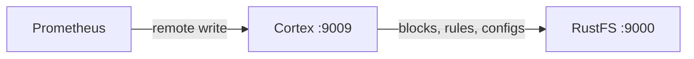

このガイドでは、水平スケール可能な Prometheus 互換のメトリクスバックエンドである [Cortex](https://github.com/cortexproject/cortex) を、Cortex ネイティブの S3 バケットストレージ経由で **RustFS** に接続します。ブロック、Ruler、Alertmanager のストレージを RustFS のバケットに向けたシングルバイナリモードで Cortex を実行し、リモートライトでメトリクスを push し、ルールグループを保存してオブジェクトを確認します。この流れは `cortexproject/cortex:v1.21.1` と `rustfs/rustfs-x86-musl:v2.3.1` で検証済みです。

Docker が必要です。このデプロイはローカルでの統合テストを目的としており、本番環境向けではありません。

## アーキテクチャ



Cortex はすべての TSDB ブロック、Ruler のルールグループ、Alertmanager の設定をオブジェクトストレージに保存します。`s3` バックエンドを RustFS に向けると、バケットがすべてのテナントデータの単一の正本になります。

## 1. Cortex の設定を作成する

接続情報のプレースホルダーをすべて置き換えて、設定ファイルを作成します。

```yaml title="cortex.yaml"
target: all
auth_enabled: false

server:
  http_listen_port: 9009

distributor:
  shard_by_all_labels: true
  pool:
    health_check_ingesters: true

ingester:
  lifecycler:
    min_ready_duration: 0s
    final_sleep: 0s
    num_tokens: 512
    ring:
      kvstore:
        store: inmemory
      replication_factor: 1

blocks_storage:
  backend: s3
  s3: &s3
    endpoint: <your-rustfs-endpoint>:9000
    region: us-east-1
    bucket_name: cortex
    access_key_id: <your-access-key>
    secret_access_key: <your-secret-key>
    insecure: true
    bucket_lookup_type: path
  tsdb:
    dir: /data/tsdb
    block_ranges_period: [15m]
    ship_interval: 30s
  bucket_store:
    sync_dir: /data/tsdb-sync
    bucket_index:
      enabled: true

compactor:
  data_dir: /data/compactor
  sharding_ring:
    kvstore:
      store: inmemory

ruler:
  enable_api: true
  rule_path: /data/ruler

ruler_storage:
  backend: s3
  s3:
    <<: *s3

alertmanager:
  external_url: /alertmanager
  enable_api: true
  data_dir: /data/alertmanager

alertmanager_storage:
  backend: s3
  s3:
    <<: *s3
```

Cortex のバケットフィールド名は `bucket_name` で、アドレス指定は `bucket_lookup_type: path` で制御します。`insecure: true` は平文 HTTP のエンドポイントを許可します。`block_ranges_period` と `ship_interval` はブロック周期を短くし、テストですぐにオブジェクトができるようにします。本番ではデフォルトを維持してください。

## 2. Cortex を実行する

バケットを作成し、RustFS と同じ Docker ネットワーク上で Cortex を起動します。

```bash
rc mb rustfs/cortex

docker run -d --name cortex --network oo-rustfs_default -p 9009:9009 \
  -v "$PWD/cortex.yaml":/etc/cortex/cortex.yaml:ro \
  -v /opt/cortex/data:/data \
  cortexproject/cortex:v1.21.1 -config.file=/etc/cortex/cortex.yaml
```

```text
ts=... caller=cortex.go:469 level=info msg="Cortex started"
```

## 3. メトリクスとルールを push する

自身をスクレイプし、Cortex へリモートライトする Prometheus を起動します。

```yaml title="prometheus.yml"
global:
  scrape_interval: 5s
scrape_configs:
  - job_name: self
    static_configs:
      - targets: ["localhost:9090"]
remote_write:
  - url: http://cortex:9009/api/v1/push
```

```bash
docker run -d --name prom-writer --network oo-rustfs_default \
  -v "$PWD/prometheus.yml":/etc/prometheus/prometheus.yml:ro \
  prom/prometheus:latest --config.file=/etc/prometheus/prometheus.yml
```

Ruler API でルールグループを保存します。

```bash
cat > rules.yaml << "EOF"
name: rustfs-demo
rules:
  - alert: RustFSAlwaysFiring
    expr: vector(1)
    labels:
      severity: demo
    annotations:
      summary: "demo alert stored in RustFS"
EOF

curl -s -o /dev/null -w "%{http_code}\n" \
  -X POST http://localhost:9009/api/v1/rules/rustfs-demo \
  --data-binary @rules.yaml -H "Content-Type: application/yaml"
```

```text
202
```

取り込んだ系列をクエリして読み戻します。

```bash
curl -s "http://localhost:9009/prometheus/api/v1/query?query=up"
```

```text
{"status":"success","data":{"resultType":"vector","result":[{"metric":{"__name__":"up",...},"value":[...,"1"]}]}}
```

## 4. RustFS 内のオブジェクトを確認する

バケットのプレフィックスを一覧します。

```bash
rc ls rustfs/cortex/ -r
```

Ruler の設定はすぐに保存され、ingester は 2 つの TSDB ブロックを送出しました（それぞれ `chunks`、`index`、`meta.json` を持ちます）。

```text
fake/01M35WE4B1G6RRKHRV0HSGADY1/chunks/000001
fake/01M35WE4B1G6RRKHRV0HSGADY1/index
fake/01M35WE4B1G6RRKHRV0HSGADY1/meta.json
fake/01M35WWS2YCC7FBK1JSBKFQGRP/chunks/000001
fake/01M35WWS2YCC7FBK1JSBKFQGRP/index
fake/01M35WWS2YCC7FBK1JSBKFQGRP/meta.json
rules/fake/cnVzdGZzLWRlbW8=/cnVzdGZzLWRlbW8=
```


## 5. 停止またはリセットする

バケット内のオブジェクトを残したままデモを破棄します。

```bash
docker rm -f cortex prom-writer
```

保存したデータを削除します。

```bash
rc rm rustfs/cortex/ --recursive --force
```

## トラブルシューティング

### `field bucket not found in type s3.Config`

Cortex が使うのは `bucket` ではなく `bucket_name` です。パススタイルアクセスは `bucket_lookup_type: path` で設定します。Thanos で使う `force_path_style` キーは Cortex にはありません。

### ブロックがバケットに現れない

ingester は、ヘッドが `block_ranges_period` の境界（デフォルト 2 時間）でコンパクトされたあとでなければブロックを送出しません。テストでは `[15m]` のような短い範囲と `ship_interval: 30s` を設定し、1 周期待ちます。

### `Unauthorized` または空のバケット一覧

バケットを使うすべての `s3` ブロックに `access_key_id` と `secret_access_key` があること、および `insecure: true` が平文 HTTP のエンドポイントと一致することを確認します。

## 次のステップ

- 追加の Cortex ストレージオプションを採用する前に、[S3 互換性ノート](/ja/administration/protocols/s3)を確認してください。
- [アクセスキー管理](/ja/security-compliance/iam/access-token)で本番用の専用認証情報を作成してください。
- 長期の Prometheus データ向けのブロックストレージも必要な場合は、Cortex を [Thanos](/ja/developer/integration/observability/thanos) と組み合わせてください。
