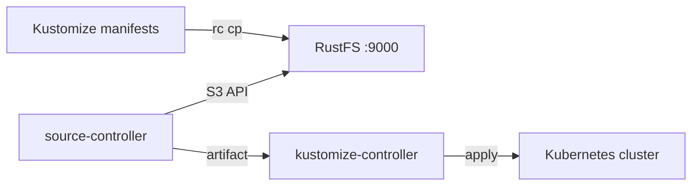

このガイドでは、Kubernetes 向け GitOps ツールキットである [Flux CD](https://github.com/fluxcd/flux2) を、source-controller の Bucket API 経由で **RustFS** に接続します。Kubernetes マニフェストを RustFS のバケットに配置し、`generic` プロバイダーの Flux `Bucket` ソースとして登録し、Kustomization で含まれる内容をすべて適用します。この流れは `k3s v1.36.4+k3s1` 上の `flux v2.9.5`（source-controller）を `rustfs/rustfs-x86-musl:v2.3.1` に対して検証済みです。

Flux をインストールした Kubernetes クラスター（`flux install`）と、`rc` クライアントが必要です。このデプロイはローカルでの統合テストを目的としており、本番環境向けではありません。

## アーキテクチャ



source-controller は S3 API でバケット内のオブジェクトを一覧してダウンロードし、アーティファクトにまとめます。kustomize-controller はそのアーティファクトからマニフェストを適用します。RustFS はクラスターにとってプル型の正本になります。

## 1. バケットに初期データを入れる

接続情報のプレースホルダーをすべて置き換え、Kustomize オーバーレイをバケットに保存します。

```yaml title="clusters/staging/kustomization.yaml"
apiVersion: kustomize.config.k8s.io/v1beta1
kind: Kustomization
resources:
  - rustfs-demo-configmap.yaml
```

```yaml title="clusters/staging/rustfs-demo-configmap.yaml"
apiVersion: v1
kind: ConfigMap
metadata:
  name: rustfs-flux-demo
  namespace: default
data:
  storage: rustfs
  source: s3-bucket
```

ファイルをアップロードします。

```bash
rc mb rustfs/flux-src
rc cp --recursive ./clusters rustfs/flux-src/
rc ls rustfs/flux-src/ -r
```

```text
staging/kustomization.yaml
staging/rustfs-demo-configmap.yaml
```

## 2. 認証情報の Secret を作成する

Flux は、ソースと同じ名前空間の Secret から、小文字のキーで認証情報を読みます。

```bash
kubectl -n flux-system create secret generic rustfs-creds \
  --from-literal=accesskey=<your-access-key> \
  --from-literal=secretkey=<your-secret-key>
```

フィールド名は `accesskey` と `secretkey` である必要があります。`accessKey` のような大文字を含む名前は `AuthenticationFailed` ステータスで失敗します。

## 3. Bucket ソースを登録する

`generic` プロバイダーで Bucket ソースを作成します。

```bash
flux create source bucket rustfs-demo \
  --bucket-name=flux-src \
  --endpoint=<your-rustfs-endpoint>:9000 \
  --insecure \
  --secret-ref=rustfs-creds \
  --provider=generic \
  --interval=30s \
  --namespace=flux-system
```

```text
✔ Bucket source reconciliation completed
```

リコンシリエーションがまだ実行中の場合は、`flux get sources bucket` でステータスを確認します。

```text
NAME        REVISION       SUSPENDED READY MESSAGE
rustfs-demo sha256:481816d1 False     True  stored artifact: revision 'sha256:481816d1'
```

`generic` プロバイダーは `--insecure` でパススタイルのリクエストと平文 HTTP を使います。そのためエンドポイントは `host:port` だけです。

## 4. マニフェストを適用する

アーティファクトを取り込む Kustomization を作成します。

```bash
flux create kustomization rustfs-demo \
  --source=Bucket/rustfs-demo \
  --path="./staging" \
  --prune=true \
  --interval=30s \
  --namespace=flux-system
```

```text
✔ applied revision sha256:481816d1
```

マニフェストがクラスターに反映されたことを確認します。

```bash
kubectl -n default get configmap rustfs-flux-demo -o jsonpath="{.data}"
```

```text
{"source":"s3-bucket","storage":"rustfs"}
```

## 5. 停止またはリセットする

バケットには触れずに、Flux リソースを一時停止または削除します。

```bash
flux suspend source bucket rustfs-demo --namespace=flux-system
flux delete kustomization rustfs-demo --namespace=flux-system
```

バケットの内容を削除します。

```bash
rc rm rustfs/flux-src/ --recursive --force
```

## トラブルシューティング

### `invalid 'rustfs-creds' secret data: required fields 'accesskey' and 'secretkey'`

Secret のキーは小文字です。`accesskey` と `secretkey` をリテラルのキー名として Secret を作り直します。

### リコンシリエーションが Ready にならない

エンドポイントがクラスター内から到達できることを確認します。Pod は `localhost` を使えません。ソースは、RustFS のポートを公開しているホストの IP、または Docker ブリッジのゲートウェイ（一般的には `172.17.0.1`）に向けます。平文 HTTP では `--insecure` が必要です。

### 認証情報が正しいのに `AuthenticationFailed` になる

Secret が Bucket ソースと同じ名前空間にあること、およびキーに末尾の空白や引用符がないことを確認します。

## 次のステップ

- 追加のソースタイプを採用する前に、[S3 互換性ノート](/ja/administration/protocols/s3)を確認してください。
- [アクセスキー管理](/ja/security-compliance/iam/access-token)で本番用の専用認証情報を作成してください。
- [Flux の Bucket ソースドキュメント](https://fluxcd.io/flux/components/source/buckets/)に従い、バケットソースを Helm リリースやイメージ自動化と組み合わせてください。
