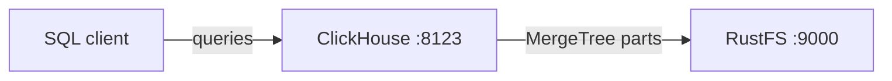
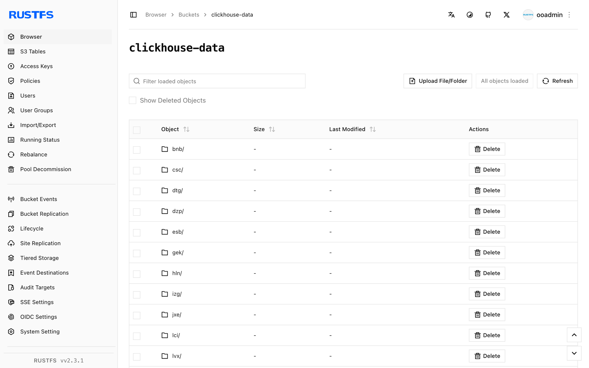

このガイドでは、リアルタイム OLAP データベースである [ClickHouse](https://github.com/ClickHouse/ClickHouse) を、ClickHouse の S3 ディスクストレージポリシーを通じて **RustFS** に接続します。Docker で ClickHouse サーバーを起動し、パーツを RustFS に保存する MergeTree テーブルを作成して行を挿入し、テーブルデータがバケットにあることを確認します。この流れは `clickhouse/clickhouse-server:25.8` と `rustfs/rustfs-x86-musl:v2.3.1` で検証済みです。

Docker が必要です。このデプロイはローカルでの統合テストを目的としており、本番環境向けではありません。

## アーキテクチャ



`rustfs` ディスクは、`clickhouse-data` バケットを指す ClickHouse の S3 ディスクです。対応するストレージポリシーで作成したテーブルは、パーツ（データ、インデックス、チェックサムのファイル）をローカルファイルシステムではなくバケットへ書き込みます。

## 1. プロジェクトファイルを作成する

先にバケットを作成します。ClickHouse はバケットを作成しません。

```bash
rc alias set rustfs http://<your-rustfs-endpoint>:9000 <your-access-key> <your-secret-key>
rc mb rustfs/clickhouse-data
```

両方の認証情報プレースホルダーを置き換え、ストレージ設定を作成します。

```xml title="storage.xml"
<clickhouse>
  <storage_configuration>
    <disks>
      <rustfs>
        <type>s3</type>
        <endpoint>http://rustfs:9000/clickhouse-data/</endpoint>
        <access_key_id><your-access-key></access_key_id>
        <secret_access_key><your-secret-key></secret_access_key>
      </rustfs>
    </disks>
    <policies>
      <rustfs_policy>
        <volumes>
          <main>
            <disk>rustfs</disk>
          </main>
        </volumes>
      </rustfs_policy>
    </policies>
  </storage_configuration>
</clickhouse>
```

エンドポイントは `/` で終わる必要があり、先頭のパスセグメントにバケット名を含めます。Compose ネットワーク内のホスト名は `rustfs` です。ホストからは `http://localhost:9000/clickhouse-data/` を使います。

設定をマウントして ClickHouse を起動します。

```bash
docker run -d --name clickhouse --network oo-rustfs_default \
  -p 8123:8123 \
  -e CLICKHOUSE_PASSWORD=<your-clickhouse-password> \
  -v "$PWD/storage.xml":/etc/clickhouse-server/config.d/storage.xml:ro \
  clickhouse/clickhouse-server:25.8
```

## 2. S3 ディスク上にテーブルを作成する

HTTP インターフェースを待ち、ストレージポリシー付きのデータベースと MergeTree テーブルを作成します。

```bash
curl "http://localhost:8123/?password=<your-clickhouse-password>" \
  --data-binary "CREATE DATABASE rustfs_demo"

curl "http://localhost:8123/?password=<your-clickhouse-password>" \
  --data-binary "CREATE TABLE rustfs_demo.events
    (id UInt32, name String)
    ENGINE = MergeTree ORDER BY id
    SETTINGS storage_policy = 'rustfs_policy'"

curl "http://localhost:8123/?password=<your-clickhouse-password>" \
  --data-binary "INSERT INTO rustfs_demo.events
    VALUES (1, 'clickhouse-on-rustfs'), (2, 'second')"
```

行を読み戻し、ClickHouse がパーツを `rustfs` ディスク上にあると報告することを確認します。

```bash
curl "http://localhost:8123/?password=<your-clickhouse-password>" \
  --data-binary "SELECT count(), any(name) FROM rustfs_demo.events"

curl "http://localhost:8123/?password=<your-clickhouse-password>" \
  --data-binary "SELECT name, disk_name FROM system.parts
    WHERE database = 'rustfs_demo' AND active"
```

```text
2  clickhouse-on-rustfs
all_1_1_0  rustfs
```

## 3. RustFS 内のオブジェクトを確認する

バケットを一覧します。

```bash
rc ls rustfs/clickhouse-data/ -r
```

ClickHouse は各パーツをコンテンツアドレス方式のブロブとして書き込みます。出力には複数の小さなオブジェクトが含まれ、パーツが増えると件数も増えます。

```text
dtg/hpsyncexixvdnsgorvseobogcgowg
dzp/zfblobhsatzdveqdrsfqcupkdehja
izg/gvhchqobrizpkdftuvlmakkoutwps
```



パーツは RustFS にあるため、データはコンテナの再起動後も残ります。

```bash
docker restart clickhouse
curl "http://localhost:8123/?password=<your-clickhouse-password>" \
  --data-binary "SELECT count() FROM rustfs_demo.events"
```

## 4. デプロイを停止またはリセットする

データを残したままサーバーを停止します。

```bash
docker rm -f clickhouse
```

パーツは `clickhouse-data` バケットに残り、次回起動後にテーブルを再びクエリできます。データを削除する場合はバケットを取り除きます。

```bash
rc rb rustfs/clickhouse-data --force
```

## トラブルシューティング

### すべてのクエリで `REQUIRED_PASSWORD` が出る

ClickHouse 25.8 のイメージでは、`default` ユーザーにパスワードが必要です。コンテナに `CLICKHOUSE_PASSWORD` を設定し、上記のとおり同じ値を `password` クエリパラメーターとして渡します。

### ディスクまたはエンドポイントのエラーでテーブル作成が失敗する

テーブル作成前にバケットが存在すること、エンドポイントが `/` で終わること、認証情報が RustFS のデプロイと一致することを確認します。根本の S3 エラーはサーバーログで確認します。

```bash
docker logs clickhouse | grep -i s3 | tail
```

## 次のステップ

- 追加の ClickHouse 操作を採用する前に、[S3 互換性ノート](/ja/administration/protocols/s3)を確認します。
- [アクセスキー管理](/ja/security-compliance/iam/access-token)で、本番用の専用認証情報を作成します。
- キャッシュディスクやホット / コールドの階層ポリシーを追加するには、[ClickHouse S3 ディスクのドキュメント](https://clickhouse.com/docs/engines/table-engines/mergetree-family/mergetree#table_engine-mergetree-s3)に従います。
