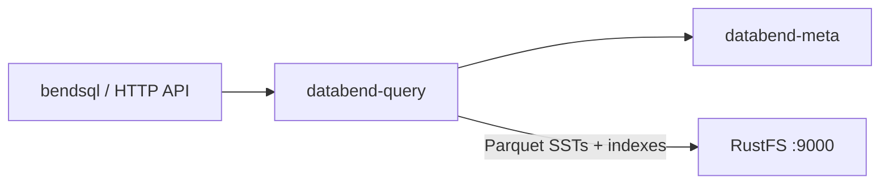

このガイドでは、オープンソースのクラウドデータウェアハウスである [Databend](https://github.com/datafuselabs/databend) を、オブジェクトストレージのバックエンドとして **RustFS** に接続します。メタサービスとクエリノードを起動し、ストレージのバックエンドを RustFS バケットに向け、データベースとテーブルを作成して、バケット内の Parquet ファイルを確認します。この流れは Databend v1.2.925-patch-13 と `rustfs/rustfs-x86-musl:v2.3.1` で検証済みです。

Linux ホスト（または Docker）上に Databend のリリースターボールが必要です。このデプロイはローカルでの統合テストを目的としており、本番環境向けではありません。

## アーキテクチャ



Databend はテーブルデータを、ブルームフィルターインデックス付きの Parquet ファイルとしてオブジェクトストレージに保存します。そのためバケットがテーブルデータセット全体を保持し、クエリノードはステートレスのままです。

## 1. ダウンロードしてインストールする

リリースターボールを取得し、バイナリを展開します。

```bash
curl -Lo /tmp/databend.tgz \
  "https://github.com/datafuselabs/databend/releases/download/v1.2.925-patch-13/databend-v1.2.925-patch-13-x86_64-unknown-linux-gnu.tar.gz"
tar -xzf /tmp/databend.tgz -C /opt
```

データディレクトリを作成します。

```bash
mkdir -p /opt/databend/data /opt/databend/logs /opt/databend/meta-logs
```

## 2. メタサービスを設定する

`databend-meta.toml` を作成します。トップレベルのアドレスと、`single = true` を含む `[raft_config]` セクションに注意します。

```toml title="databend-meta.toml"
admin_api_address = "0.0.0.0:28002"
grpc_api_address = "0.0.0.0:9191"
grpc_api_advertise_host = "127.0.0.1"

[log]
[log.file]
level = "INFO"
dir = "/opt/databend/meta-logs"

[raft_config]
id = 0
raft_dir = "/opt/databend/data/raft"
raft_api_port = 28004
raft_listen_host = "127.0.0.1"
raft_advertise_host = "127.0.0.1"
single = true
```

## 3. クエリノードを設定する

`databend-query.toml` を作成します。`tenant_id` と `cluster_id` は `[query]` セクション内に置く必要があり、`[storage.s3]` は RustFS を指します。

```toml title="databend-query.toml"
[query]
username = "databend"
tenant_id = "default"
cluster_id = "rustfs-demo"
flight_api_address = "127.0.0.1:9091"
metric_api_address = "127.0.0.1:7071"
admin_api_address = "127.0.0.1:8081"

[[query.users]]
name = "databend"
auth_type = "no_password"

[log]
[log.file]
dir = "/opt/databend/logs"

[meta]
endpoints = ["127.0.0.1:9191"]
username = "root"
password = "root"
client_timeout_in_second = 20
auto_sync_interval = 60

[storage]
type = "s3"

[storage.s3]
bucket = "databend-demo"
endpoint_url = "http://<your-rustfs-endpoint>:9000"
access_key_id = "<your-access-key>"
secret_access_key = "<your-secret-key>"
enable_virtual_host_style = false
```

すべてのキーは `[[query.users]]` 配列要素より前に置きます。TOML ではそれ以降が配列要素の一部として扱われ、キーの位置がずれると分かりにくい検証エラーになります。

## 4. サービスを起動する

```bash
nohup /opt/databend/bin/databend-meta -c /opt/databend/databend-meta.toml > /opt/databend/meta.out 2>&1 &
sleep 10
nohup /opt/databend/bin/databend-query -c /opt/databend/databend-query.toml > /opt/databend/query.out 2>&1 &
sleep 20
```

## 5. テーブルを作成してクエリする

Databend はポート 8000 で HTTP API を提供します。データベースとテーブルを作成し、行を挿入して読み戻します。SQL 内の引用符はシングルクォートである必要があります（ダブルクォートは識別子を意味します）。

```bash
curl -s -m 90 -u databend: http://127.0.0.1:8000/v1/query \
  -H "Content-Type: application/json" \
  -d '{"sql": "CREATE DATABASE rustfs_demo; CREATE TABLE rustfs_demo.events (id INT, label STRING);"}' | head -c 120

curl -s -m 120 -u databend: http://127.0.0.1:8000/v1/query \
  -H "Content-Type: application/json" \
  -d "{\"sql\": \"INSERT INTO rustfs_demo.events VALUES (1,'alpha'),(2,'beta'),(3,'gamma')\"}" | head -c 120

curl -s -m 120 -u databend: http://127.0.0.1:8000/v1/query \
  -H "Content-Type: application/json" \
  -d "{\"sql\": \"SELECT * FROM rustfs_demo.events ORDER BY id\"}" | head -c 300
```

```text
{"id":"...","state":"Succeeded",...,"data":[["1","alpha"],["2","beta"],["3","gamma"]],...}
```

## 6. RustFS 内のオブジェクトを確認する

バケットを一覧します。テーブルは、数値プレフィックス配下の Parquet ブロックとインデックスファイルとして存在します。

```bash
rc ls rustfs/databend-demo/ -r | head -4
```

```text
73/116/_b/h01a1192b11b07c38b9ae1178abc78882_v2.parquet
73/116/_i_b_v2/01a1192b11b07c38b9ae1178abc78882_v4.parquet
```


## 7. 停止またはリセットする

```bash
pkill -f databend-query; pkill -f databend-meta
rc rm rustfs/databend-demo/ --recursive --force
```

## トラブルシューティング

### `cluster_id is empty without resources management`

`tenant_id` と `cluster_id` が `[query]` セクションの外に置かれています。TOML では各キーが直前のセクションヘッダーに属します。`[query]` の下へ戻します。

### `CannotListenerPort ... 127.0.0.1:9090`

Flight API のデフォルトは 9090 で、ほかのローカルサービスが使うことが多いポートです。`[query]` 内で `flight_api_address`、`metric_api_address`、`admin_api_address` を空いているポートに設定します。

### クエリが `Authentication error: no authorization header provided` を返す

HTTP API には、`[[query.users]]` エントリに一致する Basic 認証が必要です。たとえば `auth_type = "no_password"` のときは `-u databend:` を使います。

### CREATE の成功直後に `Unknown table` が出る

SQL のダブルクォート文字列はリテラルではなく識別子です。VALUES と CONNECTION/LOCATION オプションにはシングルクォートを使います。

## 次のステップ

- 追加の Databend ストレージオプションを採用する前に、[S3 互換性ノート](/ja/administration/protocols/s3)を確認します。
- [アクセスキー管理](/ja/security-compliance/iam/access-token)で、本番用の専用認証情報を作成します。
- 同じバケット上でマルチノードのクラスターと共有テーブルを使うには、[Databend ドキュメント](https://docs.databend.com/)に従います。
