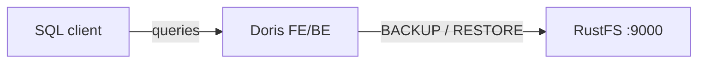

このガイドでは、リアルタイム分析データウェアハウスである [Apache Doris](https://github.com/apache/doris) を、S3 バックアップリポジトリを通じて **RustFS** に接続します。オールインワンの Doris コンテナを起動し、RustFS バケットを指す S3 リポジトリを作成してテーブルをバックアップし、削除したあと RustFS からリストアします。この流れは `apache/doris:all-in-one-4.1.3` と `rustfs/rustfs-x86-musl:v2.3.1` で検証済みです。

Docker が必要です。このデプロイはローカルでの統合テストを目的としており、本番環境向けではありません。

## アーキテクチャ



リポジトリは `doris-backups` バケット配下の名前付き S3 ロケーションです。`BACKUP SNAPSHOT` はテーブルのメタデータとタブレットのデータファイルをアップロードし、`RESTORE SNAPSHOT` はそれらを新しいテーブルへダウンロードします。

## 1. Doris を起動してリポジトリを作成する

先にバケットを作成します。Doris はバケットを作成しません。

```bash
rc alias set rustfs http://<your-rustfs-endpoint>:9000 <your-access-key> <your-secret-key>
rc mb rustfs/doris-backups
```

RustFS と同じ Docker ネットワーク上でオールインワンコンテナを起動します。

```bash
docker run -d --name doris --network oo-rustfs_default \
  -p 8030:8030 -p 9030:9030 apache/doris:all-in-one-4.1.3
```

フロントエンドが健全になるのを待ち、MySQL プロトコルで接続します（ポート 9030、ユーザー `root`、オールインワンイメージではパスワードなし）。

行を持つテストテーブルを作成します。

```sql
CREATE DATABASE rustfs_demo;
CREATE TABLE rustfs_demo.events
  (id INT, name VARCHAR(50))
  DISTRIBUTED BY HASH(id) BUCKETS 1
  PROPERTIES ("replication_num" = "1");
INSERT INTO rustfs_demo.events VALUES (1, 'doris-on-rustfs'), (2, 'backup-test');
```

エンドポイントを RustFS コンテナの IP アドレスに、両方の認証情報プレースホルダーを置き換えて、S3 リポジトリを作成します。

```sql
CREATE REPOSITORY `rustfs_repo`
  WITH S3
  ON LOCATION "s3://doris-backups/rustfs-repo"
  PROPERTIES (
    "AWS_ENDPOINT" = "http://<rustfs-container-ip>:9000",
    "AWS_ACCESS_KEY" = "<your-access-key>",
    "AWS_SECRET_KEY" = "<your-secret-key>",
    "AWS_REGION" = "us-east-1",
    "AWS_PATH_STYLE_ACCESS" = "true"
  );
```

Doris 4.1 は `AWS_PATH_STYLE_ACCESS` を有効にしても、バケットをエンドポイントのホスト名へ解決します。そのためホスト名のエンドポイントは `UnknownHostException: doris-backups.rustfs` で失敗します。コンテナの IP アドレスを使うとパススタイルアクセスのリクエストになり、動作します。`SHOW REPOSITORIES` で、リポジトリが空の `ErrMsg` とともに登録されたことを確認します。

## 2. テーブルを RustFS へバックアップする

テーブルのスナップショットを取得します。

```sql
BACKUP SNAPSHOT rustfs_demo.demo_snapshot
  TO rustfs_repo
  ON (events);
```

ステートメントはすぐに戻ります。バックアップジョブはバックグラウンドで実行されます。状態を監視します。

```sql
SHOW BACKUP;
```

`State` が `FINISHED` になるまで待ちます。スナップショットのメタデータとタブレットのデータファイルは、この時点でバケット内のオブジェクトになっています。

## 3. RustFS 内のバックアップを確認する

バケットを一覧します。

```bash
rc ls rustfs/doris-backups/ -r
```

リポジトリには、リポジトリ記述子、スナップショットのメタデータ、タブレットファイルが保存されます。

```text
rustfs-repo/__palo_repository_rustfs_repo/__repo_info
rustfs-repo/__palo_repository_rustfs_repo/__ss_demo_snapshot/__meta.d50ecf9b...
rustfs-repo/__palo_repository_rustfs_repo/__ss_demo_snapshot/__ss_content/.../...dat...
```


## 4. RustFS からテーブルをリストアする

テーブルを削除し、スナップショットからリストアします。タイムスタンプは `SHOW SNAPSHOT ON REPOSITORY rustfs_repo;` が表示するスナップショット名から取ります。

```sql
DROP TABLE rustfs_demo.events;

RESTORE SNAPSHOT rustfs_demo.demo_snapshot
  FROM rustfs_repo
  ON (events)
  PROPERTIES (
    "backup_timestamp" = "2026-09-21-16-35-12",
    "replication_num" = "1"
  );
```

リストアジョブの完了を待ち、データを確認します。

```sql
SHOW RESTORE;
SELECT count(*) FROM rustfs_demo.events;
```

```text
2
```

## 5. デプロイを停止またはリセットする

データを残したまま Doris を停止します。

```bash
docker rm -f doris
```

バックアップは `doris-backups` バケットに残り、同じリポジトリを登録した任意の Doris クラスターへリストアできます。削除する場合はバケットを取り除きます。

```bash
rc rb rustfs/doris-backups --force
```

## トラブルシューティング

### リポジトリ作成時に `UnknownHostException: doris-backups.rustfs` が出る

Doris はバケットとエンドポイントから仮想ホスト形式のホスト名を組み立てています。上記のとおり、`AWS_ENDPOINT` に RustFS コンテナの IP アドレスを使い、`AWS_PATH_STYLE_ACCESS = "true"` を併用します。

### バックアップが長時間 `SNAPSHOTING` のままになる

バックエンドがタブレットファイルをアップロードしています。バックエンドが健全で（`SHOW BACKENDS;`）、エンドポイントへ到達できることを確認します。オールインワンイメージでは、起動後に両方のプロセスが準備完了を報告するまで 1〜2 分かかります。

### `Failed to create repository: ... file status`

バケットが存在しないか、認証情報が誤っています。`rc mb` で `doris-backups` を作成し、アクセスキーの組を再確認します。

## 次のステップ

- 追加の Doris 操作を採用する前に、[S3 互換性ノート](/ja/administration/protocols/s3)を確認します。
- [アクセスキー管理](/ja/security-compliance/iam/access-token)で、本番用の専用認証情報を作成します。
- 定期スナップショットをスケジュールするには、[Doris のバックアップとリストアのドキュメント](https://doris.apache.org/docs/data-operate/backup-restore/)に従います。
