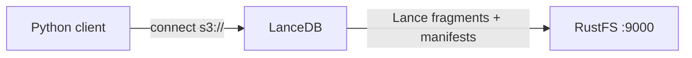
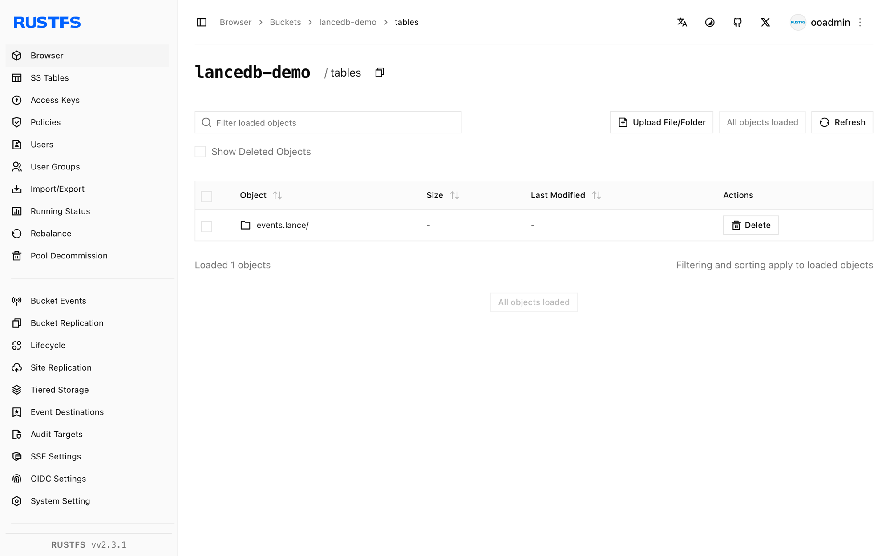

このガイドでは、Lance カラムナ形式で構築されたオープンソースのベクトルデータベースである [LanceDB](https://github.com/lancedb/lancedb) を、ストレージのバックエンドとして **RustFS** に接続します。`s3://` ロケーションにベクトルテーブルを直接作成し、行を追加してベクトル検索を実行し、バケット内の Lance テーブルファイルを確認します。この流れは `lancedb` Python パッケージと `rustfs/rustfs-x86-musl:v2.3.1` で検証済みです。

Python 3.9 以降が必要です。このデプロイはローカルでの統合テストを目的としており、本番環境向けではありません。

## アーキテクチャ



LanceDB は組み込みです。起動するサーバーはありません。Python（または Rust、JavaScript）クライアントがバケットと直接通信し、各テーブルをデータフラグメント、バージョンマニフェスト、トランザクションログを持つ `*.lance` ディレクトリとして保存します。

## 1. クライアントをインストールする

```bash
pip install lancedb
```

## 2. RustFS 上にテーブルを作成する

バケットへ直接接続してテーブルを作成します。接続用のプレースホルダーはすべて置き換えます。`storage_options` のキーは Lance の object-store の規約に従います。カスタムエンドポイントではパススタイルアクセスを使います。

```python title="lance_s3.py"
import lancedb

storage_options = {
    "endpoint": "http://<your-rustfs-endpoint>:9000",
    "access_key_id": "<your-access-key>",
    "secret_access_key": "<your-secret-key>",
    "region": "us-east-1",
    "allow_http": "true",
}

db = lancedb.connect("s3://<your-bucket>/tables", storage_options=storage_options)

rows = [{"id": i, "label": f"row-{i}", "vector": [float(i) / 10, 0.5, 0.25, 0.1] * 2}
        for i in range(5)]
table = db.create_table("events", data=rows)
print("created:", table.count_rows(), "rows")

table.add([{"id": 99, "label": "query-target", "vector": [0.9, 0.5, 0.25, 0.1] * 2}])
print("after add:", table.count_rows(), "rows")
```

```text
created: 5 rows
after add: 6 rows
```

テーブル URI は `s3://bucket/prefix` 形式です。すべての書き込みと読み取りは S3 API 経由で RustFS へ向かいます。

## 3. ベクトル検索を実行する

```python title="lance_search.py"
import lancedb

db = lancedb.connect("s3://<your-bucket>/tables", storage_options=storage_options)
table = db.open_table("events")

res = table.search([0.9, 0.5, 0.25, 0.1] * 2).limit(3).to_list()
print("top3:", [(r["id"], r["label"]) for r in res])
print("version:", table.version)
```

```text
top3: [(99, 'query-target'), (4, 'row-4'), (3, 'row-3')]
version: 2
```

最近傍は前の手順で追加した行であり、バージョンカウンタは 2 つのコミット（作成と追加）を反映します。

## 4. RustFS 内のオブジェクトを確認する

テーブルのプレフィックスを一覧します。

```bash
rc ls rustfs/<your-bucket>/ -r
```

各テーブルは、データフラグメント、バージョンマニフェスト、トランザクションレコードを持つ `.lance` ディレクトリです。

```text
tables/events.lance/_transactions/0-b93cf795-fc3d-4bc9-88c8-e37baeefdd46.txn
tables/events.lance/_versions/18446744073709551613.manifest
tables/events.lance/data/101101011110110010000100e7a149411b847dbad6ebc7d47e.lance
```

複数のテーブルは `tables/` プレフィックス配下でバケットを共有するため、1 つのバケットで LanceDB ワークスペース全体を支えられます。



## 5. 停止またはリセットする

LanceDB はサーバー状態を持ちません。テーブルを削除します。

```bash
rc rm rustfs/<your-bucket>/tables/ --recursive --force
```

## トラブルシューティング

### 初回利用時の接続エラーまたは署名エラー

`endpoint` にスキームが含まれること、平文 HTTP のエンドポイントでは `allow_http` が `"true"` であること、バケットが存在することを確認します。`region` の値は、RustFS が無視しても S3 署名に必須です。

### 作成後に `Table not found` が出る

LanceDB はバケットのプレフィックスを一覧してテーブルを検出します。クライアントキャッシュが古い場合や、URI の `tables/` プレフィックスが誤っている場合、新しいテーブルは見えません。作成時と同じ URI で再接続します。

### ネットワーク越しの一括ロードが遅い

Lance はコミットごとに 1 つのフラグメントを書き込みます。大規模な取り込みでは、行をまとめて `table.add` の呼び出し回数を減らします。呼び出しのたびにバケットへ新しいデータファイルが作られます。

## 次のステップ

- 追加の LanceDB ストレージオプションを採用する前に、[S3 互換性ノート](/ja/administration/protocols/s3)を確認します。
- [アクセスキー管理](/ja/security-compliance/iam/access-token)で、本番用の専用認証情報を作成します。
- 同じバックエンド上で ANN インデックス、ハイブリッド検索、マルチテナントのバケットレイアウトを使うには、[LanceDB ドキュメント](https://lancedb.github.io/lancedb/)に従います。
