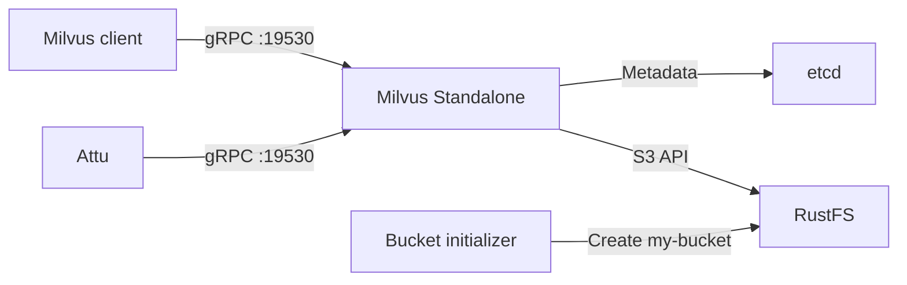

このガイドでは、S3 互換オブジェクトストレージのバックエンドとして **RustFS** を使い、**Milvus Standalone** を実行します。Milvus、etcd、RustFS、Attu を起動し、サンプルベクトルを挿入して、Milvus がオブジェクトを RustFS に永続化することを確認します。

Docker と Compose プラグイン、および Python 3.9 以降が必要です。このデプロイはローカルでの統合テストを目的としており、本番環境向けではありません。

:::note[Milvus の設定名]

Milvus は S3 互換ストレージの設定を `minio` 設定キーの下にまとめます。この名前であっても MinIO サーバーは不要です。このガイドでは `minio.address` が RustFS サービスを指し、Milvus は RustFS が公開する S3 API を使います。

:::

## アーキテクチャ



Milvus はサービスのメタデータを etcd に保存し、ベクトルデータ、インデックス、関連オブジェクトを RustFS の `s3://my-bucket/milvus` 配下に永続化します。ローカルの Milvus ボリュームは、ランタイムデータとキャッシュのために引き続き必要です。

## 1. プロジェクトファイルを作成する

作業ディレクトリを作成します。

```bash
mkdir rustfs-milvus
cd rustfs-milvus
```

環境ファイルを作成し、両方の認証情報プレースホルダーを置き換えます。

```ini title=".env"
RUSTFS_ACCESS_KEY=<your-access-key>
RUSTFS_SECRET_KEY=<your-secret-key>
```

Milvus バケットには専用の認証情報を使います。`.env` をソース管理にコミットしないでください。

Milvus のストレージ上書きを作成します。

```yaml title="user.yaml"
common:
  storageType: remote

minio:
  address: rustfs:9000
  port: 9000
  bucketName: my-bucket
  rootPath: milvus
  useSSL: false
  useIAM: false
  cloudProvider: aws
  region: us-east-1
  useVirtualHost: false
```

`useVirtualHost: false` はパススタイルアクセスの S3 リクエストを選びます。ホスト名 `rustfs` は Compose ネットワーク内で解決されます。ホスト上のクライアントは `http://localhost:9000` を使います。

Compose ファイルを作成します。

```yaml title="compose.yaml"
services:
  etcd:
    image: quay.io/coreos/etcd:v3.5.18
    environment:
      ETCD_AUTO_COMPACTION_MODE: revision
      ETCD_AUTO_COMPACTION_RETENTION: "1000"
      ETCD_QUOTA_BACKEND_BYTES: "4294967296"
      ETCD_SNAPSHOT_COUNT: "50000"
    command:
      - etcd
      - --advertise-client-urls=http://etcd:2379
      - --listen-client-urls=http://0.0.0.0:2379
      - --data-dir=/etcd
    volumes:
      - etcd-data:/etcd
    healthcheck:
      test: ["CMD", "etcdctl", "endpoint", "health"]
      interval: 30s
      timeout: 20s
      retries: 3
    networks:
      - milvus

  rustfs:
    image: rustfs/rustfs:1.0.0-alpha.83
    environment:
      RUSTFS_ACCESS_KEY: ${RUSTFS_ACCESS_KEY}
      RUSTFS_SECRET_KEY: ${RUSTFS_SECRET_KEY}
      RUSTFS_VOLUMES: /data
      RUSTFS_ADDRESS: ":9000"
      RUSTFS_CONSOLE_ADDRESS: ":9001"
      RUSTFS_CONSOLE_ENABLE: "true"
      RUSTFS_OBS_LOGGER_LEVEL: error
      RUSTFS_OBS_LOG_DIRECTORY: /var/log/rustfs/
    volumes:
      - rustfs-data:/data
    ports:
      - "9000:9000"
      - "9001:9001"
    healthcheck:
      test: ["CMD-SHELL", "curl -fsS http://localhost:9000/health/ready"]
      interval: 10s
      timeout: 5s
      retries: 12
      start_period: 20s
    networks:
      - milvus

  create-bucket:
    image: rustfs/rc:latest
    depends_on:
      rustfs:
        condition: service_healthy
    environment:
      RUSTFS_ACCESS_KEY: ${RUSTFS_ACCESS_KEY}
      RUSTFS_SECRET_KEY: ${RUSTFS_SECRET_KEY}
    entrypoint:
      - /bin/sh
      - -c
      - |
        /usr/bin/rc alias set rustfs http://rustfs:9000 "$${RUSTFS_ACCESS_KEY}" "$${RUSTFS_SECRET_KEY}" \
          --region us-east-1 --bucket-lookup path
        /usr/bin/rc bucket create rustfs/my-bucket --ignore-existing
    networks:
      - milvus

  standalone:
    image: milvusdb/milvus:v2.6.0
    command: ["milvus", "run", "standalone"]
    security_opt:
      - seccomp:unconfined
    depends_on:
      etcd:
        condition: service_healthy
      create-bucket:
        condition: service_completed_successfully
    environment:
      ETCD_ENDPOINTS: etcd:2379
      MINIO_ADDRESS: rustfs:9000
      MINIO_ACCESS_KEY_ID: ${RUSTFS_ACCESS_KEY}
      MINIO_SECRET_ACCESS_KEY: ${RUSTFS_SECRET_KEY}
      MINIO_REGION: us-east-1
      MQ_TYPE: woodpecker
    volumes:
      - milvus-data:/var/lib/milvus
      - ./user.yaml:/milvus/configs/user.yaml:ro
    ports:
      - "19530:19530"
      - "9091:9091"
    healthcheck:
      test: ["CMD", "curl", "-f", "http://localhost:9091/healthz"]
      interval: 30s
      timeout: 20s
      retries: 3
      start_period: 90s
    networks:
      - milvus

  attu:
    image: zilliz/attu:v2.6.5
    depends_on:
      standalone:
        condition: service_healthy
    environment:
      MILVUS_URL: standalone:19530
    ports:
      - "8000:3000"
    networks:
      - milvus

networks:
  milvus:

volumes:
  etcd-data:
  rustfs-data:
  milvus-data:
```

`create-bucket` サービスは公式の [`rc`](https://github.com/rustfs/cli) イメージを使い、`my-bucket` が存在することを確認してから終了します。名前付きボリュームは、コンテナを作り直しても etcd のメタデータ、RustFS のオブジェクト、Milvus のローカルデータを保持します。

:::warning[ローカルのサービスポートを保護する]

Compose ファイルは、ローカルテストのため、RustFS の API と Console、Milvus の gRPC とヘルスポート、Attu をホストに公開します。これらのポートを信頼できないネットワークへ公開しないでください。本番のデプロイには、スコープを絞った認証情報、TLS、認証、リソース計画、バックアップ、および独立して運用する依存コンポーネントが必要です。

:::

## 2. デプロイを検証して起動する

コンテナを起動する前に Compose ファイルを解決します。

```bash
docker compose config
```

サービスを起動します。

```bash
docker compose up -d
docker compose ps -a
```

`create-bucket` サービスはコード `0` で終了する想定です。`etcd`、`rustfs`、`standalone` は健全な状態になる想定です。期待する状態にならないサービスはログを確認します。

```bash
docker compose logs create-bucket rustfs standalone
```

次のローカルインターフェースを開きます。

- RustFS Console: `http://localhost:9001`
- Attu: `http://localhost:8000`
- Milvus のヘルスエンドポイント: `http://localhost:9091/healthz`

Attu は Compose ネットワーク経由で `standalone:19530` に接続します。Attu が接続先アドレスを求める場合は、`localhost:19530` ではなくそのサービス名を使います。

## 3. サンプルベクトルを挿入してクエリする

Python の仮想環境を作成し、サーバーのリリースに合う Milvus クライアントのバージョンをインストールします。

```bash
python3 -m venv .venv
source .venv/bin/activate
python -m pip install "pymilvus==2.6.0"
```

テストスクリプトを作成します。

```python title="verify_milvus.py"
from pymilvus import MilvusClient

client = MilvusClient(uri="http://localhost:19530")
collection_name = "rustfs_demo"

if client.has_collection(collection_name=collection_name):
    client.drop_collection(collection_name=collection_name)

client.create_collection(
    collection_name=collection_name,
    dimension=4,
)

client.insert(
    collection_name=collection_name,
    data=[
        {"id": 1, "vector": [0.1, 0.2, 0.3, 0.4]},
        {"id": 2, "vector": [0.2, 0.3, 0.4, 0.5]},
        {"id": 3, "vector": [0.9, 0.8, 0.7, 0.6]},
    ],
)

client.flush(collection_name=collection_name)
results = client.search(
    collection_name=collection_name,
    data=[[0.1, 0.2, 0.3, 0.4]],
    limit=2,
    output_fields=["id"],
)

print(results)
client.close()
```

スクリプトを実行します。

```bash
python verify_milvus.py
```

結果では、ID `1` の行が先頭になる想定です。Attu を開き、`rustfs_demo` コレクションに 3 つのエンティティがあることを確認します。

## 4. RustFS 内の Milvus オブジェクトを確認する

バケット初期化用のイメージを使い、設定した `milvus` ルートパス配下のオブジェクトを一覧します。

```bash
docker compose run --rm --entrypoint /bin/sh create-bucket -c \
  '/usr/bin/rc alias set rustfs http://rustfs:9000 "$RUSTFS_ACCESS_KEY" "$RUSTFS_SECRET_KEY" --region us-east-1 --bucket-lookup path >/dev/null && /usr/bin/rc find rustfs/my-bucket/milvus'
```

出力には、`milvus/` プレフィックス配下に Milvus が作成したオブジェクトが含まれる想定です。RustFS Console で `my-bucket` を開くこともできます。

Milvus は、想定するオブジェクトがすべて現れる前にデータをバッファまたはコンパクトすることがあります。挿入、フラッシュ、クエリの成功と、RustFS のオブジェクト一覧をあわせて、連携経路を検証します。

## 5. スタックを停止またはリセットする

名前付きボリュームをすべて残したままコンテナを停止します。

```bash
docker compose down
```

Milvus バケットの内容と etcd のメタデータを含むローカルのテストデータを削除するには、ボリュームを明示的に取り除きます。

```bash
docker compose down --volumes
```

:::warning[リセットはテストデータを削除する]

`--volumes` オプションは、この Compose プロジェクトが使う名前付きボリュームを完全に削除します。残す必要があるデータに対しては実行しないでください。

:::

## トラブルシューティング

### Milvus から RustFS に到達できない

Compose 内の S3 エンドポイントは `rustfs:9000` です。Milvus コンテナ内の `localhost:9000` はそのコンテナ自身を指し、RustFS ではありません。

`useVirtualHost` が `false` のままであること、Milvus に渡す認証情報が RustFS の認証情報と一致することを確認します。

```bash
docker compose logs standalone rustfs
```

### バケット初期化が失敗する

RustFS の準備完了と初期化ログを確認します。

```bash
curl -fsS http://localhost:9000/health/ready
docker compose logs create-bucket
```

`.env` に空でない認証情報があり、`docker compose config` が両方の変数を解決することを確認します。

### 既存データなしで Milvus が起動する

既存のデプロイでは `minio.bucketName`、`minio.rootPath`、etcd のルートを変更しないでください。`rustfs-data`、`etcd-data`、`milvus-data` のボリュームが残っており、同じ Compose プロジェクト名を使っていることを確認します。

### Attu が接続できない

Attu コンテナは `standalone:19530` を使う必要があります。ブラウザーまたはホスト側のクライアントは `localhost:19530` を使います。Milvus のヘルスと Attu のログを確認します。

```bash
curl -fsS http://localhost:9091/healthz
docker compose logs attu standalone
```

## 次のステップ

- 追加の Milvus ストレージ機能を有効にする前に、[S3 互換性ノート](/ja/administration/protocols/s3)を確認します。
- [アクセスキー管理](/ja/security-compliance/iam/access-token)で、本番用の専用認証情報を作成します。
- このローカルのパターンをマネージドまたは分散デプロイへ合わせるときは、[Milvus ドキュメント](https://milvus.io/docs)に従います。
