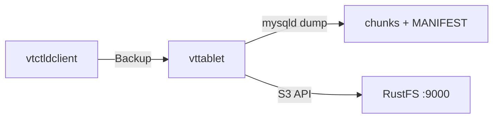

このガイドでは、MySQL を水平スケールするためのデータベースクラスターシステムである [Vitess](https://github.com/vitessio/vitess) を、Vitess の S3 バックアップストレージ実装を通じて **RustFS** に接続します。単一ホスト上に最小の Vitess トポロジーを立ち上げ、タブレットで `Backup` を実行し、バケット内のバックアップチャンクと `MANIFEST` を確認したあと、バックアップ一覧を RustFS から読み戻します。この流れは `vitess/lite`（Vitess v25.0.0-SNAPSHOT、ビルド日 2026-09-22）、MySQL 8.4、`rustfs/rustfs-x86-musl:v2.3.1` で検証済みです。安定版の Vitess 20 以降も同じフラグを使います。

Docker が必要です。このデプロイはローカルでの統合テストを目的としており、本番環境向けではありません。

## アーキテクチャ



`vtctld` がバックアップを起動しますが、実行するのはそのタブレットを所有する `vttablet` です。MySQL をスナップショットし、データを番号付きチャンクへ圧縮し、`MANIFEST` とともに S3 互換エンドポイント経由でアップロードします。

## 1. etcd と Vitess イメージを実行する

Vitess はトポロジーを etcd に保存します。`vitess/lite` イメージには Vitess のバイナリ一式と MySQL が含まれます。

```bash
docker run -d --name etcd --hostname etcd --network oo-rustfs_default \
  quay.io/coreos/etcd:v3.5.17 etcd \
  --advertise-client-urls http://etcd:2379 \
  --listen-client-urls http://0.0.0.0:2379

docker run -d --name vtess --hostname vtess --network oo-rustfs_default \
  -e AWS_ACCESS_KEY_ID=<your-access-key> \
  -e AWS_SECRET_ACCESS_KEY=<your-secret-key> \
  vitess/lite:latest sleep infinity
```

AWS の環境変数は、`vtctld` と `vttablet` の両方で S3 バックアップストレージの認証情報になります。

## 2. MySQL を初期化する

`vttablet` が後から `my.cnf` を読み込めるよう、標準の Vitess タブレットディレクトリで MySQL インスタンスを初期化します。

```bash
docker exec vtess sh -c \
  "/vt/bin/mysqlctl --log_dir /tmp/vtlogs init --tablet-dir vt_0000000100"
```

ソケットファイルが存在すれば、インスタンスの準備は完了です。

```text
/vt/vtdataroot/vt_0000000100/mysql.sock
```

## 3. vtctld と vttablet を起動する

S3 バックアップフラグ付きで `vtctld` を起動し、セルを登録してタブレットを起動します。接続用のプレースホルダーはすべて置き換えます。

```bash
docker exec vtess sh -c "nohup /vt/bin/vtctld \
  --topo-implementation etcd2 \
  --topo-global-server-address etcd:2379 \
  --topo-global-root /vitess/global \
  --service-map grpc-vtctl,grpc-vtctld \
  --backup-storage-implementation s3 \
  --s3-backup-aws-endpoint http://<your-rustfs-endpoint>:9000 \
  --s3-backup-aws-region us-east-1 \
  --s3-backup-force-path-style \
  --s3-backup-storage-bucket vitess-backups \
  --s3-backup-storage-root commerce \
  --port 15999 --grpc-port 15998 \
  --log_dir /tmp/vtlogs > /tmp/vtlogs/vtctld.out 2>&1 &"

docker exec vtess sh -c \
  "/vt/bin/vtctldclient --server localhost:15998 \
  AddCellInfo --root /vitess/zone1 --server-address etcd:2379 zone1"

docker exec vtess sh -c "nohup /vt/bin/vttablet \
  --topo-implementation etcd2 \
  --topo-global-server-address etcd:2379 \
  --topo-global-root /vitess/global \
  --tablet-path zone1-0000000100 \
  --init-keyspace commerce --init-shard 0 --init-tablet-type replica \
  --port 15100 --grpc-port 15101 \
  --service-map grpc-queryservice,grpc-tabletmanager,grpc-throttler \
  --mycnf-file /vt/vtdataroot/vt_0000000100/my.cnf \
  --db-dba-user root --db-allprivs-user root --db-app-user root --db-repl-user root \
  --db-dba-use-ssl=false --db-allprivs-use-ssl=false \
  --db-app-use-ssl=false --db-repl-use-ssl=false \
  --backup-storage-implementation s3 \
  --s3-backup-aws-endpoint http://<your-rustfs-endpoint>:9000 \
  --s3-backup-aws-region us-east-1 \
  --s3-backup-force-path-style \
  --s3-backup-storage-bucket vitess-backups \
  --s3-backup-storage-root commerce \
  --log_dir /tmp/vtlogs > /tmp/vtlogs/vttablet.out 2>&1 &"
```

バックアップを実行するのは `vttablet` で、バックアップの一覧と削除を行うのは `vtctld` です。そのため両方のプロセスに S3 フラグを付けます。AWS 以外のエンドポイントでは `--s3-backup-force-path-style` が必須です。タブレットが登録されたことを確認します。

```bash
docker exec vtess /vt/bin/vtctldclient --server localhost:15998 GetTablets
```

```text
zone1-0000000100 commerce 0 replica vtess:15100 vtess:3306 [] <null>
```

## 4. バックアップを実行する

バケットを作成し、バックアップを起動します。

```bash
rc mb rustfs/vitess-backups

docker exec vtess /vt/bin/vtctldclient --server localhost:15998 \
  Backup zone1-0000000100
```

ストリームは、エンジンがマニフェストを書き込んで終了します。

```text
commerce/0 (zone1-0000000100): ... value:"Completed backing up MANIFEST (attempt 1/2)"
```

## 5. RustFS 内のオブジェクトを確認する

バックアップのプレフィックスを一覧します。

```bash
rc ls rustfs/vitess-backups/ -r | head -4
```

タブレットは、圧縮したデータチャンクとメタデータファイルをアップロードしました。

```text
commerce/commerce/0/2026-09-23.011225.zone1-0000000100/0
commerce/commerce/0/2026-09-23.011225.zone1-0000000100/1
commerce/commerce/0/2026-09-23.011225.zone1-0000000100/MANIFEST
```


`vtctld` を通じて、バックアップ一覧を RustFS から読み戻します。

```bash
docker exec vtess /vt/bin/vtctldclient --server localhost:15998 GetBackups commerce/0
```

```text
2026-09-23.011225.zone1-0000000100
```

## 6. 停止またはリセットする

バケット内のオブジェクトを残したままデモを撤去します。

```bash
docker rm -f vtess etcd
```

保存したバックアップを削除します。

```bash
rc rm rustfs/vitess-backups/ --recursive --force
```

## トラブルシューティング

### `cannot perform backup without my.cnf`

`--db-socket` や `--db-host` などの接続パラメーターを渡すと、`vttablet` は `my.cnf` の読み込みを省略し、バックアップは実行を拒否します。インスタンス設定を指す `--mycnf-file` で `vttablet` を起動し、ソケットはそこから検出させます。手順 2 で MySQL インスタンスを `vt_0000000100` ディレクトリに置くのはこのためです。

### `unknown service vtctlservice.Vtctld`

`vtctld` が `vtctldclient` の使う API を公開するのは、サービスマップにそれが含まれる場合だけです。`--service-map grpc-vtctl,grpc-vtctld` を指定します。また `vtctldclient --server` は Web UI のポートではなく gRPC ポート（ここでは `15998`）を指す必要があります。

### `node doesn't exist: /vitess/global/cells/zone1/CellInfo`

タブレットが登録される前にセルが存在する必要があります。`vttablet` を起動する前に、手順 3 のとおり `vtctldclient AddCellInfo` を実行します。

### `unknown shorthand flag` などのフラグ解析エラー

Vitess 20 以降はアンダースコアをダッシュへ正規化するため、フラグはダッシュ形式（`--tablet-path`）で書きます。`-tablet_dir` のようなシングルダッシュのロングフラグは短縮オプションとして解析され、失敗します。

## 次のステップ

- 追加の Vitess ストレージオプションを採用する前に、[S3 互換性ノート](/ja/administration/protocols/s3)を確認します。
- [アクセスキー管理](/ja/security-compliance/iam/access-token)で、本番用の専用認証情報を作成します。
- バックアップのスケジュールと、バケットからのタブレットのリストアについては、[Vitess のバックアップとリストアのドキュメント](https://vitess.io/docs/user-guides/configuration-basic/#backups)に従います。
