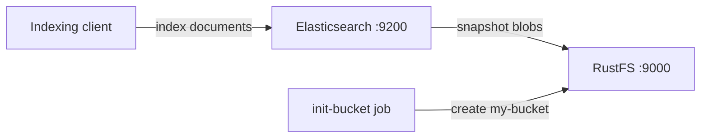

このガイドでは、分散検索・分析エンジンである [Elasticsearch](https://github.com/elastic/elasticsearch) を、インデックスの S3 スナップショットリポジトリとして **RustFS** に接続します。`repository-s3` プラグインを有効にして Elasticsearch を起動し、RustFS をバックエンドとするスナップショットリポジトリを登録し、ドキュメントをインデックスに投入してスナップショットを取得します。その後インデックスを削除し、RustFS から復元して一連の流れを確認します。この流れは `docker.elastic.co/elasticsearch/elasticsearch:8.18.0` と `rustfs/rustfs-x86-musl:v2.3.1` で検証済みです。

Docker と Compose プラグインが必要です。このデプロイはローカルでの統合テストを目的としており、本番環境向けではありません。

## アーキテクチャ



Elasticsearch は主データをローカルディスクに保持し、インデックスのバックアップをスナップショットリポジトリへ退避します。`repository-s3` プラグインは、平文 HTTP 上のパススタイルアクセスで S3 API を使い、スナップショットのメタデータとシャードデータのブロブを RustFS に書き込みます。

## 1. プロジェクトファイルを作成する

作業ディレクトリを作成します。

```bash
mkdir rustfs-elasticsearch
cd rustfs-elasticsearch
```

環境変数ファイルを作成し、2 つの認証情報プレースホルダーを置き換えます。

```ini title=".env"
RUSTFS_ACCESS_KEY=<your-access-key>
RUSTFS_SECRET_KEY=<your-secret-key>
```

バケットには専用の認証情報を使用してください。`.env` をバージョン管理にコミットしないでください。

Elasticsearch は S3 設定を `elasticsearch.yml`（機密でない値）とキーストア（認証情報）に分けます。設定ファイルを作成します。

```yaml title="elasticsearch.yml"
discovery.type: single-node
xpack.security.enabled: false
s3.client.default.endpoint: "rustfs:9000"
s3.client.default.protocol: "http"
s3.client.default.path_style_access: "true"
s3.client.default.region: "us-east-1"
```

Compose ファイルを作成します。

```yaml title="compose.yaml"
services:
  rustfs:
    image: rustfs/rustfs-x86-musl:v2.3.1
    environment:
      RUSTFS_ACCESS_KEY: ${RUSTFS_ACCESS_KEY}
      RUSTFS_SECRET_KEY: ${RUSTFS_SECRET_KEY}
      RUSTFS_VOLUMES: /data
      RUSTFS_ADDRESS: ":9000"
      RUSTFS_CONSOLE_ADDRESS: ":9001"
      RUSTFS_CONSOLE_ENABLE: "true"
    volumes:
      - rustfs-data:/data
    ports:
      - "9000:9000"
      - "9001:9001"
    healthcheck:
      test: ["CMD", "curl", "-sf", "http://127.0.0.1:9000/health"]
      interval: 10s
      timeout: 5s
      retries: 6
      start_period: 10s
    networks:
      - es

  create-bucket:
    image: rustfs/rc:latest
    depends_on:
      rustfs:
        condition: service_healthy
    environment:
      RUSTFS_ACCESS_KEY: ${RUSTFS_ACCESS_KEY}
      RUSTFS_SECRET_KEY: ${RUSTFS_SECRET_KEY}
    entrypoint:
      - /bin/sh
      - -c
      - |
        until /usr/bin/rc alias set rustfs http://rustfs:9000 "$${RUSTFS_ACCESS_KEY}" "$${RUSTFS_SECRET_KEY}"; do
          echo "Waiting for RustFS..."
          sleep 2
        done
        /usr/bin/rc ls rustfs/my-bucket >/dev/null 2>&1 || /usr/bin/rc mb rustfs/my-bucket
    networks:
      - es

  elasticsearch:
    image: docker.elastic.co/elasticsearch/elasticsearch:8.18.0
    environment:
      ES_JAVA_OPTS: "-Xms512m -Xmx512m"
    volumes:
      - ./elasticsearch.yml:/usr/share/elasticsearch/config/elasticsearch.yml:ro
    entrypoint: >
      bash -c '
        bin/elasticsearch-plugin install --batch repository-s3 &&
        echo "$${RUSTFS_ACCESS_KEY}" | bin/elasticsearch-keystore add -f -x s3.client.default.access_key &&
        echo "$${RUSTFS_SECRET_KEY}" | bin/elasticsearch-keystore add -f -x s3.client.default.secret_key &&
        exec bin/elasticsearch'
    ports:
      - "9200:9200"
    depends_on:
      create-bucket:
        condition: service_completed_successfully
    networks:
      - es

networks:
  es:

volumes:
  rustfs-data:
```

`repository-s3` は同梱プラグインであり、ネットワークなしでインストールできます。キーストアに入れるのはアクセスキーとシークレットキーだけです。エンドポイントなどの非セキュア設定は `elasticsearch.yml` に置く必要があります。そうしないとノードは起動を拒否します。

## 2. デプロイを開始する

コンテナを起動する前に Compose ファイルを解決します。

```bash
docker compose config
```

サービスを起動し、Elasticsearch の起動完了を待ちます。初回起動ではプラグインのインストールとキーストアへの登録が行われ、1〜2 分かかります。

```bash
docker compose up -d
curl -s http://localhost:9200
```

## 3. スナップショットリポジトリを登録してドキュメントを投入する

RustFS をスナップショットリポジトリとして登録し、インデックスを作成して 5 件のドキュメントを投入します。

```bash
curl -s -X PUT "http://localhost:9200/_snapshot/rustfs_repo" \
  -H "Content-Type: application/json" \
  -d '{"type":"s3","settings":{"bucket":"my-bucket"}}'

curl -s -X PUT "http://localhost:9200/rustfs_index" \
  -H "Content-Type: application/json" \
  -d '{"mappings":{"properties":{"label":{"type":"keyword"}}}}'

for v in 1 2 3 4 5; do
  curl -s -X POST "http://localhost:9200/rustfs_index/_doc" \
    -H "Content-Type: application/json" \
    -d "{\"label\":\"rustfs-es-doc-$v\",\"value\":$v}" > /dev/null
done
curl -s -X POST "http://localhost:9200/rustfs_index/_refresh" > /dev/null
curl -s "http://localhost:9200/rustfs_index/_count"
```

```text
{"count":5,...}
```

## 4. スナップショットを取得する

`wait_for_completion` を付けてスナップショットを作成し、結果をすぐに確認できるようにします。

```bash
curl -s -X PUT "http://localhost:9200/_snapshot/rustfs_repo/snap1?wait_for_completion=true"
```

```text
{"snapshot":{"snapshot":"snap1",...,"indices":["rustfs_index"],"shards":{"total":1,"failed":0,"successful":1}}}
```

## 5. RustFS 内のオブジェクトを確認する

バケット初期化用イメージを使ってスナップショットのオブジェクトを一覧します。

```bash
docker compose run --rm --entrypoint /bin/sh create-bucket -c \
  '/usr/bin/rc alias set rustfs http://rustfs:9000 "$RUSTFS_ACCESS_KEY" "$RUSTFS_SECRET_KEY" >/dev/null && /usr/bin/rc ls rustfs/my-bucket/indices --recursive'
```

スナップショットのメタデータとシャードデータのブロブは、バケット内の `indices/` 配下にあります。

```text
[2026-09-21 02:58:01]   3.56 KiB indices/mvyat2-dSEOG3uiCCiFzRA/0/__LbLsSgUUTpqji_EXvqHYCg
[2026-09-21 02:58:01]   3.21 KiB indices/mvyat2-dSEOG3uiCCiFzRA/0/__VIuGNJn3RB-RBWvr4tMn7Q
[2026-09-21 02:58:01]   1.00 KiB indices/mvyat2-dSEOG3uiCCiFzRA/0/index-e9P8q6E9QhitpkiOdgjVDQ
```

RustFS Console（管理画面）でこのプレフィックスを参照することもできます。


## 6. RustFS からインデックスを復元する

インデックスを削除してから、スナップショットから復元します。

```bash
curl -s -X DELETE "http://localhost:9200/rustfs_index" > /dev/null
curl -s -X POST "http://localhost:9200/_snapshot/rustfs_repo/snap1/_restore?wait_for_completion=true" > /dev/null
curl -s "http://localhost:9200/rustfs_index/_count"
```

```text
{"count":5,...}
```

スナップショットのブロブが RustFS から読み戻されるため、ドキュメントが戻ります。

## 7. スタックを停止・リセットする

RustFS データボリュームを保持したままコンテナを停止します。

```bash
docker compose down
```

スナップショットを削除して空の RustFS ボリュームからやり直す場合は、明示的に `--volumes` を付けます。

```bash
docker compose down --volumes
```

## トラブルシューティング

### ノードが "non-secure setting ... must be stored inside elasticsearch.yml" で起動を拒否する

キーストアに入れるのは `s3.client.default.access_key` と `s3.client.default.secret_key` だけです。エンドポイント、プロトコル、パススタイルアクセス、リージョンは非セキュア設定であり、`elasticsearch.yml` に定義する必要があります。

### 復元したシャードや新しいシャードが未割り当てのままになる

ディスク使用率がローウォーターマーク（low watermark、デフォルト 85%）を超えると、Elasticsearch はシャードの割り当てを停止します。ディスクの空きを確保するか、ローカルテストでは次のチェックを無効にします。

```bash
curl -s -X PUT "http://localhost:9200/_cluster/settings" \
  -H "Content-Type: application/json" \
  -d '{"transient":{"cluster.routing.allocation.disk.threshold_enabled":false}}'
```

### インデックスが既に存在するため復元に失敗する

以前の失敗した復元でインデックスが残っている場合があります。`DELETE /rustfs_index` で削除してから、復元を再実行します。

### AccessDenied や 403 レスポンス

キーストアの認証情報が RustFS の認証情報と一致しているか、`create-bucket` サービスが正常に完了しているかを確認します。

```bash
docker compose logs create-bucket
```

## 次のステップ

- 追加の S3 オペレーションを採用する前に、[S3 互換性ノート](/ja/administration/protocols/s3)を確認してください。
- [アクセスキー管理](/ja/security-compliance/iam/access-token)で本番用の専用認証情報を作成してください。
- [Elasticsearch のスナップショットドキュメント](https://www.elastic.co/guide/en/elasticsearch/reference/current/snapshot-restore.html)に従い、スナップショットライフサイクル管理（SLM）を設定してください。
