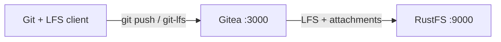

このガイドでは、セルフホストの Git サービスである [Gitea](https://github.com/go-gitea/gitea) を、Gitea の `minio` ストレージタイプ経由で **RustFS** に接続します。Docker Compose で Gitea を起動し、リポジトリを作成し、Git LFS オブジェクトを push し、Issue にファイルを添付して、LFS オブジェクトと添付ファイルの両方が RustFS に保存されることを確認します。この流れは `gitea/gitea:1.24.4` と `rustfs/rustfs-x86-musl:v2.3.1` で検証済みです。

Docker と Compose プラグイン、およびワークステーション上の `git` と `git-lfs` クライアントが必要です。このデプロイはローカルでの統合テストを目的としており、本番環境向けではありません。

## アーキテクチャ



Gitea は Git リポジトリ自体をローカルディスクに保持し、`minio` ストレージタイプが大きなファイル（LFS オブジェクト、Issue の添付ファイル、アバター、リポジトリアーカイブ、パッケージ、Actions のアーティファクト）を RustFS の `gitea-data` バケットへ送ります。バケットが存在しない場合、Gitea は起動時に作成します。

## 1. プロジェクトファイルを作成する

作業ディレクトリを作成します。

```bash
mkdir rustfs-gitea
cd rustfs-gitea
```

環境変数ファイルを作成し、2 つの認証情報プレースホルダーを置き換えます。

```ini title=".env"
RUSTFS_ACCESS_KEY=<your-access-key>
RUSTFS_SECRET_KEY=<your-secret-key>
```

`gitea-data` バケットには専用の認証情報を使用してください。`.env` をバージョン管理にコミットしないでください。

Gitea の設定を作成し、2 つの認証情報プレースホルダーを `.env` と同じ値に置き換えます。グローバルな `minio` ストレージタイプは、LFS、添付ファイル、アバター、リポジトリアーカイブ、パッケージ、Actions のアーティファクトに適用されます。

```ini title="app.ini"
APP_NAME = RustFS Gitea
RUN_MODE = prod
WORK_PATH = /data/gitea

[server]
DOMAIN = localhost
ROOT_URL = http://localhost:3000/
HTTP_PORT = 3000
LFS_START_SERVER = true

[database]
DB_TYPE = sqlite3
PATH = /data/gitea/gitea.db

[storage]
STORAGE_TYPE = minio
MINIO_ENDPOINT = rustfs:9000
MINIO_ACCESS_KEY_ID = <your-access-key>
MINIO_SECRET_ACCESS_KEY = <your-secret-key>
MINIO_BUCKET = gitea-data
MINIO_LOCATION = us-east-1
MINIO_USE_SSL = false

[log]
MODE = console
LEVEL = info

[security]
INSTALL_LOCK = true
SECRET_KEY = change-me-to-a-random-string
```

`LFS_START_SERVER` は Git LFS の HTTP API を有効にします。`MINIO_ENDPOINT` は Compose 内部のホスト名 `rustfs` を使います。エンドポイントへはデフォルトでパススタイルのリクエストが送られます。

Compose ファイルを作成します。

```yaml title="compose.yaml"
services:
  rustfs:
    image: rustfs/rustfs-x86-musl:v2.3.1
    environment:
      RUSTFS_ACCESS_KEY: ${RUSTFS_ACCESS_KEY}
      RUSTFS_SECRET_KEY: ${RUSTFS_SECRET_KEY}
      RUSTFS_VOLUMES: /data
      RUSTFS_ADDRESS: ":9000"
      RUSTFS_CONSOLE_ADDRESS: ":9001"
      RUSTFS_CONSOLE_ENABLE: "true"
    volumes:
      - rustfs-data:/data
    ports:
      - "9000:9000"
      - "9001:9001"
    healthcheck:
      test: ["CMD", "curl", "-sf", "http://127.0.0.1:9000/health"]
      interval: 10s
      timeout: 5s
      retries: 6
      start_period: 10s
    networks:
      - gitea

  gitea:
    image: gitea/gitea:1.24.4
    depends_on:
      rustfs:
        condition: service_healthy
    environment:
      USER_UID: "1000"
      USER_GID: "1000"
    volumes:
      - gitea-data:/data
      - ./app.ini:/data/gitea/conf/app.ini:ro
    ports:
      - "3000:3000"
    networks:
      - gitea

networks:
  gitea:

volumes:
  rustfs-data:
  gitea-data:
```

ボリューム上の `/data` ディレクトリは、コンテナを再起動しても SQLite データベースと Git リポジトリを保持します。LFS オブジェクトと添付ファイルは RustFS にあります。

## 2. デプロイを検証して開始する

コンテナを起動する前に Compose ファイルを解決します。

```bash
docker compose config
```

サービスを起動します。

```bash
docker compose up -d
docker compose ps
```

すべてのストレージバックエンドが Minio タイプを報告するまで、Gitea のログを確認します。

```bash
docker compose logs gitea | grep "Initialising"
```

出力には `Attachment`、`Avatar`、`LFS`、および残りのストレージセクションが並び、それぞれに `Creating Minio storage at rustfs:9000:gitea-data` の行が続くはずです。

`http://localhost:3000` を開いて管理者アカウントを作成し、続けて `http://localhost:9001` の RustFS Console（管理画面）を開きます。`gitea-data` バケットは、最初のストレージ操作のあとに現れます。

## 3. Git LFS オブジェクトを push する

Gitea の Web UI で `rustfs-demo` というリポジトリを作成し、ワークステーションから LFS で追跡するファイルを push します。

```bash
mkdir lfs-demo && cd lfs-demo
git init
git config user.email you@example.com
git config user.name you
git lfs install
git lfs track "*.bin"
git add .gitattributes
dd if=/dev/urandom of=dataset.bin bs=1M count=8
git add dataset.bin
git commit -m "add LFS dataset"
git remote add origin http://localhost:3000/<your-username>/rustfs-demo.git
git push origin main
```

`git push` は Gitea の LFS API 経由で LFS オブジェクトをアップロードし、API がそれを RustFS に書き込みます。リポジトリを別のディレクトリに clone し、`git lfs pull` を実行します。ダウンロードした `dataset.bin` は、元のファイルとバイト単位で同一である必要があります。

```bash
sha256sum dataset.bin
cd ../lfs-demo-clone && git lfs pull && sha256sum dataset.bin
```

どちらのクライアントも RustFS からオブジェクトを読み込むため、両方のチェックサムが一致します。

## 4. Issue にファイルを添付する

`rustfs-demo` リポジトリを開き、Issue を作成し、Issue フォームから小さなテキストファイルを添付します。Gitea はアップロードを `gitea-data` バケット内の `attachments/<prefix>/<uuid>` として保存し、`/attachments/<uuid>` 経由でダウンロードを提供します。

## 5. RustFS 内のオブジェクトを確認する

[`rc` クライアント](https://github.com/rustfs/cli)でバケットを一覧します。

```bash
docker compose exec rustfs /usr/bin/rc ls local/gitea-data/ -r
```

出力には `lfs/` 配下の LFS オブジェクトと、`attachments/` 配下の添付ファイルが含まれるはずです。

```text
attachments/9/2/92fdd48d-531c-4cba-8b3f-4e2004a10fc7
lfs/37/76/6ddfc07e803de58a69328db9a58a07cf7080ddde55c155a7531bc650a000
```

LFS オブジェクトキーは、Git LFS プロトコルで使われる SHA-256 コンテンツハッシュです。


## 6. デプロイを停止またはリセットする

データを残したままコンテナを停止します。

```bash
docker compose down
```

RustFS のボリュームは `gitea-data` バケットを保持するため、LFS オブジェクトと添付ファイルは再起動後も残ります。RustFS 内のオブジェクトを含めてすべて削除するには、`--volumes` を追加します。

## トラブルシューティング

### ログインページではなく Gitea のインストールページが表示される

設定ファイルはコンテナ内の `/data/gitea/conf/app.ini` に存在する必要があります。マウントパスが誤っていると、Gitea はデフォルト設定で起動し、インストールウィザードを表示します。Compose の例のとおりにファイルをマウントして再起動します。

### push が LFS エラーまたは 403 で失敗する

`app.ini` の認証情報が RustFS の認証情報と一致していること、および `rustfs` ホスト名が Compose ネットワーク内で解決できることを確認します。

```bash
docker compose logs gitea | grep -i minio
```

### オブジェクトが RustFS ではなくローカルストレージに入る

環境変数 `GITEA__storage__STORAGE_TYPE: minio` と `app.ini` の `[storage]` セクションは一致している必要があります。どちらかを変更したら Gitea を再起動し、`Initialising` のログ行を再度確認します。

## 次のステップ

- 追加の Gitea ストレージターゲットを採用する前に、[S3 互換性ノート](/ja/administration/protocols/s3)を確認してください。
- [アクセスキー管理](/ja/security-compliance/iam/access-token)で本番用の専用認証情報を作成してください。
- [Gitea のストレージドキュメント](https://docs.gitea.com/administration/storage-configurations)に従い、パッケージ、Actions のアーティファクト、または個別のストレージセクションを別々のバケットへ移してください。
