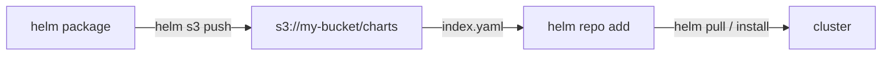

このガイドは、Kubernetes 向け CNCF パッケージマネージャー [Helm](https://github.com/helm/helm) を、[helm-s3](https://github.com/hypnoglow/helm-s3) プラグイン経由で **RustFS** に接続し、RustFS バケットをプライベートなチャートリポジトリにします。バケット内でリポジトリを初期化し、パッケージ化したチャートをプッシュした後、そのリポジトリを Helm に追加してチャートを引き戻します。このワークフローは `alpine/helm:3.16.4` と helm-s3 `v0.17.2` を RustFS バケットに対して実行して検証しました。

Docker が必要です。このデプロイはローカルでの結合テスト用であり、本番環境向けではありません。

## アーキテクチャ



バケットのプレフィックスには `index.yaml` と、チャートのバージョンごとに 1 つの `.tgz` が格納されます。Helm はプラグイン経由で読み書きするため、RustFS に到達できる場所ならどこからでもこのリポジトリを利用できます。

## 1. プラグインをインストールしてリポジトリを初期化する

`alpine/helm` イメージには `git` が含まれないため、リポジトリ URL からではなくリリースアーカイブからプラグインをインストールします：

```bash
cd /tmp
wget -q https://github.com/hypnoglow/helm-s3/releases/download/v0.17.2/helm-s3_0.17.2_linux_amd64.tar.gz
mkdir -p helm-s3 && tar -xzf helm-s3_0.17.2_linux_amd64.tar.gz -C helm-s3
helm plugin install helm-s3
```

プラグイン独自の環境変数で RustFS を指し、リポジトリのプレフィックスを初期化します：

```bash
export AWS_ENDPOINT=<your-rustfs-endpoint>:9000
export AWS_DISABLE_SSL=true
export AWS_ACCESS_KEY_ID=<your-access-key>
export AWS_SECRET_ACCESS_KEY=<your-secret-key>
export AWS_DEFAULT_REGION=us-east-1

helm s3 init s3://my-bucket/charts
```

```text
Initialized empty repository at s3://my-bucket/charts
```

:::note[helm-s3 は AWS_ENDPOINT を使う（AWS_ENDPOINT_URL ではない）]

プラグインは `AWS_ENDPOINT`（ホストとポート、スキームなし）と平文 HTTP のための `AWS_DISABLE_SSL=true` からリクエスト URL を組み立てます。標準の `AWS_ENDPOINT_URL` 変数は認識されず、それによって引き起こされる SDK のバーチャルホスト形式 addressing は RustFS に対して `403 Forbidden` で失敗します。

:::

## 2. チャートをプッシュする

最初のプッシュの前にリポジトリを登録します。プラグインは Helm のリポジトリファイルを読み、存在しないと失敗します：

```bash
helm repo add rustfs-charts s3://my-bucket/charts
```

デモ用チャートを作成してパッケージ化し、プッシュします。`helm s3 push` が取るのは **リポジトリ名** であって `s3://` URI ではありません：

```bash
helm create demo
helm package demo
helm s3 push ./demo-0.1.0.tgz rustfs-charts
```

```text
Successfully uploaded the chart to the repository.
```

## 3. バケットからインストールまたは取得する

リポジトリのインデックスを更新し、チャートが見つかることを確認します：

```bash
helm repo update
helm search repo rustfs-charts/demo
```

```text
NAME              	CHART VERSION	APP VERSION	DESCRIPTION
rustfs-charts/demo	0.1.0        	1.16.0     	A Helm chart for Kubernetes
```

RustFS からチャートを引き戻します：

```bash
helm pull rustfs-charts/demo --destination ./pullback
tar -tzf ./pullback/demo-0.1.0.tgz | head -2
```

```text
demo/Chart.yaml
demo/values.yaml
```


## 4. 停止またはリセット

チャートは普通のバケットオブジェクトなので、クリーンアップはプレフィックスの削除です：

```bash
aws s3 rm s3://my-bucket/charts --recursive \
  --endpoint-url http://<your-rustfs-endpoint>:9000
```

## トラブルシューティング

### `helm s3 init` で `head s3 object: Forbidden`

プラグインがバーチャルホスト形式 addressing を使っています。`AWS_ENDPOINT` と `AWS_DISABLE_SSL` が未設定です。手順 1 のとおり正確にエクスポートしてください。

### `check if index exists in the storage` が git エラーで失敗する

イメージに `git` がないため、`helm plugin install <git-url>` はクローンできません。手順 1 のようにリリースアーカイブからインストールしてください。

### `The index file already exists under the provided URI`

リポジトリのプレフィックスはすでに初期化されています。`helm s3 init --ignore-if-exists s3://my-bucket/charts` を再実行するか、`--force` でインデックスを置き換えてください。

### プッシュ時に `repo with name s3://... not found`

`helm s3 push` は `helm repo add` で登録したリポジトリ名を待ちます。`helm s3 push ./demo-0.1.0.tgz rustfs-charts` を使ってください。

### プッシュ時に `couldn't load repositories file`

この環境にはまだ Helm の `repositories.yaml` がありません。プッシュ前に `helm repo add rustfs-charts s3://my-bucket/charts` を実行してください。

## 次のステップ

- 多くのチャートバージョンを含む大きなリポジトリをホストする前に [S3 互換性についての注意](/administration/protocols/s3) を確認してください。
- [アクセスキー管理](/security-compliance/iam/access-token) で本番用の専用認証情報を作成してください。
- [helm-s3 ドキュメント](https://github.com/hypnoglow/helm-s3) に従い、同じバケットでリポジトリの再インデックス・チャート削除・CI 利用を活用してください。
