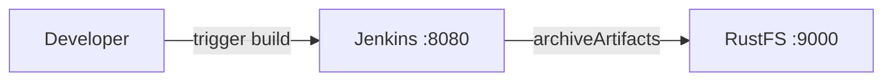
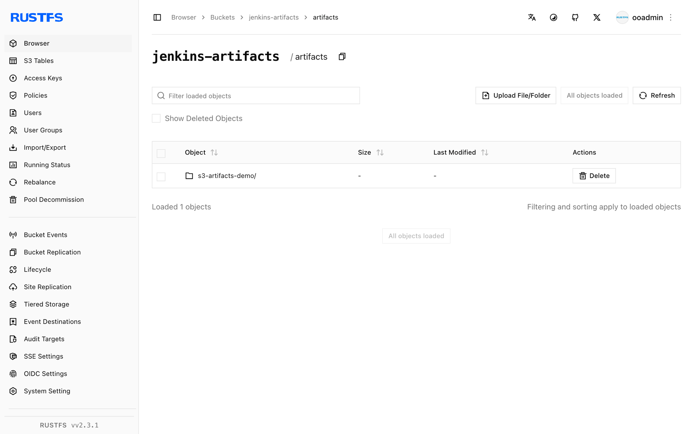

このガイドでは、自動化サーバーである [Jenkins](https://github.com/jenkinsci/jenkins) を、Artifact Manager on S3 プラグイン経由で **RustFS** に接続します。プラグインを入れた Jenkins を起動し、アーティファクトマネージャーを RustFS のバケットに向け、アーティファクトをアーカイブするジョブを実行して、アーティファクトが RustFS に保存されることを確認します。この流れは `jenkins/jenkins:lts-jdk17`（Jenkins 2.5xx LTS）と `rustfs/rustfs-x86-musl:v2.3.1` で検証済みです。

Docker が必要です。このデプロイはローカルでの統合テストを目的としており、本番環境向けではありません。

## アーキテクチャ



プラグインが有効な場合、標準の `archiveArtifacts` ステップ（または `stash` / `unstash`）でアーティファクトを公開するすべてのジョブは、コントローラーのディスクではなく、設定したプレフィックス配下の `jenkins-artifacts` バケットへアップロードします。

## 1. プロジェクトファイルを作成する

先にバケットを作成します。プラグインはバケットを検証しますが、作成はしません。

```bash
rc alias set rustfs http://<your-rustfs-endpoint>:9000 <your-access-key> <your-secret-key>
rc mb rustfs/jenkins-artifacts
```

Jenkins LTS イメージにプラグインをインストールする Dockerfile を作成します。

```dockerfile title="Dockerfile"
FROM jenkins/jenkins:lts-jdk17
USER root
RUN jenkins-plugin-cli --plugins artifact-manager-s3 aws-credentials
USER jenkins
```

`artifact-manager-s3` プラグインは必要な AWS 認証情報サポートを取り込みます。`aws-credentials` を明示すると、その認証情報タイプを利用できます。

RustFS と同じ Docker ネットワーク上で Jenkins をビルドして起動します。

```bash
docker build -t jenkins-rustfs .
docker run -d --name jenkins --network oo-rustfs_default \
  -p 8080:8080 -v jenkins-home:/var/jenkins_home jenkins-rustfs
```

セットアップウィザードを完了し、AWS 認証情報を作成します。**Manage Jenkins**（Jenkins の管理）→ **Credentials**（認証情報）→ **global** → **Add Credentials**（認証情報の追加）を開き、種類は **AWS Credential**、ID は `rustfs-creds` とし、RustFS のアクセスキーとシークレットキーを入力します。

## 2. アーティファクトマネージャーを設定する

`aws-global-configuration` プラグインの **Manage Jenkins → AWS Configuration**（AWS 設定）を開き、次を設定します。

- **Region name**（リージョン名）: `us-east-1`
- **Credentials**: `rustfs-creds`

**Manage Jenkins → System**（システム設定）を開き、**Artifact Management for Builds**（ビルドのアーティファクト管理）を探します。**Cloud Provider Amazon S3** を選び、S3 設定に次を入力します。

- **S3 Bucket Name**（S3 バケット名）: `jenkins-artifacts`
- **S3 Bucket Region**（S3 バケットのリージョン）: `us-east-1`
- **Base Prefix**（ベースプレフィックス）: `artifacts/`
- **Custom Endpoint**（カスタムエンドポイント）: `<your-rustfs-endpoint>:9000`（Compose ネットワーク内の例は `rustfs:9000`）
- **Custom Signing Region**（カスタム署名リージョン）: `us-east-1`
- **Use Path Style URL**（パススタイル URL を使用）: 有効
- **Use Insecure HTTP**（非セキュア HTTP を使用）: 有効
- **Disable Session Token**（セッショントークンを無効化）: 有効

TLS のない非 AWS エンドポイントでは、パススタイルアクセスと平文 HTTP が必要です。セッショントークンを無効にすると、プラグインは AWS STS を呼ばなくなります。単なるアクセスキーの組では STS に応答できません。**Validate S3 Bucket configuration**（S3 バケット設定の検証）をクリックして設定を確認し、保存します。

## 3. アーティファクトをアーカイブするジョブを実行する

ファイルを生成してアーカイブするフリースタイルジョブ（またはパイプライン）を作成します。

```groovy
pipeline {
    agent any
    stages {
        stage('Build') {
            steps {
                sh 'echo "jenkins artifact stored on rustfs" > report.txt'
            }
        }
    }
    post {
        always {
            archiveArtifacts 'report.txt'
        }
    }
}
```

ビルドを実行し、完了を待ちます。アーティファクトのアップロードは透過的に RustFS へ送られます。ジョブ設定に S3 は一切出てきません。

## 4. RustFS 内のオブジェクトを確認する

バケットを一覧します。

```bash
rc ls rustfs/jenkins-artifacts/ -r
```

アーティファクトはプレフィックス配下に、ジョブとビルド番号で整理されて保存されます。

```text
artifacts/s3-artifacts-demo/3/artifacts/report.txt
```



ビルドページからアーティファクトをダウンロードすると、RustFS から読み戻されます。

## 5. デプロイを停止またはリセットする

データを残したまま Jenkins を停止します。

```bash
docker rm -f jenkins
```

アーティファクトは `jenkins-artifacts` バケットに残ります。削除するにはバケットを削除します。

```bash
rc rb rustfs/jenkins-artifacts --force
```

## トラブルシューティング

### `StsException: The security token included in the request is invalid`

プラグインはセッション認証情報を得るために AWS STS を呼んでいます。S3 設定で **Disable Session Token** を有効にします。静的なアクセスキーの組では STS 呼び出しに応答できません。

### `UnknownHostException: jenkins-artifacts.rustfs`

プラグインは仮想ホスト形式を使っています。**Use Path Style URL** を有効にします。RustFS はホスト名ではなく URL パスからバケットを解決します。

### `No valid session credentials` または空の認証情報エラー

S3 バケット設定を使う**前に**、AWS Configuration ページで認証情報を選択して保存していること、および認証情報 ID が作成したものと一致することを確認します。

## 次のステップ

- 追加の Jenkins 連携を採用する前に、[S3 互換性ノート](/ja/administration/protocols/s3)を確認してください。
- [アクセスキー管理](/ja/security-compliance/iam/access-token)で本番用の専用認証情報を作成してください。
- [Artifact Manager on S3 プラグインのドキュメント](https://plugins.jenkins.io/artifact-manager-s3/)に従い、stash のサポートとクリーンアップのオプションを確認してください。
