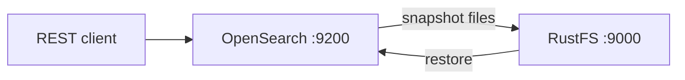

このガイドでは、Elasticsearch から派生したオープンソースの検索・分析スイートである [OpenSearch](https://github.com/opensearch-project/OpenSearch) を、`repository-s3` プラグイン経由で **RustFS** に接続します。RustFS のバケットをバックエンドとする S3 スナップショットリポジトリを登録し、インデックスのスナップショットを取得して復元します。この流れは `opensearchproject/opensearch:3.8.0` と同梱の `repository-s3` プラグインを、`rustfs/rustfs-x86-musl:v2.3.1` に対して検証済みです。

Docker、またはプラグインをインストールして設定を編集できる OpenSearch ノードが必要です。このデプロイはローカルでの統合テストを目的としており、本番環境向けではありません。

## アーキテクチャ



`repository-s3` プラグインは、スナップショットをシャードアーカイブとメタデータのブロブとしてバケットに書き込みます。登録はクラスター全体に適用されるため、すべてのノードにプラグインと同じクライアント設定が必要です。

## 1. OpenSearch を実行する

セキュリティを無効にし、ヒープを小さくしたシングルノードを起動します。

```bash
docker run -d --name opensearch --network oo-rustfs_default -p 9200:9200 \
  -e discovery.type=single-node \
  -e OPENSEARCH_JAVA_OPTS="-Xms512m -Xmx512m" \
  -e DISABLE_SECURITY_PLUGIN=true \
  opensearchproject/opensearch:3.8.0
```

`curl http://localhost:9200` がクラスター情報を返せば、ノードは準備完了です。1〜2 分かかることがあります。

## 2. repository-s3 プラグインをインストールする

S3 リポジトリプラグインは事前に読み込まれていません。インストールしてノードを再起動します。

```bash
docker exec opensearch bin/opensearch-plugin install --batch repository-s3
docker restart opensearch
```

## 3. S3 クライアントを設定する

認証情報はセキュア設定です。リポジトリのリクエストや `opensearch.yml` ではなく、OpenSearch のキーストアに入れます。接続情報のプレースホルダーをすべて置き換えて、キーストアのエントリを作成します。

```bash
docker exec opensearch sh -c \
  "printf '<your-access-key>' | bin/opensearch-keystore create 2>/dev/null; \
   printf '<your-access-key>' | bin/opensearch-keystore add -f -x s3.client.default.access_key; \
   printf '<your-secret-key>' | bin/opensearch-keystore add -f -x s3.client.default.secret_key"
```

非セキュアなクライアント設定を `config/opensearch.yml` に追加します。

```yaml title="opensearch.yml"
network.host: 0.0.0.0
plugins.security.disabled: true
s3.client.default.endpoint: http://<your-rustfs-endpoint>:9000
s3.client.default.protocol: http
s3.client.default.path_style_access: "true"
```

キーストアと新しい設定の両方を読み込むよう、ノードをもう一度再起動します。

```bash
docker restart opensearch
```

ノードの起動中にバケットを作成します。

```bash
rc mb rustfs/opensearch-snapshots
```

## 4. リポジトリを登録してスナップショットを取得する

ドキュメント入りのテストインデックスを作成してから、リポジトリを登録します。

```bash
curl -sX PUT http://localhost:9200/rustfs-demo -H "Content-Type: application/json" \
  -d '{"settings":{"number_of_shards":1}}'

curl -sX PUT http://localhost:9200/rustfs-demo/_doc/1 -H "Content-Type: application/json" \
  -d '{"product":"rustfs","via":"opensearch-snapshot"}'

curl -sX PUT "http://localhost:9200/_snapshot/rustfs-repo" -H "Content-Type: application/json" \
  -d '{"type":"s3","settings":{"bucket":"opensearch-snapshots","region":"us-east-1","server_side_encryption_type":"bucket_default"}}'
```

`server_side_encryption_type: bucket_default` の設定が重要です。これがないとプラグインは SSE-S3 を要求し、サーバー側の暗号化のマスターキーがないセルフホストの RustFS は拒否します。

スナップショットを取得し、完了を待ちます。

```bash
curl -sX PUT "http://localhost:9200/_snapshot/rustfs-repo/snapshot-1?wait_for_completion=true" \
  -H "Content-Type: application/json" -d '{"indices":"rustfs-demo"}'
```

```text
{"snapshot":{"snapshot":"snapshot-1","state":"SUCCESS","indices":["rustfs-demo"],...}}
```

## 5. オブジェクトを確認して復元する

バケットを一覧します。

```bash
rc ls rustfs/opensearch-snapshots/ -r
```

```text
index-0
index.latest
indices/5x1bwsWaSv2XINIbeoe-RQ/0/__GgxvoCw-TKuMMAYBq5Khag
indices/5x1bwsWaSv2XINIbeoe-RQ/0/snap-kRgFBiuyQIyPo3_-CMp7Hw.dat
meta-kRgFBiuyQIyPo3_-CMp7Hw.dat
snap-kRgFBiuyQIyPo3_-CMp7Hw.dat
```

インデックスを削除し、スナップショットから復元します。

```bash
curl -sX DELETE http://localhost:9200/rustfs-demo
curl -sX POST "http://localhost:9200/_snapshot/rustfs-repo/snapshot-1/_restore?wait_for_completion=true"
curl -s http://localhost:9200/rustfs-demo/_doc/1
```

```text
{"_index":"rustfs-demo","_id":"1","found":true,"_source":{"product":"rustfs","via":"opensearch-snapshot"}}
```


## 6. 停止またはリセットする

バケット内のオブジェクトを残したままデモを破棄します。

```bash
docker rm -f opensearch
```

保存したスナップショットを削除します。

```bash
rc rm rustfs/opensearch-snapshots/ --recursive --force
```

## トラブルシューティング

### `Setting [access_key] is insecure, but property [allow_insecure_settings] is not set`

リポジトリリクエスト内のインライン認証情報は拒否されます。手順 3 のとおりキーストアに保存します。OpenSearch では `access_key` と `secret_key` はセキュア設定です。

### `SSE-S3 requires RUSTFS_SSE_S3_MASTER_KEY ... (Status Code: 400)`

プラグインはデフォルトで SSE-S3 によりアップロードを暗号化します。手順 4 のとおり `"server_side_encryption_type": "bucket_default"` でリポジトリを登録し、暗号化ヘッダーを送らないようにします。

### 起動時に `unknown setting [s3.client.default.access_key]` が出る

この設定は repository-s3 プラグインを参照します。設定がある状態でノードが起動に失敗する場合、そのコンテナにプラグインが入っていません。手順 2 をやり直します。新しいコンテナでは、`docker exec` でインストールしたプラグインは失われます。

### リポジトリ検証が `path is not accessible` で失敗する

ノードがバケットに到達できません。`s3.client.default.endpoint` がコンテナから到達できること、`path_style_access` が `"true"` であること、キーストアの認証情報が読み込まれていることを確認します。認証情報は起動時に読まれるため、追加したあとは再起動します。

## 次のステップ

- 追加の OpenSearch リポジトリを採用する前に、[S3 互換性ノート](/ja/administration/protocols/s3)を確認してください。
- [アクセスキー管理](/ja/security-compliance/iam/access-token)で本番用の専用認証情報を作成してください。
- [OpenSearch のスナップショットドキュメント](https://docs.opensearch.org/docs/latest/tuning-your-cluster/availability-and-recovery/snapshots/index/)に従い、Snapshot Management（SM）ポリシーでスナップショットを自動化してください。
