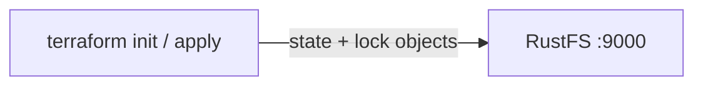

このガイドでは、HashiCorp の Infrastructure as Code ツールである [Terraform](https://github.com/hashicorp/terraform) を、S3 バックエンド経由で **RustFS** に接続します。ステートファイルと、同時実行を防ぐロックファイルは、オブジェクトとして RustFS に保存されます。バックエンドを初期化し、小さな設定を apply し、RustFS 内のステートオブジェクトを確認します。この流れは `terraform 1.12.2` と `rustfs/rustfs-x86-musl:v2.3.1` で検証済みです。

ワークステーションから到達できる RustFS のデプロイ（[インストール](/ja/installation) 配下のガイドを参照）と、`use_lockfile` による S3 ネイティブのロックに対応した Terraform 1.10 以降が必要です。

## アーキテクチャ



S3 バックエンドは、バケット内の `key` プレフィックス配下にステートファイルを保存します。`use_lockfile = true` にすると、実行がロックを保持しているあいだ Terraform は `<key>.tflock` オブジェクトを書き込みます。この構成では、以前の DynamoDB ベースのロックに代わる仕組みです。

## 1. プロジェクトファイルを作成する

作業ディレクトリを作成します。

```bash
mkdir rustfs-terraform
cd rustfs-terraform
```

設定を作成します。認証情報のプレースホルダーを置き換え、エンドポイントを RustFS サーバーに向けます。Terraform を同じホストで実行する場合は `localhost:9000` です。

```hcl title="main.tf"
terraform {
  backend "s3" {
    bucket                      = "my-bucket"
    key                         = "rustfs-demo/terraform.tfstate"
    region                      = "us-east-1"
    endpoint                    = "http://localhost:9000"
    access_key                  = "<your-access-key>"
    secret_key                  = "<your-secret-key>"
    skip_credentials_validation = true
    skip_region_validation      = true
    skip_metadata_api_check     = true
    skip_requesting_account_id  = true
    force_path_style            = true
    insecure                    = true
    use_lockfile                = true
  }
}

provider "local" {}

resource "local_file" "demo" {
  content  = "provisioned with terraform, state stored in RustFS"
  filename = "${path.module}/demo.txt"
}
```

`force_path_style` と `insecure` は、ローカルエンドポイントで RustFS が期待する、平文 HTTP 上のパススタイルアクセスを選びます。`use_lockfile` は S3 ネイティブのステートロックを有効にし、同時実行でステートが壊れないようにします。

## 2. バックエンドを初期化する

プロバイダーをダウンロードし、S3 バックエンドを設定します。

```bash
terraform init -input=false
```

```text
Successfully configured the backend "s3"! Terraform will automatically
use this backend unless the backend configuration changes.
```

## 3. 設定を apply する

リソースを作成し、ステートを RustFS に書き込みます。

```bash
terraform apply -auto-approve -input=false
```

```text
Apply complete! Resources: 1 added, 0 changed, 0 destroyed.
```

## 4. RustFS 内のステートを確認する

`rc` CLI でステートオブジェクトを一覧します。

```bash
docker run --rm --network <rustfs-network> -v "$PWD:/m" \
  --entrypoint /bin/sh rustfs/rc:latest \
  -c 'rc alias set rustfs http://rustfs:9000 <your-access-key> <your-secret-key> >/dev/null && rc ls rustfs/my-bucket/rustfs-demo --recursive'
```

```text
[2026-09-21 03:05:03]   1.62 KiB rustfs-demo/terraform.tfstate
```

RustFS Console（管理画面）でこのプレフィックスを参照することもできます。


## 5. ステートが RustFS から再読み込みされることを確認する

plan を実行します。Terraform は RustFS からステートを読み込み、設定と比較します。

```bash
terraform plan -input=false
```

```text
No changes. Your infrastructure matches the configuration.
```

ローカルファイルではなく RustFS からステートが読み戻されているため、plan に差分はありません。

## 6. 破棄してリセットする

リソースを破棄します。ステートの更新も同じように RustFS へ書き込まれます。

```bash
terraform destroy -auto-approve -input=false
```

最初からやり直すには、RustFS Console でステートオブジェクトを削除します（`rc rm` でも削除できます）。

## トラブルシューティング

### "dial tcp: lookup rustfs ... server misbehaving" または接続失敗

`endpoint` は Terraform を実行するマシンから到達できる必要があります。Compose ネットワーク内では `http://rustfs:9000` を、ホストからは `http://localhost:9000` を使用します。

### "Bucket cannot have ACLs set" または署名エラー

非 AWS エンドポイントでは `skip_credentials_validation`、`skip_region_validation`、`skip_metadata_api_check`、`skip_requesting_account_id`、`force_path_style`、`insecure` がすべて必要です。いずれかが欠けると、バックエンドは RustFS ではなく AWS のデフォルトへ通信します。

### ステートがバケットに現れない

バケットが存在すること、および認証情報が RustFS の認証情報と一致することを確認します。ステートオブジェクトは、最初の `init` または `apply` のあと、`key` のパス（このガイドでは `rustfs-demo/terraform.tfstate`）に現れます。

## 次のステップ

- 追加の S3 オペレーションを採用する前に、[S3 互換性ノート](/ja/administration/protocols/s3)を確認してください。
- [アクセスキー管理](/ja/security-compliance/iam/access-token)で本番用の専用認証情報を作成してください。
- [Terraform の S3 バックエンドドキュメント](https://developer.hashicorp.com/terraform/language/backend/s3)に従い、ワークスペースのプレフィックスやロールの引き受けなどのオプションを確認してください。
