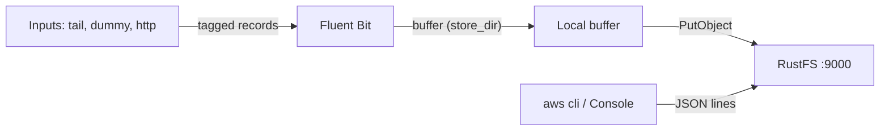

このガイドは、CNCF のログプロセッサー／フォワーダーである [Fluent Bit](https://github.com/fluent/fluent-bit) を、ログの送信先として **RustFS** に接続します。`s3` 出力を持つ Fluent Bit を実行し、レコードをディスクにバッファして RustFS バケットへアップロードし、配信されたログファイルを読み戻します。このワークフローは `fluent/fluent-bit:3.2.10` でパススタイル addressing により RustFS バケットへの書き込みを検証しました。

Docker が必要です。このデプロイはローカルでの結合テスト用であり、本番環境向けではありません。

## アーキテクチャ



S3 出力はタグ付きレコードを `store_dir` にバッファし、`total_file_size` に達するか `upload_timeout` が切れた時点でファイルをアップロードします。アップロードされた各オブジェクトは JSON Lines 形式のファイルです。

## 1. バケットを作成する

S3 出力はバケットを決して作成せず、バケットがないとアップロードは `NoSuchBucket` で失敗します。まず接続プレースホルダーをすべて置き換えてバケットを作成します：

```bash
aws s3 mb s3://my-bucket \
  --endpoint-url http://<your-rustfs-endpoint>:9000
```

## 2. S3 出力を設定する

Fluent Bit の設定ファイルを作成します：

```text title="fluent-bit.conf"
[SERVICE]
    Flush 2
    Log_Level info

[INPUT]
    Name dummy
    Tag rustfs.test
    Rate 200

[OUTPUT]
    Name s3
    Match *
    endpoint http://<your-rustfs-endpoint>:9000
    region us-east-1
    bucket my-bucket
    total_file_size 1M
    use_put_object On
    upload_timeout 30s
    store_dir /tmp/flb-store
    json_date_key date
    json_date_format iso8601
```

`use_put_object On` はバッファ済みファイルを 1 回の `PutObject` 呼び出しでアップロードします。`upload_timeout` は、バッファが `total_file_size` に達していなくても 30 秒後にアップロードを強制します。低流量の入力では必須で、指定しないとレコードがローカルディスクに留まり続けます。

:::note[カスタムエンドポイントはデフォルトでパススタイル]

Fluent Bit 3.2 には `s3_force_path_style` オプションがなく、プラグインはそれを未知のプロパティとして拒否します。`endpoint` がカスタム S3 サービスを指す場合、リクエストはパススタイルでバケットにアクセスし、RustFS のデフォルトと一致します。追加のフラグは不要です。

:::

## 3. Fluent Bit を実行する

標準の AWS 環境変数で認証情報を渡してコンテナを起動します：

```bash
docker run -d --name fluent-bit \
  -e AWS_ACCESS_KEY_ID=<your-access-key> \
  -e AWS_SECRET_ACCESS_KEY=<your-secret-key> \
  -v "$PWD/fluent-bit.conf:/fluent-bit/etc/fluent-bit.conf:ro" \
  fluent/fluent-bit:3.2.10
```

最初のアップロードを待ち、ワーカーが正常に起動したことを確認します：

```bash
docker logs fluent-bit 2>&1 | grep "worker #0 started"
```

```text
[output:s3:s3.0] worker #0 started
```

## 4. アップロードされたオブジェクトを確認する

バケットを一覧します。デフォルトのキー配置は `fluent-bit-logs/<tag>/YYYY/MM/DD/HH/MM/` です：

```bash
aws s3 ls s3://my-bucket/ --recursive \
  --endpoint-url http://<your-rustfs-endpoint>:9000
```

```text
2026-10-25 01:13:28  1021326 fluent-bit-logs/rustfs.test/2026/10/25/01/13/59-objectbmjH9744
2026-10-25 01:16:05   333735 fluent-bit-logs/rustfs.test/2026/10/25/01/15/34-objectKfCq13io
```

オブジェクトを 1 つ読み戻します。各行が 1 つの JSON レコードです：

```bash
aws s3 cp s3://my-bucket/fluent-bit-logs/rustfs.test/2026/10/25/01/13/59-objectbmjH9744 - \
  --endpoint-url http://<your-rustfs-endpoint>:9000 | head -2
```

```json
{"date":"2026-10-25T01:13:59.204844Z","message":"dummy"}
{"date":"2026-10-25T01:13:59.206396Z","message":"dummy"}
```


## 5. 停止またはリセット

バケットのオブジェクトを残したままデモを解体するには：

```bash
docker rm -f fluent-bit
```

アップロードされたログを削除するには：

```bash
aws s3 rm s3://my-bucket/fluent-bit-logs --recursive \
  --endpoint-url http://<your-rustfs-endpoint>:9000
```

## トラブルシューティング

### `PutObject request failed` と `NoSuchBucket`

出力バケットが存在しません。手順 1 のように作成してください。プラグインはバケットを作成しません。

### `[config] s3: unknown configuration property 's3_force_path_style'`

Fluent Bit 3.2 にはこのオプションがありません。削除してください。カスタムエンドポイントは既にパススタイル addressing を使います。

### オブジェクトが現れずログも静かなまま

バッファが `total_file_size` に達しておらず、`upload_timeout` も設定されていません。`upload_timeout 30s` を追加すると低流量の入力も定期的に送出されます。

### Fluent Bit のログに `InvalidAccessKeyId`

コンテナの認証情報環境変数が欠けているか誤っています。S3 出力は `AWS_ACCESS_KEY_ID` と `AWS_SECRET_ACCESS_KEY` を読み取ります。

## 次のステップ

- この出力でマルチパートアップロードや圧縮を有効にする前に [S3 互換性についての注意](/administration/protocols/s3) を確認してください。
- [アクセスキー管理](/security-compliance/iam/access-token) で本番用の専用認証情報を作成してください。
- [Fluent Bit S3 出力ドキュメント](https://docs.fluentbit.io/manual/pipeline/outputs/s3) に従い、同じバケットで `s3_key_format`・圧縮・`tail` 入力のチューニングを利用してください。
