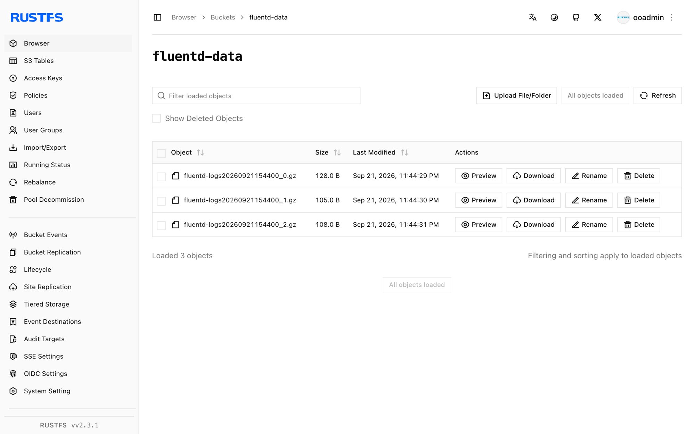

このガイドでは、オープンソースのデータコレクターである [Fluentd](https://github.com/fluent/fluentd) を、`out_s3` 出力プラグイン経由で **RustFS** に接続します。tail ソースで Fluentd を実行し、ログイベントをバッファし、フラッシュされたオブジェクトが RustFS に保存されることを確認します。この流れは `fluent/fluentd:v1.17-1`、`fluent-plugin-s3` 1.8.6、`rustfs/rustfs-x86-musl:v2.3.1` で検証済みです。

Docker が必要です。このデプロイはローカルでの統合テストを目的としており、本番環境向けではありません。

## アーキテクチャ


tail ソースは `app.log` の新しい行を読み、S3 出力へ渡します。S3 出力はタイムキーでイベントをバッファし、フラッシュ区間ごとに gzip オブジェクトを 1 つアップロードします。

## 1. プロジェクトファイルを作成する

先にバケットを作成します。Fluentd はバケットを作成しません。

```bash
rc alias set rustfs http://<your-rustfs-endpoint>:9000 <your-access-key> <your-secret-key>
rc mb rustfs/fluentd-data
```

公式の Fluentd イメージは非 root ユーザーで動作し、起動時に gem をインストールできません。S3 プラグインを入れた小さなイメージをビルドします。

```dockerfile title="Dockerfile"
FROM fluent/fluentd:v1.17-1
USER root
RUN gem install fluent-plugin-s3 --no-document
USER fluent
```

2 つの認証情報プレースホルダーを置き換えて、Fluentd の設定を作成します。

```nginx title="fluent.conf"
<source>
  @type tail
  path /var/log/app.log
  pos_file /var/log/app.log.pos
  tag rustfs.demo
  <parse>
    @type none
  </parse>
</source>

<match **>
  @type s3
  aws_key_id <your-access-key>
  aws_sec_key <your-secret-key>
  s3_bucket fluentd-data
  s3_endpoint http://rustfs:9000/
  s3_region us-east-1
  force_path_style true
  path fluentd-logs
  <buffer>
    @type memory
    timekey 30s
    timekey_wait 0s
    flush_mode immediate
  </buffer>
</match>
```

`force_path_style true` が必要です。これがないとプラグインは `fluentd-data.rustfs` をホスト名として組み立て、すべてのリクエストが DNS エラーで失敗します。Compose ネットワーク内のホスト名は `rustfs` です。ホストからは `http://localhost:9000/` を使用します。

イメージをビルドし、RustFS と同じ Docker ネットワーク上で Fluentd を起動します。

```bash
docker build -t fluentd-rustfs .
mkdir -p logs
docker run -d --name fluentd --network oo-rustfs_default \
  -v "$PWD/fluent.conf":/fluentd/etc/fluent.conf:ro \
  -v "$PWD/logs":/var/log fluentd-rustfs
```

## 2. ログイベントを生成する

監視対象のファイルに行を追記します。

```bash
echo "rustfs fluentd demo line 1" >> logs/app.log
echo "rustfs fluentd demo line 2" >> logs/app.log
```

30 秒のタイムキーと即時フラッシュモードでは、各区間が閉じた直後に gzip オブジェクトが 1 つアップロードされます。1 分ほど待ちます。

## 3. RustFS 内のオブジェクトを確認する

バケットを一覧します。

```bash
rc ls rustfs/fluentd-data/ -r
```

フラッシュ区間ごとに gzip 圧縮されたオブジェクトが 1 つできます。

```text
fluentd-logs20260921154400_0.gz
fluentd-logs20260921154400_1.gz
```

オブジェクトを 1 つ読み戻し、イベントが欠落していないことを確認します。

```bash
rc cat rustfs/fluentd-data/fluentd-logs20260921154400_0.gz | gunzip
```



## 4. デプロイを停止またはリセットする

データを残したまま Fluentd を停止します。

```bash
docker rm -f fluentd
```

オブジェクトは `fluentd-data` バケットに残ります。削除するにはバケットを削除します。

```bash
rc rb rustfs/fluentd-data --force
```

## トラブルシューティング

### `Unknown output plugin 's3'`

プラグインがインストールされていません。Dockerfile が `fluent` ユーザーに戻す前に、`root` として `fluent-plugin-s3` をインストールしていることを確認します。デフォルトユーザーのままコンテナ起動時にインストールすると、権限エラーで失敗します。

### `Failed to open TCP connection to fluentd-data.rustfs`

仮想ホスト形式が使われています。`s3` 出力に `force_path_style true` を追加し、バケットを URL パスに残します。

### ワーカーが再起動ループでクラッシュする

バケットが存在しないと出力は致命的に失敗します。Fluentd を起動する前に `fluentd-data` を作成し、起動ログを確認します。

```bash
docker logs fluentd | grep -iE "error|bucket" | tail
```

## 次のステップ

- 追加の Fluentd 出力を採用する前に、[S3 互換性ノート](/ja/administration/protocols/s3)を確認してください。
- [アクセスキー管理](/ja/security-compliance/iam/access-token)で本番用の専用認証情報を作成してください。
- [fluent-plugin-s3 のドキュメント](https://github.com/fluent/fluent-plugin-s3)に従い、オブジェクトキーの形式と圧縮オプションを確認してください。
