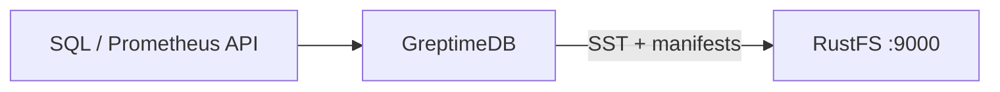

このガイドでは、オープンソースのクラウドネイティブな時系列データベースである [GreptimeDB](https://github.com/GreptimeTeam/greptimedb) を、オブジェクトストレージバックエンドとして **RustFS** に接続します。`[storage]` セクションを RustFS のバケットに向けたスタンドアロンインスタンスを起動し、SQL API で時系列の行を書き込み、バケット内の Parquet ファイルとマニフェストを確認します。この流れは `greptime/greptimedb`（main、コミット `179ff8e5`）を `rustfs/rustfs-x86-musl:v2.3.1` に対して検証済みです。

Docker、またはローカルの GreptimeDB バイナリが必要です。このデプロイはローカルでの統合テストを目的としており、本番環境向けではありません。

## アーキテクチャ



GreptimeDB は先行書き込みログ（WAL）と直近のデータをローカルに保持し、その後 SSTable（Parquet）とテーブルマニフェストをオブジェクトストレージへ永続化します。ストレージバックエンドを RustFS に向けると、バケットがすべてのテーブルデータの永続的な保管先になります。

## 1. ストレージバックエンドを設定する

接続情報のプレースホルダーをすべて置き換え、S3 ストレージセクションを持つ設定ファイルを作成し、バケットも作成します。

```toml title="greptimedb.toml"
[storage]
type = "S3"
bucket = "<your-bucket>"
root = "greptimedb"
access_key_id = "<your-access-key>"
secret_access_key = "<your-secret-key>"
endpoint = "http://<your-rustfs-endpoint>:9000"
region = "us-east-1"
```

GreptimeDB はカスタムエンドポイントに対してデフォルトでパススタイルのリクエストを使います。仮想ホスト形式は `enable_virtual_host_style` で明示的に有効にする必要があり、RustFS では追加のフラグは不要です。

## 2. GreptimeDB を実行する

設定ファイルを指定してスタンドアロンインスタンスを起動します。

```bash
docker run -d --name greptimedb --network oo-rustfs_default -p 4000:4000 -p 4002:4002 \
  -v "$PWD/greptimedb.toml":/etc/greptimedb/greptimedb.toml:ro \
  greptime/greptimedb:latest standalone start \
  --http-addr 0.0.0.0:4000 \
  --mysql-addr 0.0.0.0:4002 \
  --config-file /etc/greptimedb/greptimedb.toml
```

ポート `4000` は HTTP の SQL エンドポイント、`4002` は MySQL プロトコルです。

## 3. 時系列を書き込んでクエリする

テーブルを作成し、行を挿入して読み戻します。HTTP の SQL エンドポイントはフォームエンコードのリクエストを受け付けます。

```bash
curl -s -X POST "http://localhost:4000/v1/sql" \
  --data-urlencode "sql=CREATE TABLE rustfs_demo (host STRING, cpu DOUBLE, mem DOUBLE, ts TIMESTAMP TIME INDEX)"

curl -s -X POST "http://localhost:4000/v1/sql" \
  --data-urlencode "sql=INSERT INTO rustfs_demo VALUES (\"node-1\", 0.31, 0.62, 1790681000000), (\"node-1\", 0.35, 0.63, 1790681060000), (\"node-2\", 0.51, 0.71, 1790681000000)"
```

```text
{"output":[{"affectedrows":3}],"execution_time_ms":2}
```

行をクエリして読み戻します。

```bash
curl -s -X POST "http://localhost:4000/v1/sql" \
  --data-urlencode "sql=SELECT * FROM rustfs_demo ORDER BY ts"
```

```text
{"output":[{"records":{"rows":[["node-2",0.51,0.71,1790681000000],["node-1",0.35,0.63,1790681060000]],"total_rows":2}}]}
```

## 4. RustFS 内のオブジェクトを確認する

バケットを一覧します。memtable（メモリ上の書き込みバッファ）のフラッシュ後、バケットには Parquet の SSTable と JSON マニフェストが入ります。

```bash
rc ls rustfs/<your-bucket>/ -r
```

```text
greptimedb/data/greptime/public/1024/1024_0000000000/manifest/00000000000000000000.json
greptimedb/data/greptime/greptime_private/1025/1025_0000000000/b11e8b25-5763-4f05-bcab-b6ee0a756a69.parquet
greptimedb/data/greptime/greptime_private/1025/1025_0000000000/manifest/00000000000000000001.json
```

各データベースは `data/` 配下にディレクトリを持ち、リージョン（GreptimeDB のデータ分割単位）ごとの `manifest/*.json` が、クエリ時に GreptimeDB が読み戻す SSTable を記述します。


## 5. 停止またはリセットする

バケット内のオブジェクトを残したままデモを破棄します。

```bash
docker rm -f greptimedb
```

保存したデータを削除します。

```bash
rc rm rustfs/<your-bucket>/ --recursive --force
```

## トラブルシューティング

### `Form requests must have Content-Type: application/x-www-form-urlencoded`

`/v1/sql` の HTTP エンドポイントはフォームエンコードのボディだけを受け付けます。SQL は JSON ボディではなく、`curl --data-urlencode "sql=..."`（または `application/x-www-form-urlencoded`）で渡します。

### バケットが空のままになる

GreptimeDB は memtable をオブジェクトストレージへ非同期にフラッシュします。挿入を数回追加して数秒待つか、手動フラッシュを実行してから、バケットを再度一覧します。

### S3 エラーで起動に失敗する

`endpoint` にスキームが含まれていること、バケットが存在すること、`access_key_id` と `secret_access_key` が RustFS のアクセスキーと一致することを確認します。`root` は省略できますが、指定するとテーブルツリーが既知のプレフィックス配下にまとまります。

## 次のステップ

- 追加の GreptimeDB ストレージオプションを採用する前に、[S3 互換性ノート](/ja/administration/protocols/s3)を確認してください。
- [アクセスキー管理](/ja/security-compliance/iam/access-token)で本番用の専用認証情報を作成してください。
- [GreptimeDB の設定リファレンス](https://docs.greptime.com/operational-guide/configure/configure-datanode/)に従い、本番ワークロード向けにフラッシュ間隔とキャッシュ層を調整してください。
