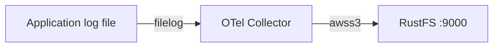

このガイドでは、CNCF のテレメトリパイプラインである [OpenTelemetry Collector](https://opentelemetry.io/docs/collector/) を、Collector の `awss3` exporter 経由で **RustFS** に接続します。`filelog` レシーバーを持つ contrib 版 Collector を実行し、ファイルのログ行を `otel-data` バケットへ送り、RustFS 内のパーティション分割されたオブジェクトを確認します。この流れは `otel/opentelemetry-collector-contrib:0.138.0` と `rustfs/rustfs-x86-musl:v2.3.1` で検証済みです。

Docker が必要です。このデプロイはローカルでの統合テストを目的としており、本番環境向けではありません。

## アーキテクチャ



`filelog` レシーバーはログファイルを tail し、`awss3` exporter はバッチを時刻ベースのプレフィックスに分割してバケットへアップロードします。メトリクスとトレースも、それぞれのパイプラインで同じ exporter に通せます。

## 1. プロジェクトファイルを作成する

先にバケットを作成します。exporter はバケットを作成しません。

```bash
rc alias set rustfs http://<your-rustfs-endpoint>:9000 <your-access-key> <your-secret-key>
rc mb rustfs/otel-data
```

2 つの認証情報プレースホルダーを置き換えて、Collector の設定を作成します。

```yaml title="config.yaml"
receivers:
  filelog:
    include: [/var/log/app.log]
    start_at: beginning

exporters:
  awss3:
    s3uploader:
      region: us-east-1
      s3_bucket: otel-data
      endpoint: http://rustfs:9000
      s3_force_path_style: true
      disable_ssl: true
      file_prefix: logs/app
    marshaler: body

service:
  pipelines:
    logs:
      receivers: [filelog]
      exporters: [awss3]
```

exporter は標準の環境変数 `AWS_ACCESS_KEY_ID`、`AWS_SECRET_ACCESS_KEY`、`AWS_REGION` から認証情報を読みます。`marshaler: body` は各ログ行をプレーンテキストとして書き込みます。省略すると OTLP JSON として保存されます。平文 HTTP の非 AWS エンドポイントでは `s3_force_path_style` と `disable_ssl` が必要です。

Compose ファイルを作成します。

```yaml title="compose.yaml"
services:
  collector:
    image: otel/opentelemetry-collector-contrib:0.138.0
    command: ["--config=/etc/otelcol-contrib/config.yaml"]
    environment:
      AWS_ACCESS_KEY_ID: <your-access-key>
      AWS_SECRET_ACCESS_KEY: <your-secret-key>
      AWS_REGION: us-east-1
    volumes:
      - ./config.yaml:/etc/otelcol-contrib/config.yaml:ro
      - ./app.log:/var/log/app.log
    networks:
      - otel

networks:
  otel:
```

## 2. Collector を起動してログを生成する

スタックを起動し、監視対象のファイルに行を追記します。

```bash
echo "otel demo log line one" > app.log
docker compose up -d
echo "second line after start" >> app.log
```

Collector はファイルを先頭から tail し、パーティションが切り替わるときに各バッファをアップロードします。最後の行のあと、確認まで 1 分ほど見てください。

## 3. RustFS 内のオブジェクトを確認する

バケットを一覧します。

```bash
rc ls rustfs/otel-data/ -r
```

ログレコードは、設定したファイルプレフィックス付きの時刻ベースのパーティション配下にアップロードされます。

```text
year=2026/month=09/day=21/hour=15/minute=53/logs/applogs_288361608.txt
```

オブジェクトを 1 つ読み戻し、行が欠落せず届いていることを確認します。

```bash
rc cat rustfs/otel-data/year=2026/month=09/day=21/hour=15/minute=53/logs/applogs_288361608.txt
```

```text
otel demo log line one
second line after start
```


## 4. デプロイを停止またはリセットする

データを残したまま Collector を停止します。

```bash
docker compose down
```

オブジェクトは `otel-data` バケットに残ります。削除するにはバケットを削除します。

```bash
rc rb rustfs/otel-data --force
```

## トラブルシューティング

### Collector の起動時に `has invalid keys` が出る

`awss3` exporter のスキーマは Collector のリリースによって異なります。バージョン 0.138 では、上記のとおりアップロード設定が `s3uploader` 配下に入り、エンドポイントのキーは `endpoint` です（`s3_endpoint` ではありません）。新しいリリースではこれらのキーがトップレベルに移っています。使用する Collector のバージョンの README を確認してください。

### バケットに何も現れない

Collector コンテナに認証情報の環境変数が設定されていること、`s3_force_path_style` が `true` であること、exporter が Compose ネットワーク内から `http://rustfs:9000` に到達できることを確認します。同じパイプラインで `debug` exporter を有効にすると、レコードが流れているかを確認できます。

## 次のステップ

- 追加の Collector 操作を採用する前に、[S3 互換性ノート](/ja/administration/protocols/s3)を確認してください。
- [アクセスキー管理](/ja/security-compliance/iam/access-token)で本番用の専用認証情報を作成してください。
- [AWS S3 exporter のドキュメント](https://github.com/open-telemetry/opentelemetry-collector-contrib/tree/main/exporter/awss3exporter)に従い、メトリクスとトレースのパイプラインを追加してください。
