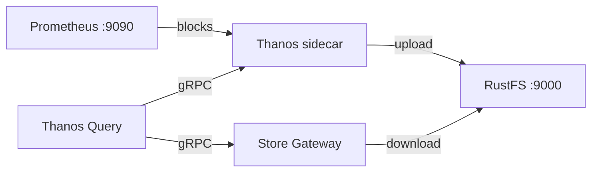

このガイドでは、長期保存を備えた高可用性 Prometheus 構成である [Thanos](https://github.com/thanos-io/thanos) を、オブジェクトストアとして **RustFS** に接続します。TSDB ブロックを RustFS へアップロードする Thanos サイドカー付きの Prometheus を実行し、Store Gateway と Query フロントエンドを通じて過去データをクエリします。この流れは `thanosio/thanos:v0.37.2`、`prom/prometheus:v2.53.1`、`rustfs/rustfs-x86-musl:v2.3.1` で検証済みです。

Docker と Compose プラグインが必要です。このデプロイはローカルでの統合テストを目的としており、本番環境向けではありません。

## アーキテクチャ



サイドカーは Prometheus の TSDB ディレクトリを監視し、2 時間ごとのブロックを RustFS の `thanos-data` バケットへアップロードします。Store Gateway は同じバケットを読み、過去のブロックに関するクエリに応答します。そのため Query は、ライブデータをサイドカー経由で、古いデータを Store Gateway 経由で解決します。

## 1. プロジェクトファイルを作成する

作業ディレクトリを作成します。

```bash
mkdir rustfs-thanos
cd rustfs-thanos
```

環境変数ファイルを作成し、2 つの認証情報プレースホルダーを置き換えます。

```ini title=".env"
RUSTFS_ACCESS_KEY=<your-access-key>
RUSTFS_SECRET_KEY=<your-secret-key>
```

`thanos-data` バケットには専用の認証情報を使用してください。`.env` をバージョン管理にコミットしないでください。

外部ラベル付きの Prometheus 設定を作成します。Thanos はブロックの重複排除に外部ラベルを必要とします。

```yaml title="prometheus.yml"
global:
  scrape_interval: 5s
  external_labels:
    monitor: rustfs-demo

scrape_configs:
  - job_name: prometheus
    static_configs:
      - targets: ["localhost:9090"]
  - job_name: rustfs
    metrics_path: /metrics
    static_configs:
      - targets: ["rustfs:9000"]
```

Thanos のオブジェクトストア設定を作成します。

```yaml title="bucket.yml"
type: S3
config:
  bucket: thanos-data
  endpoint: rustfs:9000
  access_key: ${RUSTFS_ACCESS_KEY}
  secret_key: ${RUSTFS_SECRET_KEY}
  insecure: true
```

Thanos 自身は `.env` ファイルを展開しません。スタックを起動する前に、プレースホルダーを `.env` で設定した同じ値に置き換えます。

```bash
sed -i.bak "s|\${RUSTFS_ACCESS_KEY}|$(grep RUSTFS_ACCESS_KEY .env | cut -d= -f2)|;s|\${RUSTFS_SECRET_KEY}|$(grep RUSTFS_SECRET_KEY .env | cut -d= -f2)|" bucket.yml
```

Compose ファイルを作成します。

```yaml title="compose.yaml"
services:
  rustfs:
    image: rustfs/rustfs-x86-musl:v2.3.1
    environment:
      RUSTFS_ACCESS_KEY: ${RUSTFS_ACCESS_KEY}
      RUSTFS_SECRET_KEY: ${RUSTFS_SECRET_KEY}
      RUSTFS_VOLUMES: /data
      RUSTFS_ADDRESS: ":9000"
      RUSTFS_CONSOLE_ADDRESS: ":9001"
      RUSTFS_CONSOLE_ENABLE: "true"
    volumes:
      - rustfs-data:/data
    ports:
      - "9000:9000"
      - "9001:9001"
    healthcheck:
      test: ["CMD", "curl", "-sf", "http://127.0.0.1:9000/health"]
      interval: 10s
      timeout: 5s
      retries: 6
      start_period: 10s
    networks:
      - thanos

  create-bucket:
    image: rustfs/rc:latest
    depends_on:
      rustfs:
        condition: service_healthy
    environment:
      RUSTFS_ACCESS_KEY: ${RUSTFS_ACCESS_KEY}
      RUSTFS_SECRET_KEY: ${RUSTFS_SECRET_KEY}
    entrypoint:
      - /bin/sh
      - -c
      - |
        /usr/bin/rc alias set rustfs http://rustfs:9000 "$${RUSTFS_ACCESS_KEY}" "$${RUSTFS_SECRET_KEY}"
        /usr/bin/rc mb --ignore-existing rustfs/thanos-data
    networks:
      - thanos

  prometheus:
    image: prom/prometheus:v2.53.1
    command:
      - --config.file=/etc/prometheus/prometheus.yml
      - --storage.tsdb.path=/prometheus
      - --storage.tsdb.min-block-duration=2h
      - --storage.tsdb.max-block-duration=2h
      - --web.enable-lifecycle
    volumes:
      - ./prometheus.yml:/etc/prometheus/prometheus.yml:ro
      - prom-data:/prometheus
    ports:
      - "9090:9090"
    networks:
      - thanos

  sidecar:
    image: thanosio/thanos:v0.37.2
    command:
      - sidecar
      - --tsdb.path=/prometheus
      - --prometheus.url=http://prometheus:9090
      - --objstore.config-file=/etc/thanos/bucket.yml
    volumes:
      - ./bucket.yml:/etc/thanos/bucket.yml:ro
      - prom-data:/prometheus
    depends_on:
      create-bucket:
        condition: service_completed_successfully
    networks:
      - thanos

  store:
    image: thanosio/thanos:v0.37.2
    command:
      - store
      - --objstore.config-file=/etc/thanos/bucket.yml
      - --data-dir=/data
    volumes:
      - ./bucket.yml:/etc/thanos/bucket.yml:ro
      - store-data:/data
    depends_on:
      create-bucket:
        condition: service_completed_successfully
    networks:
      - thanos

  query:
    image: thanosio/thanos:v0.37.2
    command:
      - query
      - --http-address=0.0.0.0:9090
      - --store=sidecar:10901
      - --store=store:10901
    ports:
      - "9091:9090"
    depends_on:
      - sidecar
      - store
    networks:
      - thanos

networks:
  thanos:

volumes:
  rustfs-data:
  prom-data:
  store-data:
```

`--storage.tsdb.min-block-duration` と `--storage.tsdb.max-block-duration` は Prometheus のコンパクションを無効にします。コンパクション中の TSDB からブロックを送出すると、ローカルのブロックがアップロード済みのものと一致しなくなるため、サイドカーは送出を拒否します。

## 2. デプロイを検証して開始する

コンテナを起動する前に Compose ファイルを解決します。

```bash
docker compose config
```

スタックを起動し、サイドカーが ready を報告するまで待ちます。

```bash
docker compose up -d
docker compose logs sidecar | grep -m1 "status=ready"
```

サイドカーが Prometheus の外部ラベルを取り込んだことを確認します。

```bash
docker compose logs sidecar | grep "external labels"
```

Thanos Query の UI は `http://localhost:9091` で応答し、RustFS Console（管理画面）は `http://localhost:9001` で動作します。

## 3. ブロックを RustFS へアップロードする

サイドカーは Prometheus がブロックをコンパクトしたときにアップロードします。これは 2 時間のブロック境界で起きます。すぐにブロックを作るには、管理 API で TSDB のスナップショットを取得します。コンパクションが無効な場合、サイドカーはヘッドブロックのスナップショットをそのまま送出します。

```bash
curl -s -XPOST http://localhost:9090/api/v1/admin/tsdb/snapshot | head -c 200
```

アップロードを待ち、Prometheus 内のシッパーの状態を確認します。

```bash
sleep 60
docker compose exec prometheus cat /prometheus/thanos.shipper.json
```

`uploaded` の一覧にブロック ID が入るはずです。

```json
{
	"version": 1,
	"uploaded": [
		"01M31EPTZC5E0SETZTP0SPFY79"
	]
}
```

## 4. RustFS から過去データをクエリする

Store Gateway はバケットを定期的に同期します。アップロードされたブロックをダウンロードしたことを確認します。

```bash
docker compose logs store | grep "loaded new block"
```

ブロックの時間範囲について、Query フロントエンド経由で系列をクエリします。

```bash
START=$(date -u -d '2 hours ago' +%s)
END=$(date -u +%s)
curl -s "http://localhost:9091/api/v1/query_range?query=up%7Bjob%3D%22prometheus%22%7D&start=$START&end=$END&step=30" | head -c 300
```

Store Gateway は RustFS からダウンロードしたブロックで応答し、サイドカーはライブのヘッドに応答します。どちらの経路も同じ Query エンドポイントで解決されます。

## 5. RustFS 内のオブジェクトを確認する

バケットを一覧します。

```bash
docker compose exec rustfs /usr/bin/rc ls local/thanos-data/ -r
```

各ブロックは 3 つのオブジェクトとして保存されます。チャンクファイル、インデックス、`meta.json` です。

```text
01M31EPTZC5E0SETZTP0SPFY79/chunks/000001
01M31EPTZC5E0SETZTP0SPFY79/index
01M31EPTZC5E0SETZTP0SPFY79/meta.json
```


## 6. デプロイを停止またはリセットする

データを残したままコンテナを停止します。

```bash
docker compose down
```

RustFS のボリュームはアップロード済みブロックを保持するため、再起動後も Store Gateway は過去のクエリに応答します。RustFS 内のブロックを含めてすべて削除するには、`--volumes` を追加します。

## トラブルシューティング

### サイドカーが `Compaction needs to be disabled` を記録する

Prometheus は `--storage.tsdb.min-block-duration` と `--storage.tsdb.max-block-duration` を同じ値で実行する必要があります。Compose ファイルのとおり両方を `2h` に設定します。そうしないと、サイドカーはローカルブロックが変化しないことを保証できず、アップロードを拒否します。

### `The specified bucket does not exist`

Thanos はバケットを作成しません。`create-bucket` サービスが正常に完了したことを確認します。

```bash
docker compose logs create-bucket
```

### クエリが過去データを返さない

Store Gateway が少なくとも 1 つのブロックを読み込んでいること（`docker compose logs store | grep "loaded new block"`）、およびクエリの時間範囲がアップロード済みブロックの範囲内であることを確認します。ブロックの `minTime` と `maxTime` は、RustFS Console の `meta.json` で確認できます。

## 次のステップ

- 追加の Thanos コンポーネントを採用する前に、[S3 互換性ノート](/ja/administration/protocols/s3)を確認してください。
- [アクセスキー管理](/ja/security-compliance/iam/access-token)で本番用の専用認証情報を作成してください。
- [Thanos のドキュメント](https://thanos.io/tip/thanos/getting-started.md)に従い、本番トポロジ向けに Compactor、Ruler、Receive を追加してください。
