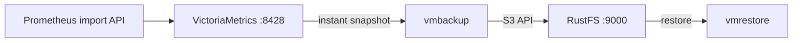
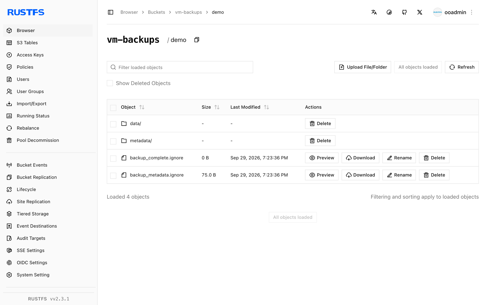

このガイドでは、Prometheus 互換の時系列データベースである [VictoriaMetrics](https://github.com/VictoriaMetrics/VictoriaMetrics) を、`vmbackup` と `vmrestore` 経由で **RustFS** に接続します。シングルノードのインスタンスを実行し、メトリクスをインポートし、即時スナップショットを作成して RustFS のバケットへバックアップし、新しいディレクトリへデータを復元します。この流れは `victoria-metrics`、`vmbackup`、`vmrestore` の v1.x イメージを `rustfs/rustfs-x86-musl:v2.3.1` に対して検証済みです。

Docker が必要です。このデプロイはローカルでの統合テストを目的としており、本番環境向けではありません。

## アーキテクチャ



`vmbackup` はストレージディレクトリの一貫したある時点のスナップショットを、任意の S3 互換エンドポイントへアップロードします。`vmrestore` はその逆を行い、VictoriaMetrics インスタンスがそのまま開けるデータディレクトリを作ります。

## 1. VictoriaMetrics を実行する

バケットを作成し、シングルノードのインスタンスを起動します。

```bash
rc mb rustfs/vm-backups

docker run -d --name vm --network oo-rustfs_default -p 8428:8428 \
  -v vm-data:/storage \
  victoriametrics/victoria-metrics:latest \
  -storageDataPath=/storage -retentionPeriod=100y
```

## 2. メトリクスをインポートする

Prometheus のインポート API でサンプルを数件書き込みます。

```bash
echo "vm_demo_metric 123" | curl -s --data-binary @- http://localhost:8428/api/v1/import/prometheus
echo "vm_demo_metric 456" | curl -s --data-binary @- http://localhost:8428/api/v1/import/prometheus
```

エンドポイントは `204 No Content` を返します。データをクエリできることを確認します。

```bash
curl -s "http://localhost:8428/api/v1/export?match[]=vm_demo_metric"
```

```text
{"metric":{"__name__":"vm_demo_metric"},"values":[123,456],"timestamps":[1790680894604,1790680894619]}
```

## 3. スナップショットを作成する

VictoriaMetrics に一貫したスナップショットを要求します。

```bash
curl -s http://localhost:8428/snapshot/create
```

```text
{"status":"ok","snapshot":"20260929112134-18D9C6C76704F913"}
```

## 4. スナップショットを RustFS へバックアップする

認証情報のプレースホルダーを置き換え、同じストレージボリュームに対して `vmbackup` を実行します。スナップショット名は手順 3 のものです。

```bash
docker run --rm --network oo-rustfs_default \
  -e AWS_ACCESS_KEY_ID=<your-access-key> \
  -e AWS_SECRET_ACCESS_KEY=<your-secret-key> \
  --volumes-from vm \
  victoriametrics/vmbackup:latest \
  -storageDataPath=/storage \
  -snapshotName=20260929112134-18D9C6C76704F913 \
  -dst=s3://vm-backups/demo \
  -customS3Endpoint=http://<your-rustfs-endpoint>:9000
```

```text
backup ... to S3{bucket: "vm-backups", dir: "demo/"} is complete; uploaded 760 bytes
```

`-customS3Endpoint` は AWS SDK を RustFS へ向けます。カスタムエンドポイントには、自動的にパススタイルアクセスが使われます。EC2 メタデータサービスがないホストでは `AWS_EC2_METADATA_DISABLED=true` を設定し、認証情報の探索による遅延を避けます。

## 5. 確認して復元する

バケットのプレフィックスを一覧します。

```bash
rc ls rustfs/vm-backups/demo/
```

```text
backup_complete.ignore
backup_metadata.ignore
data/
metadata/
```

`backup_complete.ignore` はバックアップの完了を示します。新しいディレクトリへ復元します。

```bash
docker run --rm --network oo-rustfs_default \
  -e AWS_ACCESS_KEY_ID=<your-access-key> \
  -e AWS_SECRET_ACCESS_KEY=<your-secret-key> \
  -v /opt/vm-restore:/restore \
  victoriametrics/vmrestore:latest \
  -src=s3://vm-backups/demo \
  -storageDataPath=/restore \
  -customS3Endpoint=http://<your-rustfs-endpoint>:9000
```

```text
restored 760 bytes from backup in 0.055 seconds
```

復元先ディレクトリには `data/`、`metadata/`、ロックファイルが含まれます。これは VictoriaMetrics インスタンスが `-storageDataPath` に期待する構成そのものです。



## 6. 停止またはリセットする

バケット内のオブジェクトを残したままデモを破棄します。

```bash
docker rm -f vm
docker volume rm vm-data
```

保存したバックアップを削除します。

```bash
rc rm rustfs/vm-backups/ --recursive --force
```

## トラブルシューティング

### `vmbackup` が起動時にハングする、または認証情報を見つけられない

環境変数の認証情報がないと、AWS SDK は EC2 メタデータサービスを探索します。IMDS がないマシンでは、キーの変数と一緒に `AWS_EC2_METADATA_DISABLED=true` をエクスポートします。

### バックアップの一部が実行のたびに再アップロードされる

`vmbackup` はローカルとリモートのファイルハッシュを比較して増分バックアップを行います。新しいディレクトリへ復元してそこから `vmbackup` を実行すると、すべてが再アップロードされます。増分実行には元のデータディレクトリを維持します。

### インポート直後のクエリが何も返さない

インポートは非同期に受け付けられ、負荷の高いシングルノードでは即時クエリのエンドポイントが遅れることがあります。スナップショットを作成する前に `/api/v1/export` で確認するか、数秒待ちます。

## 次のステップ

- 追加の VictoriaMetrics コンポーネントを採用する前に、[S3 互換性ノート](/ja/administration/protocols/s3)を確認してください。
- [アクセスキー管理](/ja/security-compliance/iam/access-token)で本番用の専用認証情報を作成してください。
- [vmbackup のドキュメント](https://docs.victoriametrics.com/vmbackup/)に従い、バックアップのスケジュールと古いスナップショットの削除を設定してください。
