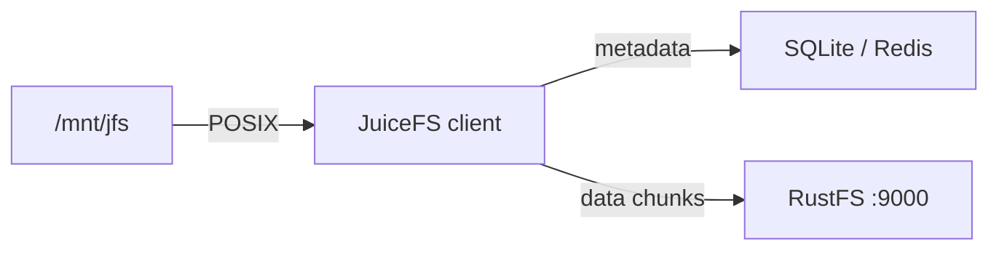
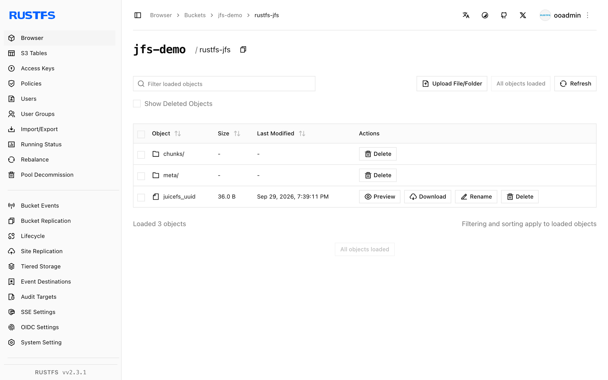

このガイドでは、クラウドネイティブな分散 POSIX ファイルシステムである [JuiceFS](https://github.com/juicedata/juicefs) を、オブジェクトストレージのバックエンドとして **RustFS** に接続します。データチャンクが RustFS のバケットに置かれるボリュームをフォーマットし、ローカルにマウントして、マウント経由でファイルを読み書きします。手順は `juicefs v1.3.1`（コミュニティ版、SQLite メタデータエンジン）と `rustfs/rustfs-x86-musl:v2.3.1` の組み合わせで確認済みです。

JuiceFS のバイナリ、メタデータエンジン、FUSE（Linux では `fuse3`）が必要です。このデプロイはローカルでの連携テスト用であり、本番向けではありません。

## アーキテクチャ



JuiceFS は各ファイルをチャンクに分割し、バケット内の `chunks/` 配下にオブジェクトとして保存します。名前、inode、レイアウトはメタデータエンジンが追跡します。ファイルシステムはローカルディスクのように振る舞いますが、データ自体はローカルに持ちません。

## 1. ボリュームをフォーマットする

接続用のプレースホルダーをすべて置き換えて、バケットを作成し、RustFS をバックエンドとする JuiceFS ボリュームをフォーマットします。バケット URL にエンドポイントが含まれ、これによりパススタイルアクセスが選択されます。

```bash
rc mb rustfs/jfs-demo

juicefs format \
  --storage s3 \
  --bucket http://<your-rustfs-endpoint>:9000/jfs-demo \
  --access-key <your-access-key> \
  --secret-key <your-secret-key> \
  sqlite3:///opt/juicefs/jfs.db \
  rustfs-jfs
```

```text
Data use s3://<your-rustfs-endpoint>:9000/jfs-demo/rustfs-jfs/
<STATUS> OK, rustfs-jfs is ready
```

このテストのメタデータエンジンは `sqlite3:///opt/juicefs/jfs.db` です。本番では、複数のクライアントが同じボリュームをマウントできるよう、Redis、MySQL、または PostgreSQL を使います。

## 2. ボリュームをマウントする

同じメタデータ URL でファイルシステムをマウントします。

```bash
mkdir -p /mnt/jfs
juicefs mount -d sqlite3:///opt/juicefs/jfs.db /mnt/jfs
```

```text
OK, rustfs-jfs is ready at /mnt/jfs
```

`-d` フラグはマウントをバックグラウンドで実行します。これでボリュームは POSIX ファイルシステムになります。

## 3. ファイルを読み書きする

ほかのディレクトリと同じようにマウントを使います。

```bash
echo "hello rustfs jfs" > /mnt/jfs/hello.txt
dd if=/dev/urandom of=/mnt/jfs/blob.bin bs=1M count=3
mkdir -p /mnt/jfs/dir1 && echo nested > /mnt/jfs/dir1/nested.txt
cat /mnt/jfs/hello.txt
```

```text
hello rustfs jfs
```

`juicefs info` でボリュームを確認します。

```text
/mnt/jfs :
  inode: 1
  files: 2
   dirs: 2
 length: 3.00 MiB
```

## 4. RustFS でチャンクを確認する

バケットのプレフィックスを一覧します。

```bash
rc ls rustfs/jfs-demo/ -r
```

各ファイルは、コンテンツアドレス指定のチャンクオブジェクトに分割されています。

```text
rustfs-jfs/chunks/0/0/1_0_17
rustfs-jfs/chunks/0/0/3_0_3145728
rustfs-jfs/chunks/0/0/4_0_7
```

チャンク名には inode、チャンクインデックス、サイズがエンコードされています。たとえば `3_0_3145728` は、手順 3 で書き込んだ 3 MiB のファイルです。



## 5. 停止またはリセットする

ボリュームをアンマウントし、必要に応じてボリュームのメタデータとバケットデータを消去します。

```bash
juicefs umount /mnt/jfs
juicefs destroy --force sqlite3:///opt/juicefs/jfs.db rustfs-jfs
rc rm rustfs/jfs-demo/ --recursive --force
```

## トラブルシューティング

### `unknown option: --daemon`

バックグラウンド用フラグはハイフン 1 つです。`juicefs mount -d` を使います。付けないと、マウントはフォアグラウンドのままです（デバッグに便利です）。

### `fusermount3: mount failed: Permission denied`

マウントには FUSE デバイスが必要です。コンテナ内では `--device /dev/fuse --cap-add SYS_ADMIN`（または `--privileged`）を追加します。ホストでは `fuse3` をインストールし、`/dev/fuse` が存在することを確認します。

### マウントがハングする、またはストレージに到達できない

クライアントは、メタデータエンジンとバケットのエンドポイントの両方に到達できる必要があります。バケット URL にはエンドポイントが埋め込まれているため、フォーマットの前にマウント元ホストから `curl` で確認します。

## 次のステップ

- ほかの JuiceFS ストレージバックエンドを採用する前に、[S3 互換性に関する注意](/ja/administration/protocols/s3)を確認します。
- [アクセスキーの管理](/ja/security-compliance/iam/access-token)で、本番用の専用認証情報を作成します。
- メタデータエンジンを Redis に切り替え、複数のクライアントからボリュームをマウントするには、[JuiceFS のドキュメント](https://juicefs.com/docs/community/quick_start_guide/)に従います。
