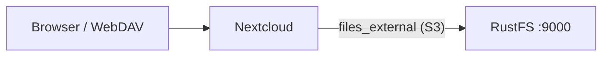

このガイドでは、セルフホスト型のコンテンツ共同作業プラットフォームである [Nextcloud](https://github.com/nextcloud/server) を、External Storage アプリの S3 バックエンド経由で **RustFS** に接続します。`files_external` を有効にし、各ユーザーのファイルビューに RustFS のバケットをマウントして、WebDAV 経由でアップロードしたファイルがバケットへ直接保存されることを確認します。手順は `nextcloud:32.0.15`（SQLite、単一コンテナ）と `rustfs/rustfs-x86-musl:v2.3.1` の組み合わせで確認済みです。

Docker、または `occ` にアクセスできる既存の Nextcloud インスタンスが必要です。このデプロイはローカルでの連携テスト用であり、本番向けではありません。

## アーキテクチャ



Nextcloud は、マウントポイント上のファイル操作を S3 バックエンドへ中継します。オブジェクトはマウントからの相対パスの下に保存されるため、バケットにはユーザーが見る名前がそのまま反映されます。

## 1. Nextcloud をインストールする

接続用のプレースホルダーをすべて置き換えて、管理者アカウント付きで Nextcloud を実行します。SQLite にすると、テストを自己完結にできます。本番では MariaDB または PostgreSQL を使います。

```bash
docker run -d --name nextcloud --network oo-rustfs_default -p 8080:80 \
  -e NEXTCLOUD_ADMIN_USER=<admin-user> \
  -e NEXTCLOUD_ADMIN_PASSWORD=<admin-password> \
  nextcloud:32.0.15
```

起動後も Web UI にインストーラーが表示される場合は、手動で完了します。

```bash
docker exec -u www-data nextcloud php occ maintenance:install \
  --admin-user <admin-user> --admin-password <admin-password>
```

## 2. External Storage アプリを有効にする

`files_external` アプリは Nextcloud に同梱されていますが、初期状態では無効です。このアプリの `occ` コマンドは、有効にした後にだけ存在します。

```bash
docker exec -u www-data nextcloud php occ app:enable files_external
```

```text
files_external 1.24.1 enabled
```

## 3. RustFS のバケットをマウントする

バックエンド種別 `amazons3` と、認証バックエンド `amazons3::accesskey` で外部ストレージを作成します。接続用のプレースホルダーをすべて置き換えます。

```bash
docker exec -u www-data nextcloud php occ files_external:create \
  /rustfs amazons3 amazons3::accesskey \
  --user <admin-user> \
  --config bucket=<your-bucket> \
  --config hostname=<your-rustfs-endpoint> \
  --config port=9000 \
  --config use_ssl=false \
  --config use_path_style=true \
  --config key=<your-access-key> \
  --config secret=<your-secret-key>
```

```text
Storage created with id 1
```

マウントポイント `/rustfs` は、指定したユーザーのファイルビューに表示されます。AWS 以外のエンドポイントでは `use_path_style=true` が必要です。使う前に接続を確認します。

```bash
docker exec -u www-data nextcloud php occ files_external:verify 1
```

```text
  - status: ok
  - code: 0
```

## 4. ファイルをアップロードして確認する

外部ストレージ経由で書き込まれる WebDAV エンドポイントからアップロードします。

```bash
echo "nextcloud writes to rustfs" > /tmp/nc-demo.txt

curl -u <admin-user>:<admin-password> \
  -T /tmp/nc-demo.txt \
  http://localhost:8080/remote.php/dav/files/<admin-user>/rustfs/nc-demo.txt \
  -o /dev/null -w "%{http_code}\n"
```

```text
201
```

同じパスから読み戻し、RustFS でオブジェクトを確認します。

```bash
rc ls rustfs/<your-bucket>/ -r
```

```text
[2026-09-29 13:42:48]       27 B nc-demo.txt
```

オブジェクトキーはマウント内のパスと一致するため、Nextcloud 経由でアップロードしたファイルは、任意の S3 クライアントから直接読み取れます。


## 5. 停止またはリセットする

バケットには触れずにマウントを削除します。

```bash
docker exec -u www-data nextcloud php occ files_external:delete 1
```

バケットの内容を削除します。

```bash
rc rm rustfs/<your-bucket>/ --recursive --force
```

## トラブルシューティング

### `There are no commands defined in the "files_external" namespace`

アプリがまだ有効になっていません。先に `occ app:enable files_external` を実行します。`occ files_external:*` コマンドは、その後に登録されます。

### `Not enough arguments (missing: "authentication_backend")`

`files_external:create` は、ストレージバックエンドと認証バックエンドを別々の引数として受け取ります。指定する値は `amazons3 amazons3::accesskey` です。バックエンド識別子は `occ files_external:backends` で一覧できます。

### マウントは表示されるが空である、またはアップロードが失敗する

`hostname` が Nextcloud コンテナから到達できること（`localhost` ではなくコンテナのネットワーク名を使います）、`use_path_style` が `true` であること、バケットが存在することを確認します。`occ files_external:verify <id>` が、具体的な接続エラーを報告します。

## 次のステップ

- ほかの外部ストレージバックエンドを採用する前に、[S3 互換性に関する注意](/ja/administration/protocols/s3)を確認します。
- [アクセスキーの管理](/ja/security-compliance/iam/access-token)で、本番用の専用認証情報を作成します。
- マウントをグループと共有し、バージョニングを有効にするには、[Nextcloud の外部ストレージのドキュメント](https://docs.nextcloud.com/server/latest/admin_manual/configuration_files/external_storage_configuration_gui.html)に従います。
