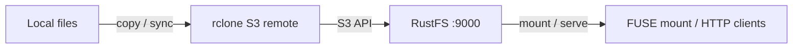

このガイドでは、クラウドストレージとの間でファイルを同期するコマンドラインツールである [rclone](https://github.com/rclone/rclone) を、S3 バックエンド経由で **RustFS** に接続します。RustFS 向けの S3 リモートを設定し、ファイルのコピーと同期、オブジェクトの読み戻し、`rclone serve` による HTTP でのバケット公開、`rclone mount` によるローカルファイルシステムとしてのマウントを行います。手順は `rclone v1.75.1` と `rustfs/rustfs-x86-musl:v2.3.1` の組み合わせで確認済みです。

Docker、またはローカルの rclone バイナリが必要です。このデプロイはローカルでの連携テスト用であり、本番向けではありません。

## アーキテクチャ



すべての rclone コマンドは、1 つのリモート定義を使います。データ転送、マウント、配信は、同じ S3 接続を使います。

## 1. リモートを設定する

接続用のプレースホルダーをすべて置き換えて、RustFS 向けの S3 リモートを含む rclone の設定ファイルを作成します。`Other` プロバイダーは AWS 固有の動作を無効にします。カスタムエンドポイントでは、パススタイルアクセスが自動的に使われます。

```ini title="rclone.conf"
[rustfs]
type = s3
provider = Other
access_key_id = <your-access-key>
secret_access_key = <your-secret-key>
endpoint = http://<your-rustfs-endpoint>:9000
region = us-east-1
```

## 2. オブジェクトをコピーして読み取る

バケットを作成し、`rclone copy` でディレクトリをアップロードします。

```bash
rc mb rustfs/rclone-demo
rclone copy /data rustfs:rclone-demo/seed
```

一覧して読み戻します。

```bash
rclone ls rustfs:rclone-demo/seed
rclone cat rustfs:rclone-demo/seed/hello.txt
```

```text
  3145728 blob.bin
       18 hello.txt
hello from rclone
```

`rclone lsd rustfs:` は、エンドポイント上のすべてのバケットを一覧します。

## 3. ディレクトリを同期する

`rclone sync` は、削除を含めて宛先をソースと同一にします。ローカルファイルを削除して同期します。

```bash
rm /data/hello.txt
rclone sync /data rustfs:rclone-demo/seed
rclone lsf rustfs:rclone-demo/seed
```

```text
blob.bin
```

`hello.txt` はバケットから消えます。バケットを変更せずに変更内容を確認するには、先に `--dry-run` を付けます。

## 4. HTTP でバケットを配信する

バケットの内容を HTTP ファイルサーバーとして公開します。

```bash
rclone serve http --addr 0.0.0.0:8080 rustfs:rclone-demo/seed
```

任意の HTTP クライアントからオブジェクトをダウンロードできます。

```bash
curl -s http://localhost:8080/blob.bin -o /dev/null -w "%{http_code} %{size_download} bytes\n"
```

```text
200 3145728 bytes
```

`rclone serve` は、同じリモート上で WebDAV、SFTP、S3 のエンドポイントにも対応します。

## 5. バケットをファイルシステムとしてマウントする

FUSE が使える場合、バケットをローカルにマウントし、ディレクトリと同じように使います。

```bash
rclone mount rustfs:rclone-demo /mnt/rclone --daemon
ls /mnt/rclone/seed
echo test > /mnt/rclone/write-test.txt
cat /mnt/rclone/write-test.txt
```

マウント経由で書き込んだファイルは、通常のオブジェクトとして RustFS に現れます。

```bash
rc ls rustfs/rclone-demo/ -r
```

```text
[2026-09-29 11:12:41]        5 B write-test.txt
```

終わったら `fusermount -u /mnt/rclone` でアンマウントします。

## 6. 停止またはリセットする

rclone はサーバー側の状態を持ちません。デモデータを削除するには、次を実行します。

```bash
rclone purge rustfs:rclone-demo
```

## トラブルシューティング

### `Access Denied`、または一覧が空になる

`endpoint` にスキームが含まれ、キーの組が RustFS のアクセスキーと一致することを確認します。`region` の値は、RustFS が無視しても S3 の署名処理では必須です。`us-east-1` のままにします。

### `fusermount3: mount failed: Permission denied` でマウントが失敗する

マウントには FUSE デバイスと昇格した権限が必要です。コンテナ内では `--device /dev/fuse --cap-add SYS_ADMIN` を付けて実行します。マウントヘルパーがそれでも失敗する場合は、`--privileged` を使います。ホストでは、`fuse3` がインストールされ、`/dev/fuse` が存在することを確認します。

### 同期しても宛先のオブジェクトが削除されない

`rclone copy` は削除しません。宛先のオブジェクトを削除するのは `rclone sync`（または `rclone delete`）だけです。どちらも `--dry-run` で、変更前に確認できます。

## 次のステップ

- ほかの rclone バックエンドを採用する前に、[S3 互換性に関する注意](/ja/administration/protocols/s3)を確認します。
- [アクセスキーの管理](/ja/security-compliance/iam/access-token)で、本番用の専用認証情報を作成します。
- `--transfers`、帯域制限、crypt オーバーレイなどのフラグについては、[rclone の S3 ドキュメント](https://rclone.org/s3/)に従います。
