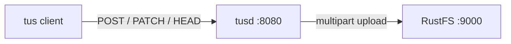

このガイドでは、tus 再開可能アップロードプロトコルの公式リファレンス実装である [tusd](https://github.com/tus/tusd) を、S3 ストレージのバックエンドとして **RustFS** に接続します。RustFS のバケットに対して tusd を実行し、tus プロトコルでアップロードを作成し、途中で中断しながらファイルを 2 つのチャンクで送り、報告されたオフセットから再開して、組み立てられたオブジェクトをバケットで確認します。手順は `tusproject/tusd:v2.10.1` と `rustfs/rustfs-x86-musl:v2.3.1` の組み合わせで確認済みです。

Docker、またはローカルの tusd バイナリが必要です。このデプロイはローカルでの連携テスト用であり、本番向けではありません。

## アーキテクチャ



tusd は、進行中の各アップロードを、バケット内の S3 マルチパートアップロードのパートとして保存します。接続を失ったクライアントは、`HEAD` で最後にコミットされたオフセットをサーバーに問い合わせ、そこから続行します。すでに受信したデータが再送されることはありません。

## 1. tusd を実行する

接続用のプレースホルダーをすべて置き換えて、バケットを作成し、S3 バックエンドを指定して tusd を起動します。RustFS はリージョンを無視しますが、AWS リージョンの設定は必須です。

```bash
rc mb rustfs/tus-uploads

docker run -d --name tusd --network oo-rustfs_default -p 8080:8080 \
  -e AWS_ACCESS_KEY_ID=<your-access-key> \
  -e AWS_SECRET_ACCESS_KEY=<your-secret-key> \
  -e AWS_REGION=us-east-1 \
  tusproject/tusd:latest \
  -s3-bucket tus-uploads \
  -s3-endpoint http://<your-rustfs-endpoint>:9000
```

サーバーが正常であることを確認します。

```bash
curl -s -o /dev/null -w "%{http_code}\n" http://localhost:8080/health
```

```text
200
```

## 2. アップロードを作成する

6 MiB のアップロードを作成し、`Location` ヘッダーを読み取ります。

```bash
curl -s -D - -o /dev/null -X POST http://localhost:8080/files/ \
  -H "Upload-Length: 6291456" -H "Tus-Resumable: 1.0.0" \
  | grep -i "^Location:"
```

```text
Location: http://localhost:8080/files/b7338250daa9...+NGVmNDRhZjEt...
```

アップロード URL には、ファイル ID とメッセージ認証タグが含まれます。再送する前にスキームとホストを取り除きます。サーバーは受信した `Host` をそのまま返すため、次のクライアントから到達できないことがあります。

## 3. 中断を挟んでチャンクでアップロードする

最初の 2.5 MB を送ってから停止します。モバイルクライアントが接続を失う地点に相当します。

```bash
head -c 2500000 demo.bin > part1.bin

curl -s -o /dev/null -w "%{http_code}\n" -X PATCH "http://localhost:8080${LOC}" \
  -H "Upload-Offset: 0" -H "Tus-Resumable: 1.0.0" \
  -H "Content-Type: application/offset+octet-stream" \
  --data-binary @part1.bin
```

```text
204
```

サーバーが実際に保持している量を問い合わせます。これが再開可能アップロードの中核です。

```bash
curl -s -X HEAD "http://localhost:8080${LOC}" \
  -H "Tus-Resumable: 1.0.0" -D - -o /dev/null | grep -i upload-offset
```

```text
Upload-Offset: 2500000
```

## 4. 再開して完了する

残りのバイト列を、オフセット 2500000 から続行します。

```bash
tail -c 3791456 demo.bin > part2.bin

curl -s -o /dev/null -w "%{http_code}\n" -X PATCH "http://localhost:8080${LOC}" \
  -H "Upload-Offset: 2500000" -H "Tus-Resumable: 1.0.0" \
  -H "Content-Type: application/offset+octet-stream" \
  --data-binary @part2.bin
```

```text
204
```

完了したアップロードを tusd 経由でダウンロードし、ソースとチェックサムを比較します。

```bash
curl -s -o download.bin "http://localhost:8080${LOC}"
sha1sum demo.bin download.bin
```

```text
d9016032ced6c7515b67a0c556e006c4b25a5858  demo.bin
d9016032ced6c7515b67a0c556e006c4b25a5858  download.bin
```

## 5. RustFS でオブジェクトを確認する

バケットを一覧します。

```bash
rc ls rustfs/tus-uploads/ -r
```

バケットには、組み立てられたオブジェクトと、アップロードごとの `.info` メタデータファイルが入ります。進行中と完了済みの両方が対象です。

```text
b7338250daa9a1a79c1343502b57b28f       6 MiB
b7338250daa9a1a79c1343502b57b28f.info  378 B
```

オブジェクトキーはアップロード ID で、オブジェクト本体はアップロードされたファイルとバイト単位で一致します。完了したアップロードは、任意の S3 クライアントからバケットを直接読み取れます。


## 6. 停止またはリセットする

バケット内のオブジェクトを残したまま、サーバーを解体します。

```bash
docker rm -f tusd
```

保存されたアップロードを削除します。

```bash
rc rm rustfs/tus-uploads/ --recursive --force
```

## トラブルシューティング

### `CreateMultipartUpload ... A region must be set when sending requests to S3`

tusd は AWS の環境変数から S3 クライアントを構築します。エンドポイント解決にはリージョンが必須です。手順 1 のように、認証情報と並べて `AWS_REGION=us-east-1` をエクスポートします。

### `PATCH` が `404` を返す、または誤ったホストに接続する

`Location` の URL は、作成リクエストの `Host` ヘッダーをそのまま返します。クライアントとサーバーでホスト名が異なる場合（コンテナ名と公開ポート）は、URL からスキームとホストを取り除き、クライアントが到達できるアドレスへパスを送ります。

### サーバー再起動後にアップロードが消える

S3 バックエンドは `.info` ファイルをバケットに保持するため、アップロードは再起動後も残ります。別のプロセスが整理する空のバケットに対して tusd を実行すると、メタデータは失われます。`tus-uploads` プレフィックスをクリーンアップジョブから保護します。

## 次のステップ

- ほかの tusd バックエンドを採用する前に、[S3 互換性に関する注意](/ja/administration/protocols/s3)を確認します。
- [アクセスキーの管理](/ja/security-compliance/iam/access-token)で、本番用の専用認証情報を作成します。
- tusd がコアプロトコルの上で対応する creation-with-upload、termination、チェックサム拡張については、[tus プロトコルのドキュメント](https://tus.io/protocols/resumable-upload)に従います。
