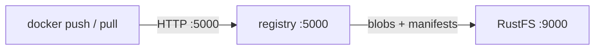
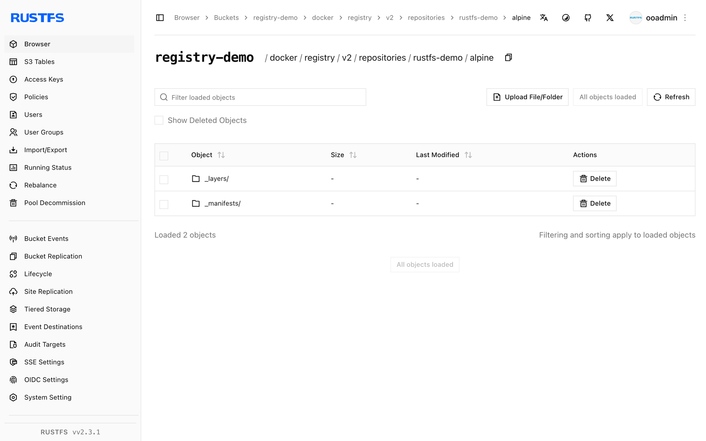

このガイドでは、オープンソースの [Docker Registry](https://github.com/distribution/distribution)（distribution）を、S3 ストレージのバックエンドとして **RustFS** に接続します。すべてのレイヤーとマニフェストを RustFS のバケットに保存するレジストリを実行し、イメージを push および pull します。手順は `registry:2` と `rustfs/rustfs-x86-musl:v2.3.1` の組み合わせで確認済みです。

レジストリのホストに Docker が必要です。

## アーキテクチャ



レジストリは、すべての blob（レイヤーと設定）とマニフェストを、バケット内の `docker/registry/v2/` 配下のオブジェクトとして保存します。コンテナ自体はステートレスなので、同じバケットに対してレジストリのノードを水平にスケールできます。

## 1. レジストリを実行する

S3 ドライバーは、環境変数だけで設定します。`REGISTRY_STORAGE_S3_REGIONENDPOINT` は、AWS SDK の接続先を RustFS に向けます。

```bash
docker run -d --name registry --network oo-rustfs_default -p 5000:5000 \
  -e REGISTRY_STORAGE=s3 \
  -e REGISTRY_STORAGE_S3_ACCESSKEY=<your-access-key> \
  -e REGISTRY_STORAGE_S3_SECRETKEY=<your-secret-key> \
  -e REGISTRY_STORAGE_S3_REGION=us-east-1 \
  -e REGISTRY_STORAGE_S3_BUCKET=registry-demo \
  -e REGISTRY_STORAGE_S3_REGIONENDPOINT=http://<your-rustfs-endpoint>:9000 \
  registry:2
```

v2 API が起動していることを確認します。

```bash
curl -s -o /dev/null -w "%{http_code}\n" http://localhost:5000/v2/
```

```text
200
```

## 2. イメージを push する

ローカルの任意のイメージにレジストリ用のタグを付け、push します。

```bash
docker pull alpine:3.20
docker tag alpine:3.20 localhost:5000/rustfs-demo/alpine:3.20
docker push localhost:5000/rustfs-demo/alpine:3.20
```

```text
3.20: digest: sha256:c64c687cbea9300178b30c95835354e34c4e4febc4badfe27102879de0483b5e
```

## 3. RustFS でオブジェクトを確認する

```bash
rc ls rustfs/registry-demo/docker/registry/v2/repositories/rustfs-demo/alpine/ -r | head -4
```

```text
_repositories/rustfs-demo/alpine/_layers/sha256/25f1d6b1.../link
_repositories/rustfs-demo/alpine/_manifests/revisions/sha256/c64c687c.../link
_repositories/rustfs-demo/alpine/_manifests/tags/3.20/current/link
```

各 `_layers` リンクは、同じバケットに保存された blob オブジェクトを指します。イメージデータ自体は RustFS にあり、レジストリのホスト上にはありません。



## 4. イメージを pull し直す

ローカルのコピーを削除し、レジストリから pull します。レイヤーは RustFS から戻ってきます。

```bash
docker rmi localhost:5000/rustfs-demo/alpine:3.20
docker pull localhost:5000/rustfs-demo/alpine:3.20
```

```text
3.20: Pulling from rustfs-demo/alpine
Digest: sha256:c64c687cbea9300178b30c95835354e34c4e4febc4badfe27102879de0483b5e
Status: Downloaded newer image for localhost:5000/rustfs-demo/alpine:3.20
```

## 5. 停止またはリセットする

```bash
docker rm -f registry
rc rm rustfs/registry-demo/ --recursive --force
```

## トラブルシューティング

### push が `unknown` または空のダイジェストで失敗する

`REGISTRY_STORAGE_S3_REGIONENDPOINT` が設定されていることを確認します。未設定だと、レジストリは実際の AWS へリクエストを送ります。バケットが存在することも確認します。

### push 時の `InvalidAccessKeyId`

アクセスキーとシークレットキーは、`REGISTRY_STORAGE_S3_ACCESSKEY` と `SECRETKEY` で渡す必要があります。このドライバーは、AWS 認証情報の環境変数チェーンを読みません。

### レジストリ再起動後の pull が `manifest unknown` を返す

マニフェストと blob はバケットにあるため、再起動で失われることはありません。両方のレジストリインスタンスが、同じ `REGISTRY_STORAGE_S3_BUCKET` と `REGIONENDPOINT` を指していることを確認します。

## 次のステップ

- UI、RBAC、または同じバケット上のレプリケーションが必要な場合は、[Harbor](/ja/developer/integration/registry/harbor) のガイドと比較します。
- [アクセスキーの管理](/ja/security-compliance/iam/access-token)で、本番用の専用認証情報を作成します。
- ストレージドライバーの調整とプロキシキャッシュの構成については、[distribution のドキュメント](https://distribution.github.io/distribution/)に従います。
