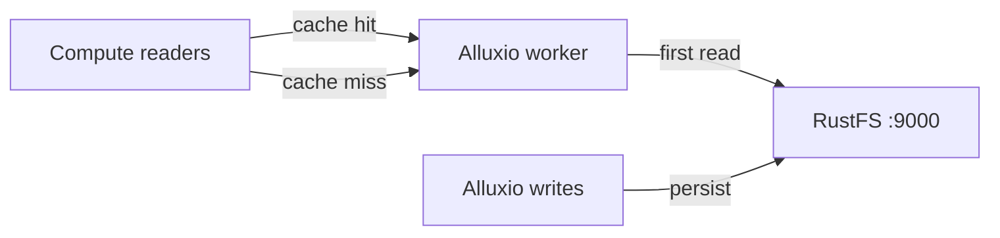
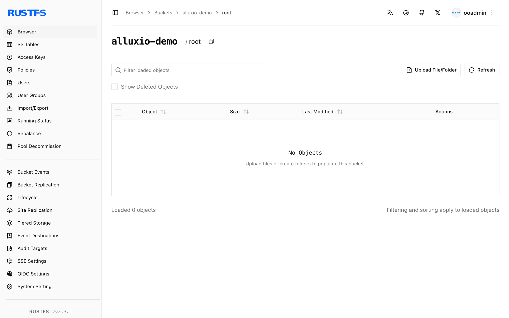

このガイドでは、分散データオーケストレーション層である [Alluxio](https://github.com/Alluxio/alluxio) を、アンダーファイルシステム（UFS）として **RustFS** に接続します。Docker 上でスタンドアロンの Alluxio クラスターを起動し、RustFS のバケットをマウントし、キャッシュ経由でオブジェクトを読み取り、Alluxio 経由でファイルをバケットへ書き戻します。手順は Alluxio 2.9.4 と `rustfs/rustfs-x86-musl:v2.3.1` の組み合わせで確認済みです。

ワーカーは tmpfs の RAM ディスクを使うため、Docker には `--shm-size 2g` の共有メモリが必要です。

## アーキテクチャ



一度読み取ったオブジェクトはワーカーの RAM ディスクにキャッシュされ、繰り返しの読み取りはメモリから応答されます。Alluxio 経由の書き込みは、通常のオブジェクトとしてバケットに保存されます。

## 1. マスターとワーカーを起動する

スタンドアロンイメージは、1 回の起動につき 1 プロセスを開始します。先にマスターを起動し、続けてワーカーを起動します。

```bash
docker run -d --name alluxio-master --hostname alluxio --network oo-rustfs_default \
  -p 19998:19998 -p 19999:19999 --shm-size 2g \
  -e ALLUXIO_JAVA_OPTS="-Dalluxio.master.hostname=alluxio -Dalluxio.worker.ramdisk.size=1G" \
  alluxio/alluxio:2.9.4 master

docker exec alluxio /entrypoint.sh worker &
```

```text
Capacity information for all workers:
    Total Capacity: 1024.00MB
```

ワーカーが `tmpfs is smaller than the configured size` ですぐに終了する場合、コンテナは `--shm-size` なしで起動されています。

## 2. RustFS のバケットをマウントする

認証情報のオプションには、完全なキー名 `alluxio.underfs.s3.*` を使う必要があります。短い `s3a.*` や `aws.*` のキーは CLI では受け付けられますが、UFS クライアントは無視します。

```bash
docker exec alluxio alluxio fs mount \
  --option alluxio.underfs.s3.accessKeyId=<your-access-key> \
  --option alluxio.underfs.s3.secretKey=<your-secret-key> \
  --option alluxio.underfs.s3.endpoint=http://<your-rustfs-endpoint>:9000 \
  --option alluxio.underfs.s3.disable.dns.buckets=true \
  --option alluxio.underfs.s3.path.style.access=true \
  /rustfs s3://alluxio-demo/
```

```text
Mounted s3://alluxio-demo/ at /rustfs
```

`disable.dns.buckets` はパススタイルアクセスを強制します。IP 形式のエンドポイントではこれが必要です。

## 3. キャッシュ経由で読み取る

マウントを一覧し、あらかじめ配置したオブジェクトを読み取ります。

```bash
docker exec alluxio alluxio fs ls /rustfs
docker exec alluxio alluxio fs cat /rustfs/rustfs-test.txt
```

```text
-rw-r--r--  rustfs  rustfs   15  PERSISTED ... /rustfs/rustfs-test.txt
hello from s3fs
```

`PERSISTED` は、正本が RustFS にあることを示します。ワーカーは初回の読み取り後にブロックをキャッシュします。

## 4. Alluxio 経由で書き込む

ローカルファイルをマウントへコピーします。

```bash
echo "written via alluxio cache to rustfs" > /tmp/rt.txt
docker cp /tmp/rt.txt alluxio:/tmp/rt.txt
docker exec alluxio alluxio fs copyFromLocal /tmp/rt.txt /rustfs/alluxio-write.txt
```

```text
Copied 'file:///tmp/rt.txt' to '/rustfs/alluxio-write.txt'
```

RustFS でオブジェクトを確認します。

```bash
rc ls rustfs/alluxio-demo/
rc cat rustfs/alluxio-demo/alluxio-write.txt
```

```text
[2026-10-07 04:07:25]       36 B alluxio-write.txt
[2026-10-07 04:01:01]       15 B rustfs-test.txt
written via alluxio cache to rustfs
```



## 5. 停止またはリセットする

```bash
docker exec alluxio alluxio fs unmount /rustfs
docker rm -f alluxio
rc rm rustfs/alluxio-demo/ --recursive --force
```

## トラブルシューティング

### `tmpfs is smaller than the configured size` でワーカーが終了する

ワーカーは RAM ディスクを `/dev/shm` に置きます。Docker の既定では、ここは 64 MB に制限されます。コンテナを `--shm-size 2g` で起動するか、`alluxio.worker.ramdisk.size` を下げます。

### マウントは成功するが `fs ls` が `InvalidAccessKeyId` を返す

マウントオプションに短いキー名（`s3a.*`、`aws.*`）が使われています。Alluxio の UFS クライアントが受け付けるのは、手順 2 に示した完全な `alluxio.underfs.s3.*` のキーだけです。

### `S3 client v2 does not support global bucket access`

パススタイルアクセスが無効です。`--option alluxio.underfs.s3.disable.dns.buckets=true` を追加します。IP 形式の RustFS エンドポイントでは必須です。

## 次のステップ

- ほかの Alluxio UFS タイプを採用する前に、[S3 互換性に関する注意](/ja/administration/protocols/s3)を確認します。
- [アクセスキーの管理](/ja/security-compliance/iam/access-token)で、本番用の専用認証情報を作成します。
- 同じバケット上のキャッシュポリシー、TTL、多層ストレージについては、[Alluxio のドキュメント](https://docs.alluxio.io/os/user/stable/ufs/S3.html)に従います。
