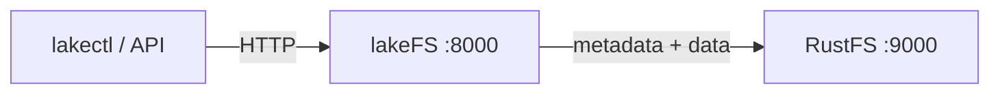

このガイドでは、Git のようにデータレイクをバージョン管理する層である [lakeFS](https://github.com/treeverse/lakeFS) を、S3 ブロックストアとして **RustFS** に接続します。lakeFS を起動し、ストレージ名前空間が RustFS のバケットを指すリポジトリを作成し、オブジェクトをコミットして、lakeFS のメタデータとデータファイルが RustFS に保存されることを確認します。手順は `treeverse/lakefs:1.58.0` と `rustfs/rustfs-x86-musl:v2.3.1` の組み合わせで確認済みです。

Docker が必要です。このデプロイはローカルでの連携テスト用であり、本番向けではありません。

## アーキテクチャ



lakeFS は、リポジトリのメタデータとコミット済みのデータファイルを、ストレージ名前空間の下のブロックストアに保存します。バケットには、`_lakefs/` のメタデータと `data/` のオブジェクトを含む `repo/` プレフィックスが 1 つあります。lakeFS は S3 API 経由でそれらを読み書きします。

## 1. プロジェクトファイルを作成する

バケットを作成し、続けて lakeFS の設定を作成します。

```bash
rc alias set rustfs http://<your-rustfs-endpoint>:9000 <your-access-key> <your-secret-key>
rc mb rustfs/lakefs-data
```

```yaml title="config.yaml"
database:
  type: local
  local:
    path: /lakefs/data

blockstore:
  type: s3
  s3:
    endpoint: http://rustfs:9000
    region: us-east-1
    force_path_style: true

auth:
  encrypt:
    secret_key: change-me-to-a-random-string

gateways:
  s3:
    domain_name: rustfs-gateway.local

logging:
  format: text
  level: info
```

`force_path_style: true` は必須です。設定しないと、lakeFS は `lakefs-data.<hostname>` をホスト名として組み立て、すべてのリクエストが DNS エラーで失敗します。認証情報は、標準の環境変数 `AWS_ACCESS_KEY_ID` と `AWS_SECRET_ACCESS_KEY` で渡します。

サービスの認証情報と初期管理者ユーザー用の環境ファイルを作成し、プレースホルダーを置き換えます。

```ini title=".env"
AWS_ACCESS_KEY_ID=<your-access-key>
AWS_SECRET_ACCESS_KEY=<your-secret-key>
LAKEFS_INSTALLATION_USER_NAME=admin
LAKEFS_INSTALLATION_ACCESS_KEY_ID=<your-lakefs-access-key>
LAKEFS_INSTALLATION_SECRET_ACCESS_KEY=<your-lakefs-secret-key>
LAKEFS_STATS_ENABLED=false
```

## 2. lakeFS を起動する

```bash
docker run -d --name lakefs --network oo-rustfs_default \
  -p 8000:8000 \
  -v "$PWD/config.yaml":/etc/lakefs/config.yaml:ro \
  --env-file .env \
  treeverse/lakefs:1.58.0 run
```

`http://localhost:8000/api/healthcheck` が `200` を返すまで待ち、バケット内のストレージ名前空間を持つリポジトリを作成します。

```bash
curl -s -u <your-lakefs-access-key>:<your-lakefs-secret-key> \
  -X POST http://localhost:8000/api/v1/repositories \
  -H "Content-Type: application/json" \
  -d '{"name": "rustfs-demo", "storage_namespace": "s3://lakefs-data/repo"}'
```

## 3. オブジェクトをコミットする

ファイルを `main` ブランチへアップロードしてコミットします。

```bash
echo "hello from lakefs on rustfs" > hello.txt

curl -s -u <your-lakefs-access-key>:<your-lakefs-secret-key> \
  -X POST "http://localhost:8000/api/v1/repositories/rustfs-demo/branches/main/objects?path=hello.txt" \
  --data-binary @hello.txt

curl -s -u <your-lakefs-access-key>:<your-lakefs-secret-key> \
  -X POST "http://localhost:8000/api/v1/repositories/rustfs-demo/branches/main/commits" \
  -H "Content-Type: application/json" \
  -d '{"message": "add hello"}'
```

ブランチ参照経由でオブジェクトを読み戻します。レスポンス本文が、コミット済みの内容です。

```bash
curl -s -u <your-lakefs-access-key>:<your-lakefs-secret-key> \
  "http://localhost:8000/api/v1/repositories/rustfs-demo/refs/main/objects?path=hello.txt"
```

## 4. RustFS でオブジェクトを確認する

バケットを一覧します。

```bash
rc ls rustfs/lakefs-data/ -r
```

出力には、リポジトリのプレフィックス配下にある lakeFS のメタデータオブジェクトと、コミット済みのデータファイルが表示されます。

```text
repo/_lakefs/19b2b26e37cb20fc6763c527f88eb5151891b04a2c8c9ddd32870c5c3f353281
repo/data/fueia10jdra000e1c480/daots7ojdra000e1c490
```


## 5. デプロイを停止またはリセットする

データを残したまま lakeFS を停止します。

```bash
docker rm -f lakefs
```

リポジトリのメタデータとデータは `lakefs-data` バケットに残るため、同じ設定で lakeFS を再起動するとリポジトリが戻ります。すべて削除するには、バケットを削除します。

```bash
rc rb rustfs/lakefs-data --force
```

## トラブルシューティング

### DNS エラーを伴う `failed to create repository: failed to access storage`

lakeFS が仮想ホスト形式を使っています。`blockstore.s3` の下に `force_path_style: true` を設定します。1.x の設定スキーマでは、古い `path_style` キーは起動時に拒否されます。

### `missing required keys: [auth.encrypt.secret_key]`

lakeFS 1.x では、ローカルデータベース用の暗号化キーが必要です。上の設定に示した `auth.encrypt.secret_key` のブロックを追加します。

### `mkdir /lakefs: permission denied`

コンテナは root 以外のユーザーで動作し、データベースディレクトリを作成できません。ローカルテストでは `-u 0` を付けてコンテナを実行するか、設定したパスに書き込み可能なディレクトリをマウントします。

## 次のステップ

- ほかの lakeFS 操作を採用する前に、[S3 互換性に関する注意](/ja/administration/protocols/s3)を確認します。
- [アクセスキーの管理](/ja/security-compliance/iam/access-token)で、本番用の専用認証情報を作成します。
- S3 プロトコルを使うツール向けに S3 ゲートウェイを設定するには、[lakeFS の S3 ブロックストアのドキュメント](https://docs.lakefs.io/howto/using-s3.html)に従います。
