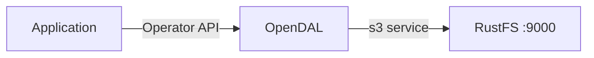
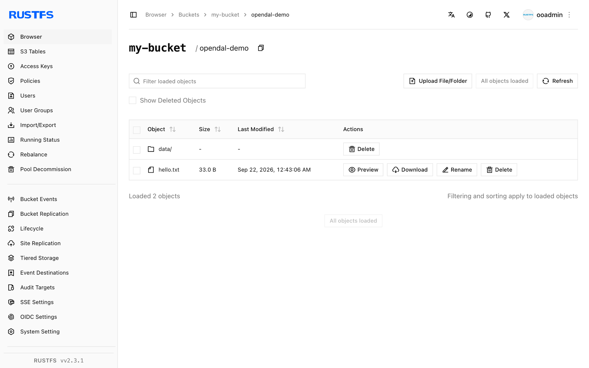

このガイドでは、統一データアクセス層である [Apache OpenDAL](https://github.com/apache/opendal) を、`s3` サービス経由で **RustFS** に接続します。OpenDAL の Python バインディングを RustFS に対して実行し、オブジェクトの書き込みと読み取り、プレフィックスの一覧、削除を行います。手順は `python:3.12-slim` 上の `opendal` Python パッケージ 0.46 と `rustfs/rustfs-x86-musl:v2.3.1` の組み合わせで確認済みです。

Docker と Python 3.9 以降が必要です。OpenDAL は、同等の設定であれば、Rust、Java、Node.js、Go のバインディングからも同じ `s3` サービスを使えます。

## アーキテクチャ



`s3` サービスに結び付けた OpenDAL の `Operator` は、バケットに対して `write`、`read`、`stat`、`list`、`delete` という統一された API を公開します。接続設定を変えるだけで、同じコードを S3、RustFS、その他の対応サービスに対して実行できます。

## 1. プロジェクトをセットアップする

Python バインディングをインストールします。

```bash
pip install opendal
```

接続用のプレースホルダーをすべて置き換えて、スクリプトを作成します。

```python title="opendal_demo.py"
import opendal

op = opendal.Operator(
    "s3",
    endpoint="http://<your-rustfs-endpoint>:9000",
    bucket="my-bucket",
    access_key_id="<your-access-key>",
    secret_access_key="<your-secret-key>",
    region="us-east-1",
)
op.write("opendal-demo/hello.txt", b"hello from opendal against rustfs")
print("read-back:", op.read("opendal-demo/hello.txt"))
print("content_length:", op.stat("opendal-demo/hello.txt").content_length)
for entry in op.list("opendal-demo/"):
    print("listed:", entry.path)
op.delete("opendal-demo/hello.txt")
print("deleted:", not op.exists("opendal-demo/hello.txt"))
```

認証情報のオプション名は `access_key_id` と `secret_access_key` です。短い `access_key` という名前は存在せず、署名エラーで失敗します。AWS 以外のエンドポイントでは、パススタイルアクセスが既定です。

## 2. デモを実行する

RustFS に到達できるマシンからスクリプトを実行します。

```bash
python opendal_demo.py
```

```text
read-back: b"hello from opendal against rustfs"
content_length: 33
listed: opendal-demo/hello.txt
deleted: True
```

往復検証では、オブジェクトのライフサイクル全体を確認します。write がバイト列をアップロードし、`read` が読み戻し、`stat` がオブジェクトサイズを返し、`list` がプレフィックスを列挙し、`delete` がオブジェクトを削除します。

## 3. RustFS でオブジェクトを確認する

最後の `op.delete` 行をコメントアウトし、スクリプトを再実行して、RustFS のプレフィックスを一覧します。

```bash
rc ls rustfs/my-bucket/opendal-demo/ -r
```

```text
hello.txt
data/rows.csv
```



RustFS Console に表示されるオブジェクトは、OpenDAL API が書き込んだパスそのものです。

## 4. 停止またはリセットする

OpenDAL はライブラリであり、自身の状態は持ちません。デモ用オブジェクトを削除するには、次を実行します。

```bash
rc rm rustfs/my-bucket/opendal-demo/ --recursive --force
```

## トラブルシューティング

### `failed to load signing credential`

オペレーターに使える認証情報が渡されていません。オプション名は `access_key_id` と `secret_access_key` をそのまま使います。ほかの綴りは黙って無視され、その後の署名が失敗します。

### 書き込み時の接続エラーまたは DNS エラー

エンドポイントにスキームとポートが含まれ、アプリケーションから到達できることを確認します。Compose ネットワーク内のホスト名は `rustfs` です。ホストからは `http://localhost:9000` を使います。

## 次のステップ

- ほかの OpenDAL 操作を採用する前に、[S3 互換性に関する注意](/ja/administration/protocols/s3)を確認します。
- [アクセスキーの管理](/ja/security-compliance/iam/access-token)で、本番用の専用認証情報を作成します。
- Rust、Java、Node.js から同じオペレーターを使うには、[OpenDAL のドキュメント](https://opendal.apache.org/docs/)に従います。
