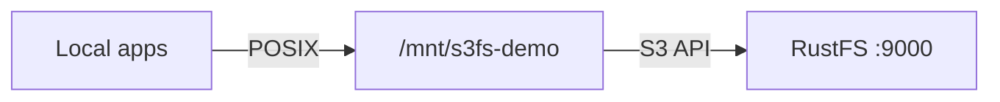

このガイドでは、FUSE ベースの S3 ファイルシステムである [s3fs-fuse](https://github.com/s3fs-fuse/s3fs-fuse) を **RustFS** に接続します。バケットをローカルディレクトリとしてマウントし、マウント経由でファイルを書き込み、アンマウントしたうえで、オブジェクトがバケットに残ることを確認します。手順は Ubuntu 24.04 上の s3fs v1.93 と `rustfs/rustfs-x86-musl:v2.3.1` の組み合わせで確認済みです。

FUSE（`fuse3` パッケージ）と `s3fs` バイナリを備えた Linux ホストが必要です。

## アーキテクチャ



マウントポイント配下に作成した各ファイルは、相対パスをキーとするバケット内のオブジェクトになります。キャッシュ層のない、単純な 1 対 1 の対応です。

## 1. インストールする

```bash
apt-get install -y s3fs
s3fs --version
```

```text
Amazon Simple Storage Service File System V1.93 ...
```

## 2. 認証情報を保存する

s3fs が想定するパスワードファイルに、アクセスキーとシークレットキーを書き込みます。

```bash
echo "<your-access-key>:<your-secret-key>" > ~/.passwd-s3fs
chmod 600 ~/.passwd-s3fs
```

## 3. バケットをマウントする

```bash
mkdir -p /mnt/s3fs-demo
s3fs s3fs-demo /mnt/s3fs-demo \
  -o passwd_file=~/.passwd-s3fs \
  -o url=http://<your-rustfs-endpoint>:9000 \
  -o endpoint=us-east-1 \
  -o use_path_request_style \
  -o allow_other -o umask=000
```

`use_path_request_style` は、RustFS が提供するパススタイルアクセスを選択します。`allow_other` を付けると、root 以外のユーザーもマウントを読み取れます。

## 4. ファイルを書き込み、読み取る

```bash
echo "hello from s3fs" > /mnt/s3fs-demo/s3fs-test.txt
dd if=/dev/urandom of=/mnt/s3fs-demo/blob.bin bs=1M count=5
cat /mnt/s3fs-demo/s3fs-test.txt
```

```text
hello from s3fs
```

## 5. オブジェクトと永続化を確認する

アンマウントして再マウントします。オブジェクトはバケットに残ります。

```bash
fusermount -u /mnt/s3fs-demo
s3fs s3fs-demo /mnt/s3fs-demo -o passwd_file=~/.passwd-s3fs \
  -o url=http://<your-rustfs-endpoint>:9000 -o endpoint=us-east-1 \
  -o use_path_request_style
ls /mnt/s3fs-demo/
```

```text
blob.bin  s3fs-test.txt
```

バケットを一覧し、S3 側から同じオブジェクトを確認します。

```bash
rc ls rustfs/s3fs-demo/
```

```text
[2026-10-06 12:09:27]      5 MiB blob.bin
[2026-10-06 12:09:26]       16 B s3fs-test.txt
```


## 6. 停止またはリセットする

```bash
fusermount -u /mnt/s3fs-demo
rc rm rustfs/s3fs-demo/ --recursive --force
```

## トラブルシューティング

### コンテナ内で `fuse: device not found` になる

`docker run` に `--device /dev/fuse --cap-add SYS_ADMIN` を渡します。マウントヘルパーがそれでも失敗する場合は、`--privileged` を使います。

### 別のユーザーがマウントを読むと `Permission denied` になる

s3fs のマウントは、既定ではマウントしたユーザー専用です。マウント時に `-o allow_other -o umask=000`（またはより厳しい umask）を追加します。

### マウントは成功するが、別のクライアントでは一覧が空になる

s3fs には、マウント間で共有されるメタデータキャッシュはありません。クライアントと一覧操作には結果整合性があります。数秒待ってから再マウントするか、一覧を再実行します。

## 次のステップ

- ほかの FUSE オプションを採用する前に、[S3 互換性に関する注意](/ja/administration/protocols/s3)を確認します。
- [アクセスキーの管理](/ja/security-compliance/iam/access-token)で、本番用の専用認証情報を作成します。
- `-o multipart` や `-o parallel_count` などの性能調整オプションについては、[s3fs-fuse のドキュメント](https://github.com/s3fs-fuse/s3fs-fuse/wiki/Fuse-Over-https)に従います。
