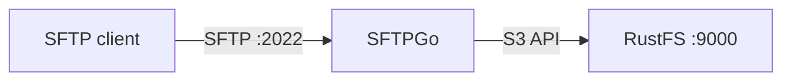
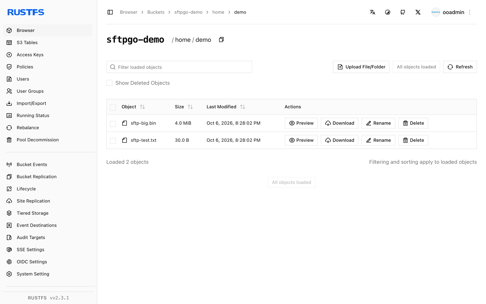

このガイドでは、SFTP、WebDAV、FTP に対応するサーバーである [SFTPGo](https://github.com/drakkan/sftpgo) を、ユーザーごとの S3 バックエンドとして **RustFS** に接続します。ホームディレクトリが RustFS バケットのプレフィックスである SFTP ユーザーを作成し、SFTP 経由でファイルをアップロードして、バケット内のオブジェクトを確認します。手順は SFTPGo 2.7.6 と `rustfs/rustfs-x86-musl:v2.3.1` の組み合わせで確認済みです。

Docker と SFTP クライアントが必要です（`sftp` は OpenSSH に含まれます）。

## アーキテクチャ



SFTPGo は、ユーザーの仮想パスをバケットのプレフィックスへ対応付けます。SFTP 経由でアップロードしたファイルは、設定した `key_prefix` 配下のオブジェクトになります。SFTPGo ホスト自体には保存されません。

## 1. SFTPGo を起動する

```bash
docker run -d --name sftpgo --hostname sftpgo --network oo-rustfs_default \
  -p 2022:2022 -p 8080:8080 \
  -e SFTPGO_COMMON__TEMP_PATH=/tmp \
  drakkan/sftpgo:latest
```

`SFTPGO_COMMON__TEMP_PATH` は重要です。S3 バックエンドでは、SFTPGo がローカルのパイプファイル経由でアップロードをストリームします。既定の一時パスは、存在しないか書き込めないことがあります。

## 2. 管理者ユーザーを作成する

イメージは管理者を自動では作成しません。`http://localhost:8080/web/admin/setup` を一度開いてフォームを送信するか、curl で実行します。

```bash
FORM=$(curl -s -c /tmp/sg-cookie.txt http://localhost:8080/web/admin/setup)
FT=$(echo "$FORM" | grep -oE "name=\"_form_token\" value=\"[^\"]+\"" | sed "s/.*value=\"//;s/\"//")
curl -s -b /tmp/sg-cookie.txt -X POST http://localhost:8080/web/admin/setup \
  --data-urlencode "username=admin" \
  --data-urlencode "password=<admin-password>" \
  --data-urlencode "confirm_password=<admin-password>" \
  --data-urlencode "_form_token=$FT" \
  -o /dev/null -w "setup: %{http_code}\n"
```

```text
setup: 302
```

## 3. S3 バックエンドのユーザーを作成する

API トークンを取得してユーザーを作成します。次の 3 点が重要です。`home_dir` はコンテナ内の既存の書き込み可能ディレクトリである必要があります（`/tmp` で動作します）。RustFS では `force_path_style` を `true` にする必要があります。`access_secret` は KMS オブジェクトなので、シークレットは `{"status": "Plain", "payload": ...}` の中に渡します。

```json title="sftpgo-user.json"
{
  "username": "demo",
  "password": "<user-password>",
  "home_dir": "/tmp",
  "status": 1,
  "permissions": { "/": ["*"] },
  "filesystem": {
    "provider": 1,
    "s3config": {
      "bucket": "sftpgo-demo",
      "region": "us-east-1",
      "access_key": "<your-access-key>",
      "access_secret": { "status": "Plain", "payload": "<your-secret-key>" },
      "endpoint": "http://<your-rustfs-endpoint>:9000",
      "key_prefix": "home/demo/",
      "force_path_style": true
    }
  }
}
```

```bash
TOKEN=$(curl -s "http://localhost:8080/api/v2/token" -u "admin:<admin-password>" \
  | python3 -c "import json,sys; print(json.load(sys.stdin)['access_token'])")
curl -s -X POST http://localhost:8080/api/v2/users \
  -H "Authorization: Bearer $TOKEN" -H "Content-Type: application/json" \
  --data-binary @sftpgo-user.json -o /dev/null -w "create-user: %{http_code}\n"
```

```text
create-user: 201
```

## 4. SFTP 経由でファイルをアップロードし、読み取る

```bash
printf "uploaded via sftpgo to rustfs\n" > /tmp/sftp-test.txt
printf "up1\n" > /tmp/sftp-batch.txt
echo "put /tmp/sftp-test.txt" >> /tmp/sftp-batch.txt
echo "ls" >> /tmp/sftp-batch.txt

sshpass -p <user-password> sftp \
  -o StrictHostKeyChecking=no -o UserKnownHostsFile=/dev/null -P 2022 \
  demo@localhost < /tmp/sftp-batch.txt
```

```text
sftp> put /tmp/sftp-test.txt
Uploading /tmp/sftp-test.txt to /sftp-test.txt
sftp> ls
sftp-big.bin    sftp-test.txt
```

## 5. RustFS でオブジェクトを確認する

```bash
rc ls rustfs/sftpgo-demo/home/demo/ -r
rc cat rustfs/sftpgo-demo/home/demo/sftp-test.txt
```

```text
[2026-10-06 12:28:02]      4 MiB home/demo/sftp-big.bin
[2026-10-06 12:28:02]       30 B home/demo/sftp-test.txt
uploaded via sftpgo to rustfs
```

オブジェクトキーは、`key_prefix` 配下にあるユーザーの仮想パスです。単純な対応付けです。



## 6. 停止またはリセットする

```bash
docker rm -f sftpgo
rc rm rustfs/sftpgo-demo/ --recursive --force
```

## トラブルシューティング

### アップロード時の `create resource error` / `InvalidAccessKeyId`

次の 3 点を順に確認します。`force_path_style` は `true` である必要があります。SFTPGo の AWS SDK は既定で仮想ホスト形式になり、IP のエンドポイントでは失敗します。`access_secret` は KMS オブジェクトの形式である必要があります。`home_dir` は書き込み可能なディレクトリを指す必要があります。SFTPGo は、ここを経由して S3 へのアップロードをパイプします。

### `unknown command init`、または管理者ログインが拒否される

管理者アカウントは、Web のセットアップフォームを一度送信した後にだけ存在します。手順 2 を繰り返します。古いブラウザのクッキーは再利用しません。

### トークン取得で API が `405 Method Not allowed` を返す

トークンのエンドポイントが受け付けるのは、Basic 認証付きの `GET` だけです。`GET /api/v2/token` を使います。

## 次のステップ

- ほかの SFTPGo バックエンドを採用する前に、[S3 互換性に関する注意](/ja/administration/protocols/s3)を確認します。
- [アクセスキーの管理](/ja/security-compliance/iam/access-token)で、本番用の専用認証情報を作成します。
- 同じバケット上に WebDAV と FTP のリスナー、ユーザーごとのクォータ、二要素認証を追加するには、[SFTPGo のドキュメント](https://github.com/drakkan/sftpgo/blob/main/README.md)に従います。
